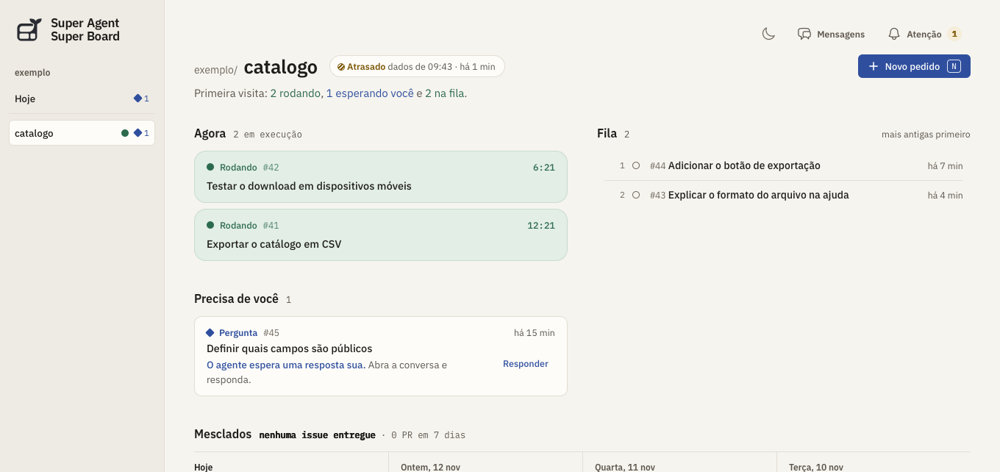
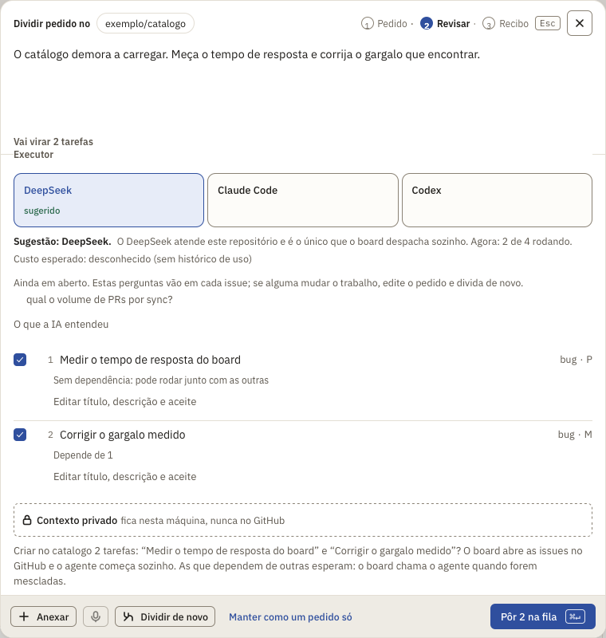
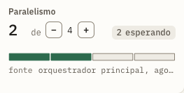

<p align="center">
  <picture>
    <source media="(prefers-color-scheme: dark)" srcset="priv/static/favicon.svg">
    
  </picture>
</p>
<h1 align="center">Super Agent Super Board</h1>
<p align="center"><strong>A local board for GitHub issues, pull requests and the agents working on them.</strong></p>
<p align="center"><a href="README.md">Português</a> · English</p>

**Super Board** is the app in this repository. It brings together what is queued, what is running and what needs your attention, grouped by project. **You can use it with GitHub alone.** You do not need DeepSeek Harness, an agent or an AI provider key to browse synced GitHub data.

The **[DeepSeek Super Agent](https://github.com/deepseek-ai/dsh-superagent-prototype)** is a separate DeepSeek project. Its software package, `dsh-superagent`, runs inside **[DeepSeek Harness](https://www.deepseek.com/en/harness/)**. It can take a programming task from a GitHub issue and return a pull request. Connect it when you want the board to show the work behind the PR as well.

**Get started:** [Install the board](#quick-start) · [Download and connect the agent](#install-and-connect-the-agent) · [Split a request](#from-one-request-to-several-issues) · [Read the parallelism indicator](#reading-parallelism).



*The real board in Brazilian Portuguese with an example project. “Definir quais campos são públicos” is under “Precisa de você” (Needs you): open the task there to read the question holding it up.*

## Why we built it

An issue describes the request, a PR holds the proposed change and checks tell you whether it passed. Across several repositories and workers, a simpler question gets hard to answer: **which task needs me now?** The board connects these records so you can find a stalled task, read the agent’s question and respond. GitHub remains the shared record. Closing the board does not stop a running agent.

| What you want to do | What you need |
| --- | --- |
| Follow issues, PRs, reviews, checks, merges and recent activity across repositories | The board and read access to those repositories on GitHub. |
| Turn a request into a GitHub issue | Write access to the repository. You review the request before publishing. |
| Refine a request, propose subtasks with acceptance criteria or ask a question that needs a model | A provider for the **board’s own AI**. This is independent of the agent. |
| Delegate implementation, follow a ticket, read progress reports and see worker capacity | DeepSeek Harness and a `dsh-superagent` profile watching the repository. Claude Code and Codex are also supported as alternative local executors. |
| Check the day’s activity, ask Chat about the board or inspect usage | **SuperBoard Skills** can query saved board data. Usage depends on the sources connected. Text chat and browser speech output do not require ElevenLabs. |

## Quick start

Install **Git, Elixir 1.19 / Erlang OTP 27 and PostgreSQL 16**. If you have PostgreSQL already, see the [local configuration](docs/operations.md#local-secrets). For a development database using Docker:

```sh
docker run --name dsh-board-postgres \
  -e POSTGRES_USER=board -e POSTGRES_PASSWORD=board \
  -e POSTGRES_DB=agent_board_dev -p 127.0.0.1:5434:5432 -d postgres:16
```

1. Download **the board** and prepare its configuration:

   ```sh
   git clone https://github.com/sallaumen/dsh-superagent-superboard.git
   cd dsh-superagent-superboard
   cp .env .env.local
   ```

2. Set `GITHUB_TOKEN` in `.env.local` for the repositories you want to follow. Read access is enough to monitor a repository; publishing issues needs write access. Keep this file out of Git. Start the board:

   ```sh
   mix setup
   PORT=4002 mix phx.server
   ```

3. Open **[localhost:4002](http://127.0.0.1:4002)**. In **Settings → Projects → Add project**, enter `owner/repository`. For GitHub alone, leave the option to create an agent unchecked. After sync, select the project in the sidebar to see its issues and PRs. If nothing appears, check the last sync in **Settings → System → Activity**.

Change the UI language under **Settings → System → Board language**. **Settings → AI and setup** lists which integrations are ready and remembers the date and outcome of the last check. A missing AI provider affects AI features; you can still browse GitHub data. To keep the board running on macOS, see [Run as a service](docs/operations.md#run-as-a-service).

## Install and connect the agent

Use this path if you want an authorized person to mention a bot on an issue and get an implementation back in a PR. There are **two downloads**:

1. **[Download DeepSeek Harness](https://www.deepseek.com/en/harness/)**, which hosts the sessions. Configure a model provider for the Harness. A key in the board does not automatically configure the Harness profile.
2. **[Get the DeepSeek Super Agent](https://github.com/deepseek-ai/dsh-superagent-prototype)**, the package that watches a repository and coordinates workers:

   ```sh
   git clone https://github.com/deepseek-ai/dsh-superagent-prototype.git
   cd dsh-superagent-prototype
   ```

3. **Install and configure the package.** Open that folder in your coding assistant and ask: *“Read this repository’s SETUP.md and walk me through setting up dsh-superagent.”* The [official guided setup](https://github.com/deepseek-ai/dsh-superagent-prototype/blob/main/SETUP.md) covers the repository, a dedicated bot account, authorized senders and execution policy. For terminal instructions, use the [official manual install](https://github.com/deepseek-ai/dsh-superagent-prototype/blob/main/docs/006-deployment.md#install), including creating the profile and starting it. Cloning alone does not start the agent.
4. **Connect it to the board.** On the machine running the Harness, open **Settings → Projects** and add the detected profile to the matching project. For another repository, see [Set up a second profile](docs/agent/setup.md#a-second-repository-optional). In **AI and setup**, check that the agent responds.
5. **Try one small issue.** From an authorized account, mention your bot and describe a verifiable result. Follow the ticket in the board and the reply on GitHub. [Verify the installation](docs/agent/setup.md#5-verify-it-is-configured-and-alive) if you need to distinguish an idle agent from a stopped agent.

**Agent prerequisites:** Node.js 22.19+ or 24+, pnpm, Git 2.32+, Python 3.8+, tmux, GitHub CLI 2.48+ and a local clone of the target repository. Workers run with the operating system user’s privileges; the [deployment guide](https://github.com/deepseek-ai/dsh-superagent-prototype/blob/main/docs/006-deployment.md) covers isolating accounts and credentials. For session titles such as `SB - Fix project filters`, see **Settings → AI and setup → Harness session names**.

## From one request to several issues

In **New request**, describe the outcome. Keep it as **one issue**, or ask the board’s AI to split it. Each proposed task has a title, description, acceptance criteria, size and dependencies. Requesting a split does not publish anything. Review the proposal and confirm which work to send to GitHub.



*The real split review in rehearsal mode, before publishing issues and without a paid model call.*

In this example, **measure the board’s response time** can start now. **Fix the measured bottleneck** has to wait: without a measurement, nobody knows what to fix. The board keeps the issues together as one objective and records this dependency. With an agent connected, it waits for prerequisites before calling the agent on dependent work. Independent tasks can use separate worker slots.

## Reading parallelism



**“2 of 4”** means the orchestrator reported **two workers busy out of four allowed at that moment**. **“2 tickets waiting”** is the queue, reported separately. The card’s **− / +** controls change the limit for that agent. Raising it does not remove a dependency or answer a blocked task’s question. When the source is unavailable the board shows **`?`**, not zero. The screenshot uses an example orchestrator response.

For delivery rather than occupancy, look at **Throughput**: completed tasks, merged PRs, commits and cycle time. The [metric definitions](docs/maintainer-contract.md#throughput) explain the source and time window behind each number.

## Where to go next

| To… | Read |
| --- | --- |
| Follow a mention through a ticket, execution and PR | [The agent loop](docs/agent/how-it-works.md) |
| Configure providers, spending limits and AI features | [Board AI](docs/ai-layer.md) · [Costs](docs/operations.md#what-it-costs) |
| Use Chat, dictation, voice and shortcuts | [Chat and voice](docs/voice-conversation.md) |
| Diagnose stale data or local services | [Operations and troubleshooting](docs/operations.md#when-something-is-wrong) |
| Integrate or contribute | [JSON API](docs/api.md) · [Architecture](docs/architecture/README.md) · [Contributing](CONTRIBUTING.md) · [CI](PIPELINES.md) |
