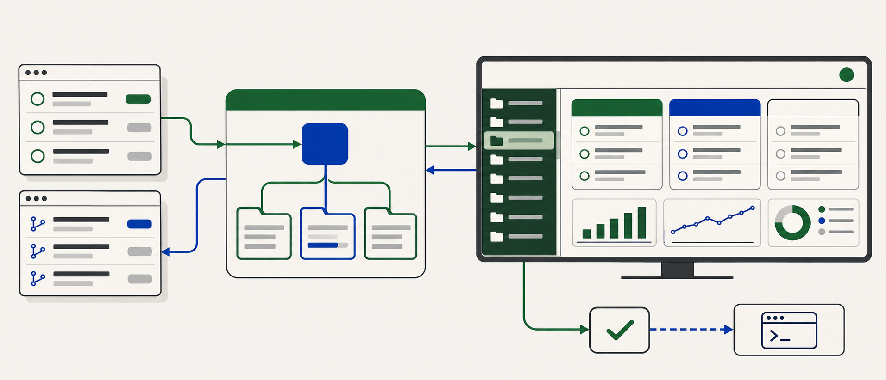
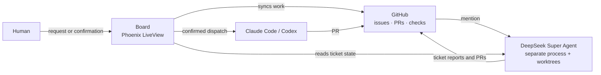

<picture>
  <source media="(prefers-color-scheme: dark)" srcset="priv/static/favicon.svg">
  
</picture>

# Super Agent Super Board

A live operations desk for work that starts on GitHub. The external **DeepSeek
Super Agent** executes tickets; this Elixir board makes the work visible, keeps
the human in control of consequential actions, and connects GitHub, local
executors, voice, and usage in one place.

[](https://github.com/sallaumen/dsh-superagent-superboard/actions/workflows/ci.yml)
[](.github/workflows/ci.yml)
[](.github/workflows/ci.yml)
[](mix.lock)
[](mix.lock)
[](.github/workflows/ci.yml)
[](mix.lock)

The version badges reflect the CI toolchain and the checked-in dependency lockfile; update them when those change.

## What you can do

| In the board | Why it matters |
|---|---|
| Follow issues, pull requests, reviews, checks, and agent tickets across repositories | See what is running, queued, blocked, or waiting for you without piecing together several screens |
| Turn a request into GitHub tasks and coordinate Claude Code or Codex locally | Keep the chosen executor, spending limits, and confirmation in the same workflow |
| Ask questions, dictate requests, and hear status | Use browser speech or optional ElevenLabs voice, with confirmation before consequential actions |
| Review daily summaries, activity, and usage by source | Understand what changed and where time and model usage went |

The board starts in English. **Settings → System → Board language** switches this browser to
Brazilian Portuguese; spoken language is a separate preference.

## How the pieces fit



*Architectural illustration. The screen is a stylized preview of the board;
[real interface captures](docs/ui-audit/README.md) are kept with the UI audits.*



**GitHub is the shared record.** The agent watches mentions, works in isolated
worktrees, and reports back through issues and PRs. The board mirrors that work,
offers actions through a recorded confirmation gate, and can dispatch local
executors. Stopping the board does not stop the separate agent. See
[the agent loop](docs/agent/how-it-works.md) and the
[architecture map](docs/architecture/README.md).

## Quick start

The project uses **Elixir 1.19 / Erlang OTP 27** in CI and **PostgreSQL 16**.
The development database is configured at `127.0.0.1:5434` with user `board`,
password `board`, and database `agent_board_dev`.

If you need a local PostgreSQL instance, one option is:

```sh
docker run --name dsh-board-postgres \
  -e POSTGRES_USER=board -e POSTGRES_PASSWORD=board \
  -e POSTGRES_DB=agent_board_dev -p 5434:5432 -d postgres:16
```

Then:

```sh
git clone https://github.com/sallaumen/dsh-superagent-superboard.git
cd dsh-superagent-superboard
cp .env .env.local
# Add a GITHUB_TOKEN to .env.local for repositories you want to sync.
mix setup
PORT=4002 mix phx.server
```

Open **http://127.0.0.1:4002**. `mix setup` installs dependencies, creates and
migrates the development database, seeds it, and builds assets.

Then open **Settings → AI and setup** and press **Check the setup**. It lists
what the board needs in three groups — who does the work (GitHub, projects, the
DeepSeek agents, Claude Code, Codex), the board's own AI, and the voice — checks
each part with free reads, and names the next step with its fix. Reopening the
section shows the date and outcome of your last check. Choose **Check again**
when you want a fresh result. Only GitHub, a
project and a key for the board's own AI are required; without an AI key, AI
requests report `:not_configured`. The board can start without the external agent, but
live ticket state requires it. Follow the
[agent learning path](docs/agent/learning-path.md) to set up that separate
process.

For a long-running launchd service, environment loading, logs, and
troubleshooting, use the [operations guide](docs/operations.md). Never commit
`.env.local`.

## Explore further

| Goal | Start here |
|---|---|
| Understand the agent and its setup | [How the agent works](docs/agent/how-it-works.md) · [Setup](docs/agent/setup.md) |
| Integrate with the board | [JSON API](docs/api.md) · [Architecture](docs/architecture/README.md) |
| Use Chat, SuperBoard Skills and voice | [Chat and voice](docs/voice-conversation.md) |
| Find implementation rules and design decisions | [Maintainer contract](docs/maintainer-contract.md) · [Documentation index](docs/README.md) |
| Contribute and validate | [Contributing](CONTRIBUTING.md) · [Pipeline matrix](PIPELINES.md) |

The board is eventually consistent: ticket state is polled about every 10
seconds and GitHub sync runs about every five minutes. The
[operations guide](docs/operations.md#the-limits) documents the other boundaries.

## Contributing

Create a branch, make a focused change, and open a pull request to `main`. Run
`scripts/ci-local.sh all` before opening the PR; the repository's
[contribution guide](CONTRIBUTING.md) and [pipeline matrix](PIPELINES.md)
explain the checks and shared-worktree rules.
