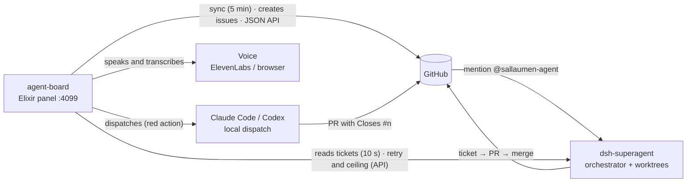

# dsh-supergent-superboard

The board for the agent's work, in Elixir: **Ecto** for the data, **Oban** for
durable sync, **LiveView** for the real-time UI, and **Req** for GitHub. It is
the data source and the operations desk of the
[DeepSeek Super Agent](docs/agent/how-it-works.md): the agent does the work;
this board shows, asks, speaks, and dispatches.

## What it does

- **Mirrors the agent** (`dsh-superagent`, a separate process): GitHub sync
  every 5 minutes (issues, PRs, reviews, checks, comments) and ticket reads
  every 10 s, with the live state over the issue (running, ready, blocked)
  while it is open.
- **Creates and stops tasks**: open an issue that mentions the agent, stop,
  archive, resume. Every write goes through the action log, with the
  confirmation phrase on screen, in voice, and in the API.
- **Dispatches local executors**: Claude Code and Codex, with ceilings and the
  owner's decision, recorded in `runner_executions`.
- **Speaks**: the board summary, answers to questions, and the announcement of
  what changed — Web Speech in the browser and ElevenLabs on the server. Voice
  conversation creates, asks, and stops tasks with spoken confirmation.
- **Exposes a JSON API** at `/api` — board, repositories, tasks, and voice;
  documented in [docs/api.md](docs/api.md).
- **Counts the cost**: the board's AI calls, the spend of the three executors
  (DeepSeek, Claude Code, Codex — each in its own currency), voice (ElevenLabs),
  and the summary of the day.

## The system in one figure



The agent **does not live in this repository**; the board only mirrors it —
stopping the board does not stop the agent. The details are in
[docs/agent/how-it-works.md](docs/agent/how-it-works.md) and the full map of the
documentation is in [docs/README.md](docs/README.md).

## Run

```sh
mix setup            # deps, database, assets
PORT=4002 mix phx.server  # http://127.0.0.1:4002
```

The explicit `PORT` keeps the URL deterministic; the runtime configuration uses
the environment or the default itself. The development database is the local
Postgres at `127.0.0.1:5434`.

## Run as a service

The board is built to stay up. [ops/com.agentboard.plist](ops/com.agentboard.plist)
is an example launchd file with absolute paths from a checkout; before loading
it, adjust `ProgramArguments`, `WorkingDirectory`, the log paths, and the `PATH`
of your machine's toolchain. It runs
[scripts/service.sh](scripts/service.sh), whose defaults and overrides are in the
[script matrix](PIPELINES.md#script-matrix).

```sh
mkdir -p ~/Library/LaunchAgents
cp ops/com.agentboard.plist ~/Library/LaunchAgents/com.agentboard.plist
# Edit the copy with the paths described above before loading.
launchctl bootstrap "gui/$(id -u)" ~/Library/LaunchAgents/com.agentboard.plist
```

`KeepAlive` restarts the board after a crash or update; `RunAtLoad` starts it
with the system. The plist names the log in `AGENT_BOARD_LOG`; on every start
`scripts/service.sh` rotates the log to `<log>.1` when it exceeds 50 MB
(`AGENT_BOARD_LOG_MAX_BYTES`), keeping one old copy, and reopens it. The plist's
`StandardOutPath` only captures what fails before that; a manual run without
`AGENT_BOARD_LOG` writes to the terminal.

The board does not start without the Postgres at `127.0.0.1:5434`, and launchd
starts the script before Docker brings the containers back. If that Postgres
runs in Docker, give the container a restart policy (`restart: unless-stopped` in
the compose file, or `docker update --restart unless-stopped <container>`):
without it Docker leaves it stopped after a reboot and the board never comes
back. `scripts/service.sh` waits for the database before migrating, for up to
`AGENT_BOARD_DB_WAIT` seconds (300), and then exits so launchd tries again. The
**Atualizar e reiniciar** (Update and restart) button is in **Configurações →
Versão** (Settings → Version) and appears after **Verificar** (Check) when the
checkout is behind; the service log records the deps/migrate/boot sequence.

```sh
launchctl bootout "gui/$(id -u)/com.agentboard"   # stop for good
launchctl kickstart -k "gui/$(id -u)/com.agentboard"  # restart now
```

`ProcessType` is `Interactive`: without it launchd applies the light limits to
the job (`launchctl print "gui/$(id -u)/com.agentboard"` would say
`spawn type = daemon`) and the board responds several times slower.
`kickstart` restarts the process with the plist launchd already has; changing
the plist itself requires updating the copy in `~/Library/LaunchAgents`,
`bootout`, waiting for `launchctl print` to no longer find the job, and
`bootstrap` (`bootstrap` returns error 5 while the job is still loaded).

**Nothing here updates on a timer**: the board watches agents, and a restart
would interrupt them. Updating is a button. In a checkout already running the
new code, **Atualizar e reiniciar** fast-forwards to `origin/main` and restarts;
under `scripts/service.sh` the updater uses `AGENT_BOARD_RESTART_MODE=supervised`,
stops the service, and lets launchd start the new code (the script refreshes
deps and migrations first). A standalone `mix phx.server` starts a detached
shell and logs to `agent-board-update-restart.log` in the system temp
directory. The page keeps the old assets until you accept the **Recarregar**
(Reload) prompt, so a restart does not leave the browser in a dead navigation.

## Logs

The board logs a timestamp on every line. `LOG_LEVEL=debug|info|warning|error`
chooses the level (the 4099 service runs at `info`; dev uses `debug`, which logs
every SQL query). Voice pipeline lines start with `voice stage=`; the same
events appear live in the voice panel. See
[docs/voice-conversation.md](docs/voice-conversation.md#diagnosis-logs-and-backstage).

## Local secrets

`.env.local` feeds the environment before any config: `KEY=value` lines,
comments with `#`, and a variable already defined in the shell is left alone. It
is gitignored. `.env` is the committed list of variables — copy what you need.

```sh
cp .env .env.local        # then fill in DEEPSEEK_API_KEY, GEMINI_API_KEY or OPENAI_API_KEY
```

The app uses the first provider with a key; `AI_PROVIDER` pins one. Without a
key, AI answers `:not_configured`, and `AI_REHEARSAL=1` runs the whole panel
against free fixtures. Tests never read `.env.local`. `AGENT_BOARD_ENV_FILE`
chooses another file (for example, in a worktree). The loader lives in
[config/runtime.exs](config/runtime.exs).

## What it costs

- **The sync** reads a bounded window of issues and PRs updated per repository,
  plus reviews/checks for each PR and the comments of active tasks — GitHub API
  traffic per scheduled run. The window lives in
  [AgentBoard.GitHub](lib/agent_board/github.ex) and comment selection in
  [AgentBoard.Sync](lib/agent_board/sync.ex); check those limits when estimating
  a deploy's traffic.
- **The 10 s poller does not touch GitHub**: it reads the agent's sqlite and
  only broadcasts when the ticket hash changed.

## Where the documentation is

The full map is in [docs/README.md](docs/README.md): binding contracts
(maintainer-contract, API, motion), operational guides (agent, agent
collaboration, voice), the agent prompts, the decisions (ADRs), research and
product plans, historical plans, and the evidence (UI evaluations and audits).

## Validation and contribution

[PIPELINES.md](PIPELINES.md) has the script matrix, the local checks, and the
[procedure when CI cannot run](PIPELINES.md#if-ci-cannot-run-no-token-billing-or-runner).
Branch and PR in [CONTRIBUTING.md](CONTRIBUTING.md). More than one agent writes
to this repository: the two rules that prevent accidents are in
[docs/agent/collaboration.md](docs/agent/collaboration.md).

## When something is wrong

| Symptom | Cause | Fix |
|---|---|---|
| `no sync yet` in the header | no sync outcome recorded | wait for the next sync and check the Activity |
| `sync failed … · showing saved data` | the repository's last sync failed | open the Activity from the health row; `sync_error` names the cause |
| a repo with Issues disabled | GitHub answers 404 | handled: issues are optional, PRs keep syncing |
| `No task is running.` | the runner has no active ticket | not an error; it is the empty state |
| every card says `no review` / `no ci` | the repo has no reviews or CI | correct, not a bug |
| CI red on every PR | GitHub Billing: payment failed / spending limit | fix it in Billing & plans; no code makes this green |
| `sync_error` with 401/403 | `GITHUB_TOKEN` missing, expired, or rate limited | export a new token (`gh auth token`) |

## The tests

`mix test` covers every layer: state mapping (ticket overlay, review and check
rollups), the spoken summary, the ElevenLabs client (stubbed, no network), sync
against a fake GitHub (no network), the JSON API controllers (board and voice),
the LiveView (columns, empty state, voice events, PubSub broadcast), and the
pipeline contract.

## The limits

- The board is **eventually consistent**: the poller reads the runner every 10 s
  and the GitHub sync runs every 5 min — a merged PR can take that long to
  appear.
- **The poller is one shot per tick**: `handle_info(:poll)` reschedules before
  polling, so a slow poll delays the next one instead of stacking them (the
  interval is a floor, not a guarantee).
- **Stop** is the board flag plus closing the issue. A worker already running
  finishes the current ticket: the Super-Agent API has no cancellation.
- The board **reads** the agent's state; it never writes to it.
- The spoken summary uses the browser's Web Speech API; server TTS and STT
  (ElevenLabs) live behind `/api/voice` and answer with a reason on failure,
  never with an exception.

## Shared practices

The board consumes the [Elixir Agent Kit](https://github.com/sallaumen/elixir-agent-kit)
through a tag pinned in `mix.exs` (v0.8.0 today), only in dev/test. After
`mix deps.get`, use [.elixir-agent-kit/START.md](.elixir-agent-kit/START.md):
it points to the dependency's contract and workflows. Only the small index, the
ownership state, and the references in `AGENTS.md`/`CLAUDE.md` stay in this
project — there are no workflow copies. `mix agent_kit.check` validates the
installation (inside `mix gate`); `mix agent_kit.outdated` warns when a new tag
exists. Reusable improvements go to the kit; local rules stay here — the details
are in [docs/agent/practices.md](docs/agent/practices.md).
