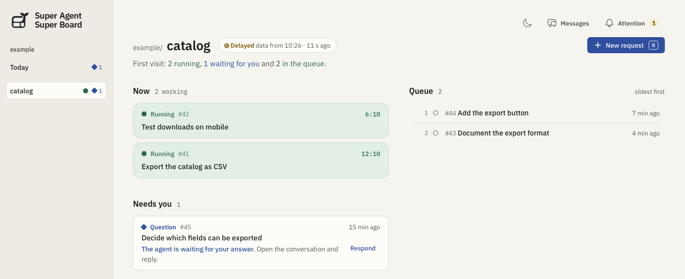

  <picture>
    <source media="(prefers-color-scheme: dark)" srcset="priv/static/favicon.svg">
    
  </picture>

<h1 align="center">Super Agent Super Board</h1>

English · <a href="README.pt-BR.md" lang="pt-BR">Português (Brasil)</a>

Super Board is a local dashboard for GitHub projects. See which issues are waiting, which pull requests are ready for review and which tasks need an answer from you. **GitHub is all you need to track a repository.** Connect a coding agent when you want it to do the work, too.

**[Set up your first board](docs/getting-started.md)** · [Connect an agent](docs/getting-started.md#connect-the-super-agent) · [Documentation](docs/README.md)

## From a request to a pull request

1. **Describe the outcome.** Type or dictate a request such as “Let customers export the catalog as CSV.” In **New request**, keep it as one issue or ask the board’s AI to split it. Review the tasks and dependencies before publishing to GitHub. [Request guide](docs/first-request.md#review-the-issues)
2. **Choose who does the work.** Give one task to **Claude Code** and another to **Codex** (OpenAI’s coding agent for GPT models), or let **DeepSeek Super Agent** pick up an issue addressed to its bot. The board suggests an executor; you choose. Local runs start after you confirm. [Executors and parallel work](docs/first-request.md#choose-an-executor)
3. **Ask for an update by voice.** Open **Chat** and ask what needs your attention. With the board microphone enabled, **ElevenLabs** transcribes your question and can read the answer aloud. The conversation stays in Chat while coding continues. [Set up voice](docs/first-request.md#talk-to-the-board)

## Start with GitHub, add AI when you need it

- **GitHub only:** connect a repository with a read-only `GITHUB_TOKEN`. Publishing issues needs write access.
- **Planning:** choose DeepSeek, Gemini or OpenAI as the board’s AI provider for refining and splitting requests.
- **DeepSeek execution:** the separate [Super Agent](https://github.com/deepseek-ai/dsh-superagent-prototype) runs inside [DeepSeek Harness](https://www.deepseek.com/en/harness/). Its **Parallelism** counter shows busy workers, not total tasks: `2 of 4` means two slots are in use; waiting tickets are counted separately.

[Operations and troubleshooting](docs/operations.md) · [JSON API](docs/api.md) · [Contributing](CONTRIBUTING.md)
