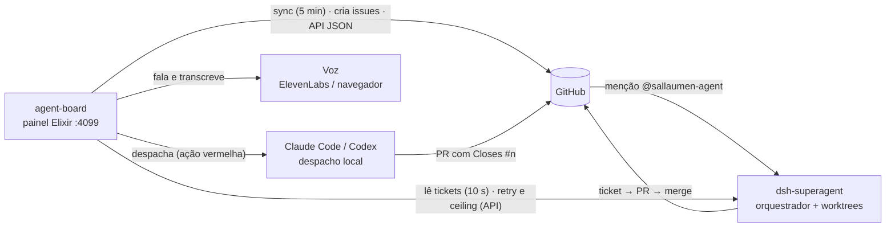

# agent-board

O board do trabalho do agente, em Elixir: **Ecto** para os dados, **Oban**
para o sync durável, **LiveView** para a UI em tempo real e **Req** para o
GitHub. É a fonte de dados e a mesa de operação do
[DeepSeek Super Agent](docs/agent/how-it-works.md): o agente faz o trabalho;
este board mostra, pergunta, fala e despacha.

## O que ele faz

- **Espelha o agente** (`dsh-superagent`, processo separado): sync do GitHub a
  cada 5 minutos (issues, PRs, reviews, checks, comentários) e leitura dos
  tickets a cada 10 s, com o estado ao vivo sobre a issue (rodando, pronto,
  bloqueado) enquanto ela está aberta.
- **Cria e para tarefas**: abrir uma issue que menciona o agente, parar,
  arquivar, retomar. Toda escrita passa pelo registro de ações, com a frase de
  confirmação na tela, na voz e na API.
- **Despacha executores locais**: Claude Code e Codex, com tetos e decisão do
  dono, registrados em `runner_executions`.
- **Fala**: o resumo do board, respostas a perguntas e o anúncio do que mudou —
  Web Speech no navegador e ElevenLabs no servidor. A conversa por voz cria,
  pergunta e para tarefas com confirmação falada.
- **Expõe uma API JSON** em `/api` — board, repositórios, tarefas e voz;
  documentada em [docs/api.md](docs/api.md).
- **Conta o custo**: as chamadas de IA do board, o gasto dos três executores
  (DeepSeek, Claude Code, Codex — cada um na própria moeda), a voz (ElevenLabs)
  e o resumo do dia.

## O sistema em uma figura



O agente **não vive neste repositório**; o board só o espelha — parar o board
não para o agente. Os detalhes estão em
[docs/agent/how-it-works.md](docs/agent/how-it-works.md) e o mapa completo da
documentação em [docs/README.md](docs/README.md).

## Rodar

```sh
mix setup            # deps, database, assets
PORT=4002 mix phx.server  # http://127.0.0.1:4002
```

O `PORT` explícito mantém a URL determinística; a configuração de runtime usa
o ambiente ou o próprio padrão. O banco de desenvolvimento é o Postgres local
em `127.0.0.1:5434`.

## Run as a service

O board é feito para ficar sempre de pé. [ops/com.agentboard.plist](ops/com.agentboard.plist)
é um exemplo de launchd com caminhos absolutos de um checkout; antes de
carregá-lo, ajuste `ProgramArguments`, `WorkingDirectory`, os caminhos de log
e o `PATH` da toolchain da sua máquina. Ele roda
[scripts/service.sh](scripts/service.sh), cujos padrões e sobrescritas estão na
[matriz de scripts](PIPELINES.md#matriz-de-scripts).

```sh
mkdir -p ~/Library/LaunchAgents
cp ops/com.agentboard.plist ~/Library/LaunchAgents/com.agentboard.plist
# Edite a cópia com os caminhos descritos acima antes de carregar.
launchctl bootstrap "gui/$(id -u)" ~/Library/LaunchAgents/com.agentboard.plist
```

`KeepAlive` reinicia o board após crash ou atualização; `RunAtLoad` sobe com o
sistema. O plist nomeia o log em `AGENT_BOARD_LOG`; a cada start o
`scripts/service.sh` roda o log para `<log>.1` quando passa de 50 MB
(`AGENT_BOARD_LOG_MAX_BYTES`), guardando uma cópia antiga, e reabre. O
`StandardOutPath` do plist só captura o que falha antes disso; uma execução
manual sem `AGENT_BOARD_LOG` escreve no terminal.

O board não sobe sem o Postgres de `127.0.0.1:5434`, e o launchd inicia o
script antes de o Docker trazer os containers de volta. Se esse Postgres roda
em Docker, dê ao container política de restart (`restart: unless-stopped` no
compose, ou `docker update --restart unless-stopped <container>`): sem ela o
Docker o deixa parado após um reboot e o board nunca volta.
`scripts/service.sh` espera o banco antes de migrar, até `AGENT_BOARD_DB_WAIT`
segundos (300), e então sai para o launchd tentar de novo. O botão
**Atualizar e reiniciar** fica em **Configurações → Versão** e aparece depois
de **Verificar** quando o checkout está atrás; o log do serviço registra a
sequência deps/migrate/boot.

```sh
launchctl bootout "gui/$(id -u)/com.agentboard"   # parar de vez
launchctl kickstart -k "gui/$(id -u)/com.agentboard"  # reiniciar agora
```

`ProcessType` é `Interactive`: sem isso o launchd aplica os limites leves ao
job (`launchctl print "gui/$(id -u)/com.agentboard"` diria
`spawn type = daemon`) e o board responde várias vezes mais devagar.
`kickstart` reinicia o processo com o plist que o launchd já tem; mudança no
próprio plist exige atualizar a cópia em `~/Library/LaunchAgents`, `bootout`,
esperar `launchctl print` não achar mais o job e `bootstrap` (`bootstrap`
responde erro 5 enquanto o job ainda está carregado).

**Nada aqui atualiza em timer**: o board observa agentes, e um restart os
interromperia. Atualizar é um botão. Em um checkout já rodando o código novo,
**Atualizar e reiniciar** faz fast-forward para `origin/main` e reinicia; sob o
`scripts/service.sh` o updater usa `AGENT_BOARD_RESTART_MODE=supervised`, para
o serviço e deixa o launchd subir o código novo (o script refresca deps e
migrações antes). Um `mix phx.server` avulso sobe um shell desanexado e loga em
`agent-board-update-restart.log` no diretório temporário do sistema. A página
mantém os assets antigos até você aceitar o aviso **Recarregar**, então um
restart não deixa o navegador numa navegação morta.

## Logs

O board loga com timestamp em toda linha. `LOG_LEVEL=debug|info|warning|error`
escolhe o nível (o serviço da 4099 roda em `info`; dev usa `debug`, que loga
toda query SQL). As linhas do pipeline de voz começam com `voice stage=`; os
mesmos eventos aparecem ao vivo no painel de voz. Ver
[docs/voice-conversation.md](docs/voice-conversation.md#diagnóstico-logs-e-bastidores).

## Local secrets

`.env.local` alimenta o ambiente antes de qualquer config: linhas `KEY=value`,
comentários com `#`, e uma variável já definida no shell é deixada em paz. É
gitignorado. `.env` é a lista commitada de variáveis — copie o que precisar.

```sh
cp .env .env.local        # e preencha DEEPSEEK_API_KEY, GEMINI_API_KEY ou OPENAI_API_KEY
```

A app usa o primeiro provider com chave; `AI_PROVIDER` fixa um. Sem chave, a
IA responde `:not_configured`, e `AI_REHEARSAL=1` roda o painel inteiro contra
fixtures gratuitas. Testes nunca leem `.env.local`. `AGENT_BOARD_ENV_FILE`
escolhe outro arquivo (por exemplo, num worktree). O loader vive em
[config/runtime.exs](config/runtime.exs).

## O que custa

- **O sync** lê uma janela limitada de issues e PRs atualizados por
  repositório, mais reviews/checks de cada PR e os comentários das tarefas
  ativas — tráfego de API do GitHub por run agendado. A janela vive em
  [AgentBoard.GitHub](lib/agent_board/github.ex) e a seleção de comentários em
  [AgentBoard.Sync](lib/agent_board/sync.ex); confira esses limites ao estimar
  tráfego de um deploy.
- **O poller de 10 s não toca o GitHub**: lê a sqlite do agente e só
  transmite quando o hash dos tickets mudou.

## Onde está a documentação

O mapa completo está em [docs/README.md](docs/README.md): contratos vinculantes
(maintainer-contract, API, movimento), guias operacionais (agente, colaboração
entre agentes, voz), os prompts do agente, as decisões (ADRs), pesquisa e
planos de produto, planos históricos e as evidências (avaliações e auditorias
de UI).

## Validação e contribuição

[PIPELINES.md](PIPELINES.md) tem a matriz de scripts, os checks locais e o
[procedimento quando a CI não consegue rodar](PIPELINES.md#se-a-ci-não-consegue-rodar-sem-token-billing-ou-runner).
Branch e PR em [CONTRIBUTING.md](CONTRIBUTING.md). Mais de um agente escreve
neste repositório: as duas regras que evitam acidentes estão em
[docs/agent/collaboration.md](docs/agent/collaboration.md).

## Quando algo está errado

| Sintoma | Causa | Correção |
|---|---|---|
| `no sync yet` no cabeçalho | nenhum desfecho de sync registrado | espere o próximo sync e veja a Activity |
| `sync failed … · showing saved data` | o último sync do repositório falhou | abra a Activity pela linha de saúde; `sync_error` nomeia a causa |
| um repo com Issues desativadas | GitHub responde 404 | tratado: issues são opcionais, os PRs seguem sincronizando |
| `No task is running.` | o runner não tem ticket ativo | não é erro; é o estado vazio |
| todo card diz `no review` / `no ci` | o repo não tem reviews nem CI | correto, não é bug |
| CI vermelho em todo PR | GitHub Billing: pagamento falhou / limite de gasto | corrija em Billing & plans; nenhum código deixa isso verde |
| `sync_error` com 401/403 | `GITHUB_TOKEN` ausente, vencido ou rate limited | exporte um token novo (`gh auth token`) |

## Os testes

`mix test` cobre cada camada: o mapeamento de estado (overlay de ticket,
rollups de review e check), o resumo falado, o cliente ElevenLabs (stubado, sem
rede), o sync contra um GitHub falso (sem rede), os controllers da API JSON
(board e voz), a LiveView (colunas, estado vazio, eventos de voz, broadcast do
PubSub) e o contrato do pipeline.

## Os limites

- O board é **eventualmente consistente**: o poller lê o runner a cada 10 s e o
  sync do GitHub roda a cada 5 min — um PR mesclado pode levar até isso para
  aparecer.
- O **poller é um disparo por tick**: `handle_info(:poll)` reagenda antes de
  pesquisar, então um poll lento atrasa o próximo em vez de empilhá-los (o
  intervalo é piso, não garantia).
- **Parar** é a flag do board mais o fechamento da issue. Um worker já rodando
  termina o ticket atual: a API do Super-Agent não tem cancelamento.
- O board **lê** o estado do agente; nunca escreve nele.
- O resumo falado usa o Web Speech API do navegador; TTS e STT de servidor
  (ElevenLabs) vivem atrás de `/api/voice` e respondem com um motivo na falha,
  nunca com uma exceção.

## Práticas compartilhadas

O board consome o [Elixir Agent Kit](https://github.com/sallaumen/elixir-agent-kit)
por uma tag fixada no `mix.exs` (v0.8.0 hoje), só em dev/test. Depois de
`mix deps.get`, use [.elixir-agent-kit/START.md](.elixir-agent-kit/START.md):
ela aponta para o contrato e os workflows da dependência. Só o índice pequeno,
o estado de propriedade e as referências em `AGENTS.md`/`CLAUDE.md` ficam neste
projeto — não há cópias de workflows. `mix agent_kit.check` valida a instalação
(dentro de `mix gate`); `mix agent_kit.outdated` avisa quando existe tag nova.
Melhorias reutilizáveis vão para o kit; regras locais ficam aqui — o
detalhamento está em [docs/agent/practices.md](docs/agent/practices.md).
