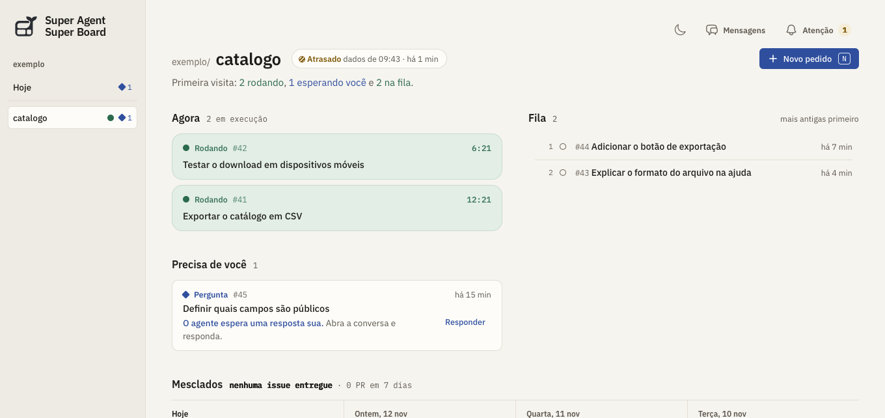

  <picture>
    <source media="(prefers-color-scheme: dark)" srcset="priv/static/favicon.svg">
    
  </picture>

<h1 align="center">Super Agent Super Board</h1>

<a href="README.md" lang="en">English</a> · Português (Brasil)

O Super Board é um painel local para projetos no GitHub. Veja quais issues estão na fila, quais pull requests aguardam revisão e quais tarefas precisam de uma resposta sua. **Para acompanhar um repositório, basta conectar o GitHub.** Se quiser delegar a implementação, conecte também um agente.

**[Configure seu primeiro board](docs/primeiros-passos.md)** · [Conecte um agente](docs/primeiros-passos.md#conectar-o-super-agent) · [Documentação em inglês](docs/README.md)

## Do pedido ao pull request

1. **Descreva o resultado.** Digite ou dite um pedido como “Quero que o cliente possa exportar o catálogo em CSV”. Em **Novo pedido**, mantenha uma única issue ou peça à IA do painel para dividir o trabalho. Revise as tarefas e suas dependências antes de publicar no GitHub. [Como revisar as issues](docs/primeiros-passos.md#do-pedido-às-issues)
2. **Escolha quem executa.** Você pode atribuir uma tarefa ao **Claude Code** e outra ao **Codex** (o agente de programação da OpenAI para modelos GPT), ou mencionar o bot do **DeepSeek Super Agent** em uma issue. O painel sugere um executor; você escolhe. A execução local começa após sua confirmação. [Executores e trabalho em paralelo](docs/primeiros-passos.md#escolher-um-executor)
3. **Peça uma atualização por voz.** Abra o **Chat** e pergunte o que precisa da sua atenção. Com o microfone do board ativado, a **ElevenLabs** transcreve a pergunta e pode ler a resposta em voz alta. A conversa fica no Chat enquanto o agente continua trabalhando. [Como ativar a voz](docs/primeiros-passos.md#conversar-por-voz)

## Comece pelo GitHub e conecte a IA quando precisar

- **Só GitHub:** conecte o repositório com um `GITHUB_TOKEN` de leitura. Para publicar issues, é preciso acesso de escrita.
- **Planejamento:** escolha DeepSeek, Gemini ou OpenAI como provedor da IA do painel para refinar e dividir pedidos.
- **Execução com DeepSeek:** o [Super Agent](https://github.com/deepseek-ai/dsh-superagent-prototype) é um projeto separado e roda no [DeepSeek Harness](https://www.deepseek.com/en/harness/). No cartão **Paralelismo**, `2 de 4` indica duas vagas ocupadas; os tickets na fila aparecem à parte.

[Operação e diagnóstico](docs/operations.md) · [API JSON](docs/api.md) · [Como contribuir](CONTRIBUTING.md)
