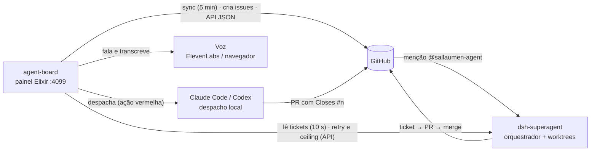

# Documentação

Mapa da documentação do repositório. O [README](../README.md) é a porta de
entrada; este índice organiza tudo que vive em `docs/`.

> Regra de manutenção: se um documento novo não couber no README e não estiver
> listado aqui, ele não é encontrável — adicione a linha no índice junto com o
> arquivo.

## O sistema em uma figura

O agente **não vive neste repositório**: é o processo `dsh-superagent` dentro
do DeepSeek Harness, descrito em [agent/how-it-works.md](agent/how-it-works.md).
O board é o espelho e a mesa de operação: lê GitHub e os tickets do agente,
expõe a API JSON e despacha executores locais.

## Contratos vinculantes

| Arquivo | O que é |
|---|---|
| [maintainer-contract.md](maintainer-contract.md) | Regras de implementação: dados, registro de ações, voz, chamadas de IA, sync, rede e tempo real |
| [api.md](api.md) | A API JSON do board (`/api` e `/api/voice`): rotas, corpos, status e efeitos reais |
| [ui-motion.md](ui-motion.md) | Contrato do movimento da interface: tokens, o que se move, o que não se move, reduced motion |
## Guias operacionais

| Arquivo | O que é |
|---|---|
| [agent/learning-path.md](agent/learning-path.md) | Tutorial do zero: instalar o Harness, Creator Mode, primeiro Super-Agent num repositório e segurança — destilado do guia de referência do dono |
| [agent/how-it-works.md](agent/how-it-works.md) | O agente (`dsh-superagent`): o loop, as tabelas, os quatro desfechos e o que o board adiciona |
| [agent/setup.md](agent/setup.md) | Instalar o agente em outra máquina: identidade do bot, perfil, LaunchAgent, política de merge |
| [agent/collaboration.md](agent/collaboration.md) | Dois agentes escrevendo em `main`: as duas regras que evitam acidentes e o loop de PR |
| [agent/practices.md](agent/practices.md) | Propriedade das práticas compartilhadas (Elixir Agent Kit), evolução e migração |
| [voice-conversation.md](voice-conversation.md) | Guia de uso da conversa por voz (WisprFlow, comandos, ajustes, custo e diagnóstico) |

## Prompts do agente

Os três textos que o orquestrador injeta em toda sessão do executor, versionados
por `scripts/agent/prompts.sh` (ver [agent/setup.md](agent/setup.md#8-merge-policy)):

- [agent/prompts/communication.md](agent/prompts/communication.md) — Communication (inclui o formato do workpad)
- [agent/prompts/scope.md](agent/prompts/scope.md) — Ticket scope (até onde uma tarefa vai sozinha)
- [agent/prompts/delivery.md](agent/prompts/delivery.md) — Delivery requirements (evidência visual, gate local, merge)

## Decisões (ADRs)

[decisions/README.md](decisions/README.md) lista as decisões registradas com
alternativas e estado. ADR novo: adicione a linha lá — o índice é a fonte única.

## Pesquisa e plano de produto

| Arquivo | O que é |
|---|---|
| [research/alfred.md](research/alfred.md) | Plano de produto (07/11/2026): o Alfred comparado com a nossa plataforma, o roteamento entre executores e o roteiro por fases. As decisões D1–D5 saíram daqui para o [ADR 0004](decisions/0004-o-board-despacha-para-executores-locais.md); as regras entregues estão no [contrato](maintainer-contract.md#dispatch-despacho-local) |
| [research/symphony.md](research/symphony.md) | Pesquisa (06/11/2026): o openai/symphony com dados de saúde, comparação e ideias. As ideias da frente paralela já foram entregues (ver [ADR 0003](decisions/0003-ciclo-de-vida-do-agente.md) e o contrato) |
| [research/superagents.md](research/superagents.md) | Proposta de arquitetura (08/11/2026): gerir um `dsh-superagent` por projeto a partir do board — provisionamento, ciclo de vida, modelo de dados, UI, multi-dono e fases |
| [research/superagents.md](research/superagents.md) | Plano (08/11/2026) para o board provisionar, observar, ligar/desligar e escalar superagents DeepSeek por projeto, com isolamento por dono e o roteiro de implementação |

## Planos históricos

Propostas anteriores à implementação, preservadas como registro. Não descrevem
o estado atual; cada uma aponta para onde a regra vigente mora:

| Arquivo | O que foi | Onde está o atual |
|---|---|---|
| [ai-layer.md](ai-layer.md) | Proposta da camada de IA do painel (05/11/2026) | [contrato — AI calls](maintainer-contract.md#ai-calls) |
| [voice-command-plan.md](voice-command-plan.md) | Plano dos comandos de voz por duplo Espaço | substituído por [voice-conversation.md](voice-conversation.md) |
| [voice-output-plan.md](voice-output-plan.md) | Plano da voz falada (itens escolhidos já implementados) | [contrato — The voice](maintainer-contract.md#the-voice) |

## Evidências e avaliação

| Arquivo | O que é |
|---|---|
| [board-ai-evaluation.md](board-ai-evaluation.md) | Como reproduzir a campanha de avaliação das respostas do board (casos, oráculo, rodada opcional com modelo real) |
| [evaluations/](evaluations/README.md) | Rodadas da campanha com revisão humana caso a caso e o ledger JSONL completo |
| [ui-audit/](ui-audit/README.md) | Auditorias de UI com capturas e gates locais (05 e 06/11/2026) — registro histórico |
