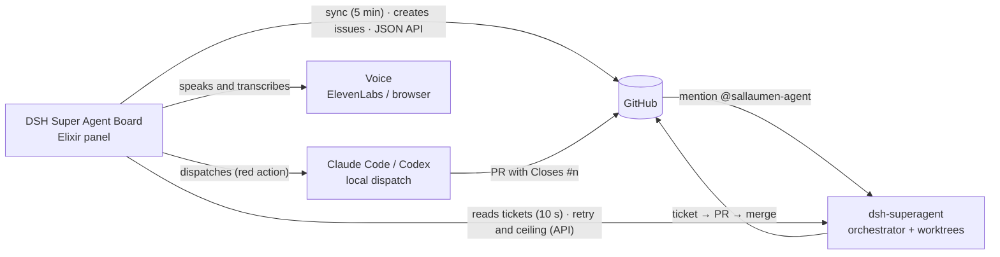

# Documentation

Map of the repository documentation. The [README](../README.md) is the entry
point; this index organizes everything that lives in `docs/`.

> Maintenance rule: if a new document does not fit in the README and is not
> listed here, it is not findable — add the row to the index together with the
> file.

## The system in one figure

The agent **does not live in this repository**: it is the `dsh-superagent`
process inside the DeepSeek Harness, described in
[agent/how-it-works.md](agent/how-it-works.md). The board is the mirror and the
operations desk: it reads GitHub and the agent's tickets, exposes the JSON API,
and dispatches local executors.

## Architecture

| File | What it is |
|---|---|
| [architecture/README.md](architecture/README.md) | Map of the contexts, table owners, creation flow, and where future changes enter — includes the 2026-11-08 review |

## Binding contracts

| File | What it is |
|---|---|
| [maintainer-contract.md](maintainer-contract.md) | Implementation rules: data, action log, voice, AI calls, sync, network, and real time |
| [api.md](api.md) | The board's JSON API (`/api` and `/api/voice`): routes, bodies, status, and real effects |
| [ui-motion.md](ui-motion.md) | Interface motion contract: tokens, what moves, what does not move, reduced motion |

## Operational guides

| File | What it is |
|---|---|
| [operations.md](operations.md) | Run the board as a service, configure credentials, diagnose failures, and understand operating limits |
| [agent/learning-path.md](agent/learning-path.md) | From-zero tutorial: install the Harness, Creator Mode, the first Super-Agent in a repository, and security — distilled from the owner's reference guide |
| [agent/how-it-works.md](agent/how-it-works.md) | The agent (`dsh-superagent`): the loop, the tables, the four outcomes, and what the board adds |
| [agent/setup.md](agent/setup.md) | Install the agent on another machine: bot identity, profile, LaunchAgent, merge policy |
| [agent/collaboration.md](agent/collaboration.md) | Two agents writing to `main`: the two rules that prevent accidents and the PR loop |
| [agent/practices.md](agent/practices.md) | Ownership of the shared practices (Elixir Agent Kit), evolution, and migration |
| [voice-conversation.md](voice-conversation.md) | Guide to using voice conversation (WisprFlow, commands, settings, cost, and diagnosis) |

## Agent prompts

The three texts the orchestrator injects into every executor session, versioned
by `scripts/agent/prompts.sh` (see [agent/setup.md](agent/setup.md#8-merge-policy)):

- [agent/prompts/communication.md](agent/prompts/communication.md) — Communication (includes the workpad format)
- [agent/prompts/scope.md](agent/prompts/scope.md) — Ticket scope (how far a task goes on its own)
- [agent/prompts/delivery.md](agent/prompts/delivery.md) — Delivery requirements (visual evidence, local gate, merge)

## Decisions (ADRs)

[decisions/README.md](decisions/README.md) lists the recorded decisions with
alternatives and status. New ADR: add the row there — the index is the single source.

## Research and product plan

| File | What it is |
|---|---|
| [research/alfred.md](research/alfred.md) | Product plan (07/11/2026): Alfred compared with our platform, the routing between executors, and the phased roadmap. Decisions D1–D5 moved from here to [ADR 0004](decisions/0004-o-board-despacha-para-executores-locais.md); the delivered rules are in the [contract](maintainer-contract.md#dispatch-local-dispatch) |
| [research/symphony.md](research/symphony.md) | Research (06/11/2026): openai/symphony with health data, comparison, and ideas. The parallel-front ideas were already delivered (see [ADR 0003](decisions/0003-ciclo-de-vida-do-agente.md) and the contract) |
| [research/superagents.md](research/superagents.md) | Plan (08/11/2026) for the board to provision, observe, start/stop, and scale DeepSeek superagents per project, with per-owner isolation and the implementation roadmap |
| [research/bug-audit-2026-11-09.md](research/bug-audit-2026-11-09.md) | Audit (09/11/2026): the board's connection errors and other bugs found in the running app, each with its evidence, cause, fix, and validation state. |

## Historical plans

Proposals from before the implementation, preserved as a record. They do not
describe the current state; each one points to where the current rule lives:

| File | What it was | Where the current one is |
|---|---|---|
| [ai-layer.md](ai-layer.md) | Proposal for the panel's AI layer (05/11/2026) | [contract — AI calls](maintainer-contract.md#ai-calls) |
| [voice-command-plan.md](voice-command-plan.md) | Plan for the double-Space voice commands | superseded by [voice-conversation.md](voice-conversation.md) |
| [voice-output-plan.md](voice-output-plan.md) | Plan for spoken voice (the chosen items are already implemented) | [contract — The voice](maintainer-contract.md#the-voice) |

## Evidence and evaluation

| File | What it is |
|---|---|
| [board-ai-evaluation.md](board-ai-evaluation.md) | How to reproduce the campaign that evaluates the board's answers (cases, oracle, optional round with a real model) |
| [evaluations/](evaluations/README.md) | Campaign rounds with case-by-case human review and the complete JSONL ledger |
| [ui-audit/](ui-audit/README.md) | UI audits with screenshots and local gates (05 and 06/11/2026) — historical record |
