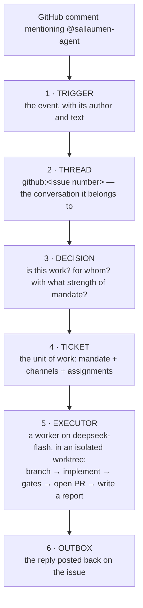

# How the agent works

The agent is **not** in this repository. It is a separate process
(`dsh-superagent`, TypeScript, running inside DeepSeek Harness) that watches
GitHub. This board only **mirrors** what it did -- stop the board and the
agent keeps working.

## The loop



## The pieces, and where each lives

| Piece | What it is | Where |
|---|---|---|
| Orchestrator | the state machine above | `~/.dsh/state/superagent/orchestrator.sqlite` |
| Profile | the model and the plugin config | `~/.dsh/profiles/superagent/cordis.patch.yml` |
| Web/API | the management surface | `127.0.0.1:3082` (needs `x-orchestrator-request: 1`) |
| Worker bin | the tools the executor may call | `~/.dsh/state/superagent/worker-bin/` |
| Bot identity | the `gh` the worker uses | `~/.local/bin/gh-agent` (config `~/.config/gh-agent`) |
| Worktrees | one checkout per assignment | `~/.dsh/state/superagent/work/` |
| Team prompts | the three sections every session reads: Communication, Ticket scope, Delivery requirements | the orchestrator's prompt revisions, mirrored in [`prompts/`](prompts/) by `scripts/agent/prompts.sh` |

## The tables

`trigger`, `thread`, `decision`, `ticket`, `outbox`, `effect`, plus `kv`,
`disposition`, `trigger_thread`. There is no `task` table: a **ticket** is the
unit of work, and its `assignments[]` carry the executor runs.

A ticket carries a **mandate** -- the reason it exists:

```json
"mandate": {
  "strength": "explicit",
  "basis": {"source": "github", "row": "issues", "sender": "sallaumen",
            "via": "addressed", "addressed": "mention"},
  "scope": "Combat feedback and game states"
}
```

`via: addressed` + `addressed: mention` means: **the human named the bot**.
Nothing runs without that. There is no queue of "pending tasks" the agent
polls; the human sentence is the trigger.

## The four outcomes a ticket can report

| State | Meaning |
|---|---|
| `ready` | a PR is open; under the [merge policy](setup.md#8-merge-policy) the executor merges it itself, otherwise a human does |
| `progress` | the executor is still working |
| `waiting` | the executor needs input |
| `failed` | the run ended without a PR |

The report always carries a `summary` and an `at`. A `ready` report names the
PR, its head sha, the gates that ran, and the limitations -- it is evidence,
not a claim.

## What a ticket leaves behind

Nothing in `dsh-superagent` deletes old records. A ticket that ended keeps its
worktree under `~/.dsh/state/superagent/work/`, and one that ended `closed`,
`dropped` or `stopped` may also leave its PR open. `scripts/agent/cleanup.sh`
reads the ended tickets from the sqlite (`ended.outcome`, the **last**
Assignment), removes every worktree that still exists with `git worktree
remove` from the main checkout the prepare command used, prunes it, and closes
as the bot each open PR on `agent/<name>` (or any `agent/*-<ticket id prefix>`
branch) of a ticket that ended without a merge, with a comment saying so. It
never touches an open ticket, a PR someone else opened, a merged PR, or the PR
of a ticket that ended `completed` or `merged`. By default it is a dry run that
prints one line per action; `--apply` executes, `--force` also removes a
worktree that still holds uncommitted changes, `--older-than DAYS` takes only
tickets that ended at least that long ago and `--no-prs` leaves the pull
requests alone (and needs no `gh`).

The board runs this script for each project: it keeps the ended folders for a
number of days (30 unless the owner chooses otherwise) and removes the older
ones once a day, folders only; "Remover tudo agora" in Configurações →
Projetos is the script's `--apply`. The contract's section "Ended tickets'
folders" has the rules.

The main checkout is written nowhere in this repository: the prepare command
lives in the orchestrator's Execution settings (the panel), today
`git -C /Users/tavano/src/arena-rogue worktree add -b "agent/$DSH_SUPERAGENT_NAME" …`.
The script reads it from each worktree's own `.git` file; `--repo DIR` names
it when that file is gone. Directories under `work/` that match no ticket in
the sqlite (an earlier database, another repository) are listed on stderr and
left alone.

For GitHub issues using the board's worktree setup, the executor checks its
branch before sending the assignment to the worker. First runs keep the
prepared ticket branch. For a follow-up after its previous PRs are closed,
it starts from the current default branch on
`agent/run-<assignment-id>/<ticket-name>`. The final segment lets the Harness
bind the PR. An open PR stays on its existing branch. The worker's
`gh pr create` checks the assigned head and reuses the PR for that branch,
including after a lost response. Dirty work is never reset to prepare a new
branch. Installed profiles receive this behavior via runtime synchronization.

## What the board adds

- **Visibility**: the five columns, the conversation, the AI panel.
- **Merged**: when the Harness reports which PR of the task was merged, the
  board confirms that PR on GitHub and updates the open board; the periodic
  sync covers missing signals. A merge made directly on GitHub may take a
  while to appear on the board: the Harness GitHub source reads notifications
  periodically and respects the interval GitHub asks for, so the wait until
  the next cycle varies.
- **Intake**: a rough request refined into tasks before it becomes an issue
  (see [`../ai-layer.md`](../ai-layer.md)).
- **Version**: whether this checkout is behind `main`, and a manual update.
- **Silence**: a running ticket with no report and no worktree change for
  15 minutes is flagged in Agora and Precisa de você
  (`AgentBoard.AgentSignal`; the board only looks, it never retries or
  stops the ticket).
- **Workpad**: the one structured comment the agent keeps per issue
  (`## Relatório do agente`, see [`prompts/communication.md`](prompts/communication.md))
  is read by section: Pergunta and Bloqueio decide the task state, Validação
  the local CI checked against the PR's head; the text heuristics remain the
  fallback (`AgentBoard.Workpad`, [`../maintainer-contract.md`](../maintainer-contract.md#workpad)).

None of that is on the agent's critical path.
