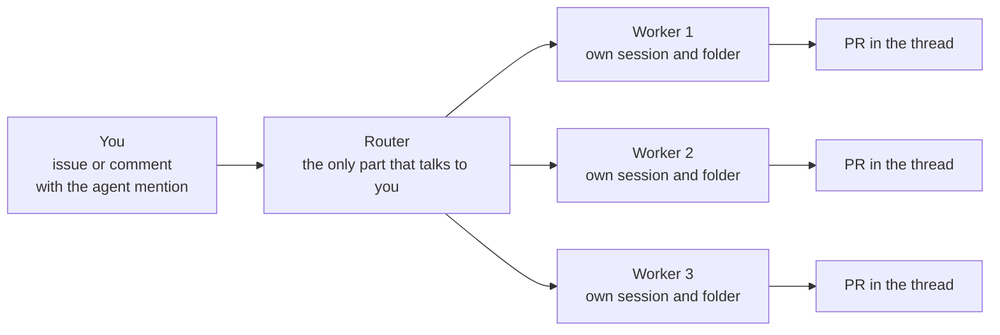

# From zero to Super-Agent: a learning path

> **Source and filter.** This document is the distillation of a reference guide
> (the "DRAGON Guide", [Google Doc](https://docs.google.com/document/d/1xansSgzYmt3KGJuxfgbbe6_txdIMDNhTWUtYA3Eh7yI)),
> accessed on 2026-11-08. Marketing numbers (stars, benchmarks) and community
> invites were left out; the facts this repository confirms point to our
> documents. What this document describes from the outside (Harness, Creator
> Mode, the `dsh-superagent` prototype) is the guide's text, not an inventory
> verified by this repository.

It is the path from zero: install DeepSeek Harness, learn Creator Mode, and put
a Super-Agent to work in your repository. The precise operational reference for
this project — profile, bot identity, LaunchAgent, merge policy — remains in
[setup.md](setup.md); here is the learning narrative, with the shortcuts and the
prompts worth copying.

## 1. The idea on one page

- **An agent that works without a prompt.** A mention on an issue, a review
  comment, or a failing CI wakes it up; it reproduces the problem, writes the
  fix, and opens a pull request in the same thread.
- **One boss, many workers.** A lightweight "router" is the only part that
  talks to you. It hands each job to a worker with its own clean context — five
  jobs run at the same time without stepping on each other.
- **Always on.** Thinking runs in the cloud and a small helper runs on your
  machine: the work continues when you close the laptop.
- **Free and open (MIT).** The only thing you pay for is the model it uses.



This repository is exactly that design: the [agent](how-it-works.md) is
`dsh-superagent` (a router + workers in their own sessions), and the board is the
mirror and the operations desk. The [board overview](../../README.md) shows
what the operator sees and explains when to connect the agent.

## 2. Step 1 — install DeepSeek Harness (≈10 min)

The Harness is the app inside which everything else runs.

1. **Download the app** from [deepseek.com/en/harness](https://deepseek.com/en/harness)
   — there are builds for Mac (Apple silicon) and Windows (64-bit).
2. **Get a model key**: create an account at
   [platform.deepseek.com](https://platform.deepseek.com), open **API Keys**, and
   create a key. The Harness is not tied to DeepSeek: the models guide covers
   other providers and any OpenAI-compatible endpoint.
3. **Connect the model**: in the Harness, **Settings → Models**, paste the key,
   and save. It takes effect immediately, with no restart.
4. **Choose a workspace**: **Choose workspace** → the folder where it will
   work. The message box stays gray until a workspace is chosen.
5. **Send the first task**: something small, for example *"Look at this
   folder and tell me what is in it."* The Harness asks before anything
   risky, according to the permission you choose.

> **Pro move:** create a `Harness Playground` folder as your first workspace.
> Everything you build in Creator Mode lands there, and nothing touches your
> real projects while you learn.

From here to our actual setup (the `superagent` profile, `cordis.patch.yml`,
port 3082), go to [setup.md](setup.md).

## 3. Step 2 — Creator Mode: a sentence becomes a tool

At its core, the Harness is built on **Cordis**, where everything is a plugin —
including the interface. Creator Mode lets the agent **write new plugins for you
and install them live**.

1. **Change the mode**: in the message box's mode selector (it says "Default"),
   choose **Creator**.
2. **Describe the tool, not the code**: say where it lives (left sidebar, right
   sidebar, or opened from the chat), what it shows, and what can be clicked.
   That is all it needs.
3. **Let it finish**: it reads its own plugin-building skill, writes the files,
   installs, and checks that it works.
4. **Ask for changes in plain English**: "Make the cards bigger", "add a dark
   theme", "save my notes between sessions". It edits and reloads the plugin.

The five prompts below are from the guide, in the format that works best:
*where it lives, what it does, what you click.*

**1. A sticky-note wall for ideas**

> Build a plugin with a left sidebar entry called Idea Wall. It opens a
> full-page wall of sticky notes. At the top there is a text box with five
> colour dots and an "Add to wall" button. Each note shows a small category
> label, the text, and the date. I can drag notes around, change their colour
> and delete them. Save the notes so they are still there after I restart the
> app.

**2. A client follow-up board**

> Build a plugin with a left sidebar entry called Follow-ups. It shows a table
> of clients with name, company, last contact date and next step. Rows older
> than 7 days since last contact turn orange, older than 14 turn red. I can
> add a client from a form at the top and mark a follow-up as done. Add a
> button that drafts a short, friendly follow-up email for the selected client
> in the chat.

**3. A content calendar**

> Build a plugin opened from the chat called Content Calendar. It shows a
> month view. Each day can hold posts with a platform tag (Instagram, YouTube,
> LinkedIn, X), a title and a status (idea, drafted, scheduled, posted). I can
> drag a post to another day. Show a small counter at the top: how many posts
> are scheduled this week. Save everything locally.

**4. A 3D explainer for anything**

> Build a left-sidebar plugin that is an interactive 3D scene explaining how a
> sales funnel works: visitors enter at the top as glowing particles, drop
> through Awareness, Interest, Decision and Purchase layers, and the funnel
> narrows at each step. A slider on the right controls the conversion rate of
> each layer and the particles update live. Keep the title and toolbar clear
> of the window buttons.

**5. A simple video cutter**

> Build a dark-themed video editing plugin opened from the chat. A large
> preview sits at the top and a timeline at the bottom. I can upload several
> clips, trim the start and end of each, reorder them on the timeline and
> export one MP4. Also let me type an edit in the chat, like "cut the first 3
> seconds of clip 2", and apply it.

DeepSeek published the official prompts (in English and Chinese) behind each
plugin in the Creator Mode video — the link is in the Resources section of the
original guide.

## 4. Step 3 — Super-Agent in your repository

It is the "codes without anyone asking" part. More technical than steps 1 and
2, but the setup was designed for an agent to guide you one question at a time.
You need a GitHub repository of your own.

Check the [agent prerequisites](../getting-started.md#connect-the-super-agent). The setup assistant checks your machine and identifies any missing tools.

**Download the code:**

```sh
git clone https://github.com/deepseek-ai/dsh-superagent-prototype.git && cd dsh-superagent-prototype
```

**Let your coding agent do the setup.** Open your coding agent in that folder
(the Harness itself, Claude Code, or Codex all work) and paste the prompt
below. It reads the setup file, asks one short question per message, shows the
full plan once, and only then installs everything:

```
Read SETUP.md in this repository and set up dsh-superagent with me.
```

**Recommended answers on the first run:**

| Question | Recommended answer |
|---|---|
| Where do the requests come from? | GitHub only. (Feishu is the Chinese team chat; skip it if your team does not live there.) |
| Which repository? | Yours, as `owner/name`. |
| Which GitHub account does the agent use? | **A new, separate account, just for the agent — never yours.** Everything it writes appears under that name, and your history stays clean. |
| Who can ask it for work? | Only you, at first. Add colleagues after you trust the behavior. |

**How to ask for work:** open (or comment on) an issue, mention the agent's
account, and describe the work. It opens the item, works in its own session and
folder, and replies in the same thread with a pull request. A small web panel
shows what needs you.

The machine-to-machine path of this project — the bot identity in
`~/.config/gh-agent`, the `superagent` profile, the LaunchAgent, and the merge
policy — is in [setup.md](setup.md); what happens inside is in
[how-it-works.md](how-it-works.md).

## 5. Before you run it (read this)

- The Super-Agent is a **research prototype, not production software**.
- Sessions run with **full access as the computer user who starts them**.
  DeepSeek itself recommends running it under a separate user account on the
  machine, so it only touches what that account touches.
- Point it at a **test repository first** — never at the main code on day one.

The "do nots" of our installation are in [setup.md](setup.md#9-what-not-to-do).

## 6. Bonus — Claude Design inside the Harness

A community plugin that brings a Claude Design–style design flow to the
Harness: five editors (design, slides, dashboards, design systems, and docs).
You mark the page on screen, send the note to the agent, and it edits and
replies in the thread.

```sh
git clone https://github.com/JimLiu/baoyu-design.git
```

In the Harness: **Plugins → add local plugin → the
`baoyu-design/dsh-plugins` folder** → new session. Ask for a landing page, a
deck, or a dashboard; click anywhere in the result to leave a note
("make the headline bigger and olive green") and **Send to agent**.

## 7. The first three pairs of hands

1. **The bug inbox.** Point the Super-Agent at your site's or app's repo and
   let the team file small bugs as issues. Every morning you review pull
   requests instead of writing fixes — which is what the board already does
   with **Precisa de você** (Needs you) and **Para revisar** (To review).
2. **Internal tools in an afternoon.** Creator Mode for what the team always
   asks for: follow-up tracker, content calendar, price calculator, numbers
   dashboard. Each one is a plugin described in a paragraph.
3. **A sellable offering.** For an agency, "an AI dev that lives in your repo
   and delivers fixes overnight" is a service clients understand right away.
   Build it in a test repo, record it working, and offer the setup + the first
   month of supervision.

## 8. Source and attribution

- Original guide (DRAGON Guide):
  [Google Doc](https://docs.google.com/document/d/1xansSgzYmt3KGJuxfgbbe6_txdIMDNhTWUtYA3Eh7yI),
  accessed on 2026-11-08.
- What this repository confirms is linked to the local documents in the
  sections above; the rest is the guide's text, not an inventory verified
  here. The links the guide listed without a URL (the official Creator Mode
  prompt collection, the Super-Agent design article) are in the Resources
  section of the original guide.
