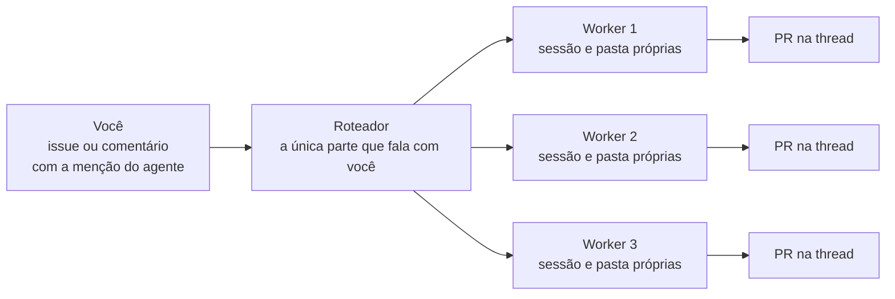

# Do zero ao Super-Agent: caminho de aprendizado

> **Fonte e filtro.** Este documento é a destilação de um guia de referência
> (o "DRAGON Guide", [Google Doc](https://docs.google.com/document/d/1xansSgzYmt3KGJuxfgbbe6_txdIMDNhTWUtYA3Eh7yI)),
> acessado em 2026-11-08. Ficaram de fora os números de marketing (estrelas,
> benchmarks) e convites de comunidade; os fatos que este repositório confirma
> apontam para os nossos documentos. O que este documento descreve de fora
> (Harness, Creator Mode, o protótipo `dsh-superagent`) é o texto do guia, não
> um inventário verificado por este repositório.

É o caminho do zero: instalar o DeepSeek Harness, aprender o Creator Mode e
colocar um Super-Agent para trabalhar no seu repositório. A referência
operacional precisa deste projeto — perfil, identidade do bot, LaunchAgent,
política de merge — continua em [setup.md](setup.md); aqui fica a narrativa
de aprendizado, com os atalhos e os prompts que valem copiar.

## 1. A ideia em uma página

- **Um agente que trabalha sem prompt.** Uma menção numa issue, um comentário
  de revisão ou um CI falhando o acorda; ele reproduz o problema, escreve a
  correção e abre um pull request na mesma thread.
- **Um chefe, muitos workers.** Um "roteador" leve é a única parte que fala
  com você. Ele entrega cada trabalho a um worker com contexto limpo e
  próprio — cinco trabalhos rodam ao mesmo tempo sem pisar um no outro.
- **Sempre ligado.** O pensamento roda na nuvem e um helper pequeno roda na
  sua máquina: o trabalho continua quando você fecha o laptop.
- **Grátis e aberto (MIT).** A única coisa que você paga é o modelo que ele
  usa.



Este repositório é exatamente esse desenho: o [agente](how-it-works.md) é o
`dsh-superagent` (roteador + workers em sessões próprias), e o board é o
espelho e a mesa de operação — o mesmo sistema em uma figura está no
[hub](../README.md#o-sistema-em-uma-figura).

## 2. Passo 1 — instalar o DeepSeek Harness (≈10 min)

O Harness é o app dentro do qual todo o resto roda.

1. **Baixe o app** em [deepseek.com/en/harness](https://deepseek.com/en/harness)
   — há build para Mac (Apple silicon) e Windows (64-bit).
2. **Pegue uma chave de modelo**: crie uma conta em
   [platform.deepseek.com](https://platform.deepseek.com), abra **API Keys** e
   crie uma chave. O Harness não é preso ao DeepSeek: o guia de modelos cobre
   outros providers e qualquer endpoint OpenAI-compatible.
3. **Conecte o modelo**: no Harness, **Settings → Models**, cole a chave e
   salve. Vale na hora, sem restart.
4. **Escolha um workspace**: **Choose workspace** → a pasta onde ele vai
   trabalhar. A caixa de mensagem fica cinza até um workspace ser escolhido.
5. **Mande a primeira tarefa**: algo pequeno, por exemplo *"Look at this
   folder and tell me what is in it."* O Harness pergunta antes de qualquer
   coisa arriscada, conforme a permissão que você escolher.

> **Pro move:** crie uma pasta `Harness Playground` como primeiro workspace.
> Tudo que você construir no Creator Mode cai lá, e nada toca seus projetos
> reais enquanto você aprende.

Daqui para o nosso setup de verdade (perfil `superagent`,
`cordis.patch.yml`, porta 3082), vá para [setup.md](setup.md).

## 3. Passo 2 — Creator Mode: uma frase vira ferramenta

No fundo, o Harness é construído sobre **Cordis**, onde tudo é plugin —
inclusive a interface. O Creator Mode deixa o agente **escrever plugins novos
para você e instalá-los ao vivo**.

1. **Mude o modo**: no seletor de modo da caixa de mensagem (diz "Default"),
   escolha **Creator**.
2. **Descreva a ferramenta, não o código**: diga onde ela mora (sidebar
   esquerda, direita ou aberta pelo chat), o que mostra e o que dá para
   clicar. É tudo que ele precisa.
3. **Deixe terminar**: ele lê a própria skill de construção de plugins,
   escreve os arquivos, instala e confere que funciona.
4. **Peça mudanças em inglês simples**: "Make the cards bigger", "add a dark
   theme", "save my notes between sessions". Ele edita e recarrega o plugin.

Os cinco prompts abaixo são do guia, no formato que funciona melhor: *onde
vive, o que faz, o que clica.*

**1. Mural de sticky notes para ideias**

> Build a plugin with a left sidebar entry called Idea Wall. It opens a
> full-page wall of sticky notes. At the top there is a text box with five
> colour dots and an "Add to wall" button. Each note shows a small category
> label, the text, and the date. I can drag notes around, change their colour
> and delete them. Save the notes so they are still there after I restart the
> app.

**2. Quadro de follow-up de clientes**

> Build a plugin with a left sidebar entry called Follow-ups. It shows a table
> of clients with name, company, last contact date and next step. Rows older
> than 7 days since last contact turn orange, older than 14 turn red. I can
> add a client from a form at the top and mark a follow-up as done. Add a
> button that drafts a short, friendly follow-up email for the selected client
> in the chat.

**3. Calendário de conteúdo**

> Build a plugin opened from the chat called Content Calendar. It shows a
> month view. Each day can hold posts with a platform tag (Instagram, YouTube,
> LinkedIn, X), a title and a status (idea, drafted, scheduled, posted). I can
> drag a post to another day. Show a small counter at the top: how many posts
> are scheduled this week. Save everything locally.

**4. Explicador 3D de qualquer coisa**

> Build a left-sidebar plugin that is an interactive 3D scene explaining how a
> sales funnel works: visitors enter at the top as glowing particles, drop
> through Awareness, Interest, Decision and Purchase layers, and the funnel
> narrows at each step. A slider on the right controls the conversion rate of
> each layer and the particles update live. Keep the title and toolbar clear
> of the window buttons.

**5. Um cortador de vídeo simples**

> Build a dark-themed video editing plugin opened from the chat. A large
> preview sits at the top and a timeline at the bottom. I can upload several
> clips, trim the start and end of each, reorder them on the timeline and
> export one MP4. Also let me type an edit in the chat, like "cut the first 3
> seconds of clip 2", and apply it.

A DeepSeek publicou os prompts oficiais (em inglês e chinês) por trás de cada
plugin do vídeo do Creator Mode — o link está na seção Resources do guia
original.

## 4. Passo 3 — Super-Agent no seu repositório

É a parte do "codifica sem que ninguém peça". Mais técnica que os passos 1 e
2, mas o setup foi desenhado para um agente te guiar uma pergunta por vez.
Você precisa de um repositório GitHub seu.

**O que a máquina precisa:** Node.js 22.19+, pnpm, git, tmux, Python 3.8+, o
GitHub CLI (`gh`) e o DeepSeek Harness. Não sabe se tem tudo? O setup agent
confere e adiciona o que faltar ao plano.

**Baixe o código:**

```sh
git clone https://github.com/deepseek-ai/dsh-superagent-prototype.git && cd dsh-superagent-prototype
```

**Deixe o seu coding agent fazer o setup.** Abra o seu coding agent nessa
pasta (o próprio Harness, o Claude Code ou o Codex funcionam) e cole o prompt
abaixo. Ele lê o arquivo de setup, faz uma pergunta curta por mensagem,
mostra o plano completo uma vez e só então instala tudo:

```
Read SETUP.md in this repository and set up dsh-superagent with me.
```

**Respostas recomendadas no primeiro run:**

| Pergunta | Resposta recomendada |
|---|---|
| De onde vêm os pedidos? | GitHub apenas. (Feishu é o chat de time chinês; pule se o seu time não vive lá.) |
| Qual repositório? | O seu, como `owner/name`. |
| Qual conta GitHub o agente usa? | **Uma conta nova e separada, só do agente — nunca a sua.** Tudo que ele escreve aparece com o nome dela, e sua história fica limpa. |
| Quem pode pedir trabalho a ele? | Só você, no começo. Adicione colegas depois de confiar no comportamento. |

**Como pedir trabalho:** abra (ou comente em) uma issue, mencione a conta do
agente e descreva o trabalho. Ele abre o item, trabalha em sessão e pasta
próprias e responde na mesma thread com um pull request. Um painel web
pequeno mostra o que precisa de você.

O caminho máquina a máquina deste projeto — a identidade do bot em
`~/.config/gh-agent`, o perfil `superagent`, o LaunchAgent e a política de
merge — está em [setup.md](setup.md); o que acontece por dentro, em
[how-it-works.md](how-it-works.md).

## 5. Antes de rodar (leia isto)

- O Super-Agent é um **protótipo de pesquisa, não software de produção**.
- As sessões rodam com **acesso total do usuário de computador que as
  inicia**. O próprio DeepSeek recomenda rodá-lo sob uma conta de usuário
  separada na máquina, para ele só tocar no que aquela conta toca.
- Aponte para um **repositório de teste primeiro** — nunca para o código
  principal no dia um.

Os "não faça" da nossa instalação estão em [setup.md](setup.md#9-what-not-to-do).

## 6. Bônus — Claude Design dentro do Harness

Um plugin de comunidade que traz um fluxo de design estilo Claude Design para
o Harness: cinco editores (design, slides, dashboards, design systems e docs).
Você marca a página na tela, manda a nota ao agente, e ele edita e responde
na thread.

```sh
git clone https://github.com/JimLiu/baoyu-design.git
```

No Harness: **Plugins → adicionar plugin local → pasta
`baoyu-design/dsh-plugins`** → nova sessão. Peça uma landing page, um deck ou
um dashboard; clique em qualquer lugar do resultado para deixar uma nota
("make the headline bigger and olive green") e **Send to agent**.

## 7. As três primeiras mãos

1. **A caixa de entrada de bugs.** Aponte o Super-Agent para o repo do seu
   site ou app e deixe o time registrar bugs pequenos como issues. Toda manhã
   você revisa pull requests em vez de escrever correções — é o que o board
   já faz com **Precisa de você** e **Para revisar**.
2. **Ferramentas internas numa tarde.** Creator Mode para o que o time pede
   sempre: tracker de follow-up, calendário de conteúdo, calculadora de
   preço, dashboard de números. Cada uma é um plugin descrito em um parágrafo.
3. **Uma oferta vendável.** Para uma agência, "um dev de IA que mora no seu
   repo e entrega correções da noite para o dia" é um serviço que clientes
   entendem na hora. Monte num repo de teste, grave funcionando e ofereça o
   setup + o primeiro mês de supervisão.

## 8. Fonte e atribuição

- Guia original (DRAGON Guide):
  [Google Doc](https://docs.google.com/document/d/1xansSgzYmt3KGJuxfgbbe6_txdIMDNhTWUtYA3Eh7yI),
  acessado em 2026-11-08.
- O que este repositório confirma está ligado aos documentos locais nas
  seções acima; o restante é o texto do guia, não um inventário verificado
  aqui. Os links que o guia listava sem URL (a coleção oficial de prompts do
  Creator Mode, o artigo de design do Super-Agent) ficam na seção Resources
  do guia original.
