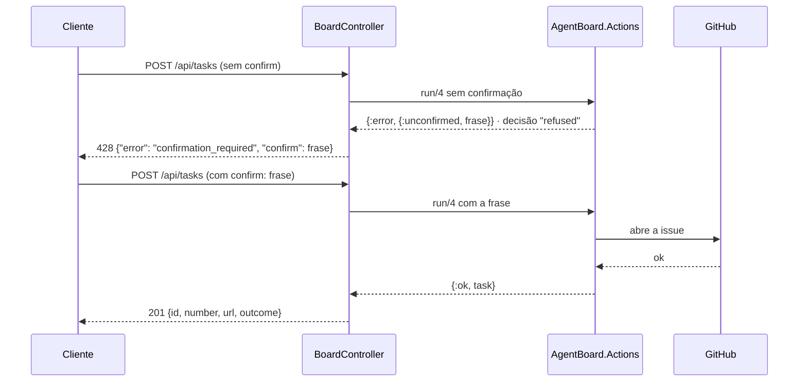

# API JSON

O board expõe endpoints HTTP em `/api`. As respostas explícitas do
[controller](../lib/agent_board_web/controllers/board_controller.ex) são JSON;
os erros tratados têm um campo `error` com uma mensagem. A interface LiveView
chama o contexto Board diretamente. Os exemplos de entrada abaixo são
ilustrativos: use um repositório e uma tarefa reais ao executar uma requisição.

| Método | Rota | O que faz |
|---|---|---|
| GET | `/api/board?repo=<owner>/<name>` | Estado do board do repositório rastreado |
| GET | `/api/repos` | Lista de repositórios rastreados |
| POST | `/api/repos` | Rastreia um repositório novo |
| POST | `/api/tasks` | Cria uma tarefa (issue no GitHub que menciona o agente) |
| PATCH | `/api/tasks/:id` | Ação sobre uma tarefa: `stop`, `archive` ou `resume` |

## GET /api/board

Parâmetro de query obrigatório: `repo` no formato `owner/name`.

- `200` — o board do repositório (colunas de tarefas por estado).
- `404` — `{"error": "repository not tracked"}` quando o repositório não está rastreado.

## GET /api/repos

- `200` — lista de repositórios rastreados.

## POST /api/repos

Corpo ilustrativo: `{"owner": "example", "name": "project"}`.

- `201` — objeto com `id` (inteiro), `owner` e `name` (strings) do repositório criado.
- `400` — `{"error": "invalid"}` quando a criação não é válida.

## Confirmação das ações vermelhas

Toda escrita da API passa pelo registro de ações (`AgentBoard.Actions`, contrato,
"Board actions"). Criar uma tarefa e parar uma tarefa são **vermelhas**: abrem ou
fecham uma issue no GitHub. A primeira chamada não faz nada e responde `428` com a
frase que confirma a ação, com os valores reais; a chamada só age quando repete o
pedido com essa frase em `confirm`. As duas respostas ficam registradas como
decisões (`action_decisions`), recusada e confirmada, `via: api`.

- `428` — `{"error": "confirmation_required", "confirm": "<frase>"}`: nada rodou;
  repita o pedido com `"confirm": "<frase>"`.
- `428` — `{"error": "confirmation_mismatch", "confirm": "<frase atual>"}`: a frase
  enviada é de outros valores (outro título, a tarefa mudou de nome); nada rodou.

## POST /api/tasks

Corpo ilustrativo: `{"repo": "example/project", "title": "Corrigir link da documentação"}`; `body` opcional (detalhes da issue); `confirm` com a frase da resposta `428`.

- `201` — objeto com `id` (inteiro local), `number` (inteiro da issue), `url` (string) e `outcome: "created"`. A issue menciona o agente automaticamente.
- `200` — o mesmo objeto com `outcome: "existing"` quando o mesmo título e corpo já tinham entrado (a chave do pedido, `Board.request_key/3`): nenhuma issue nova.
- `428` — sem `confirm`, ou com a frase de outros valores (acima).
- `400` — `{"error": "a repository and a title are required"}` quando o repositório não está rastreado, o slug é inválido ou o título é vazio; com o motivo quando o GitHub recusa.
- Efeito real: abre uma issue no GitHub do repositório rastreado.

## PATCH /api/tasks/:id

Corpo: `{"action": "stop"}`. O valor de `action` também pode ser `"archive"` ou `"resume"`; envie uma ação por requisição. `stop` é vermelha e pede `confirm`; `archive` e `resume` são amarelas e agem direto.

- `200` — `{"ok": true}`.
- `428` — `stop` sem `confirm`, ou com a frase de outros valores.
- `404` — `{"error": "task not found"}` para tarefa inexistente, ação desconhecida ou falha do GitHub ao fechar a issue.
- Efeitos reais: `stop` fecha a issue e marca a flag de parada; `archive` arquiva a tarefa; `resume` limpa as flags de parada/arquivamento e volta a tarefa para `queued` localmente. Não reabre a issue no GitHub (ver [Board.resume_task/1](../lib/agent_board/board.ex)).

## Contrato e limites

- O pipeline `:api` aceita apenas JSON — **não há autenticação**; a API é destinada ao próprio board e aos testes. Qualquer uso exposto exigiria um plug de auth antes.
- O cliente GitHub é injetável via `Application.get_env(:agent_board, :github_client)`, o que permite testar os endpoints sem rede (ver `test/agent_board_web/controllers/board_controller_test.exs`).
- O formato dos erros tratados acima não garante um contrato JSON para qualquer exceção. O cliente GitHub pode levantar uma exceção, que o contexto converte em erro; os endpoints ainda podem falhar ao consumir esse resultado. Não presuma que toda falha de rede corresponde ao status de validação documentado.

## Voice (ElevenLabs)

| Método | Rota | O que faz |
|---|---|---|
| GET | `/api/voice/status` | O que está configurado (sem a chave) |
| GET | `/api/voice/voices` | As vozes da conta, para o seletor |
| PUT | `/api/voice/settings` | Salva voz, modelo, idioma, volume e quando falar (vazio limpa a voz) |
| GET/POST | `/api/voice/speech?text=...` | O áudio falado (mp3) |
| POST | `/api/voice/transcribe` | O corpo de áudio transcrito (JSON) |

### GET /api/voice/status

- `200` — `{"configured": true|false, "status": "logged_in"|"not_configured", "voice_id": "...", "voice_source": "environment"|"saved"|"default", "tts_model": "...", "tts_source": "environment"|"saved"|"default", "stt_model": "...", "speak_events": true|false, "language": "pt-BR"|"en-US", "volume": 0..100, "attention": true|false, "speed": 0.8..1.2, "style": "steady"|"natural"|"expressive", "pause": "short"|"normal"|"long", "usage": {"day": "2026-11-07", "tts_characters": 3420, "tts_requests": 41, "cache_hits": 18, "stt_seconds": 72.0, "stt_requests": 9}, "daily_char_cap": 20000}`. Nunca expõe a chave. Os campos `*_source` dizem de onde vem cada escolha: a variável de ambiente, a escolha salva na UI ou o padrão; `speak_events` narra o resto do board (ligada por padrão); `attention` são os chamados quando uma tarefa precisa do dono (pergunta, bloqueio, revisão; ligados por padrão); `language` é o idioma de tudo que o agente fala, `volume` o volume da reprodução, `speed` a velocidade da fala, `style` a entonação (estabilidade 0,7 / 0,5 / 0,3 na ElevenLabs) e `pause` quanto silêncio encerra uma fala do dono (0,8 / 1,2 / 1,8 s). `usage` é o gasto de hoje na ElevenLabs (dia UTC, `AgentBoard.ElevenLabs.Usage`): caracteres de TTS cobrados (o header `x-character-count`, ou o tamanho do texto sem ele), pedidos de TTS pagos, falas servidas do cache (custo zero), segundos de áudio transcritos (`audio_duration_secs`) e transcrições. `daily_char_cap` é o teto diário de caracteres (`ELEVENLABS_DAILY_CHAR_CAP`, padrão 20000, `0` = sem teto); atingi-lo não muda nada sozinho, só registra um evento em "Bastidores da voz".

### GET /api/voice/voices

- `200` — `{"voices": [{"id": "...", "name": "..."}]}` — as vozes da conta.
- Erros seguem o mesmo mapa do speech (401/429/502/503).

### PUT /api/voice/settings

Corpo: qualquer combinação de `{"voice_id": "..."}`, `{"tts_model": "..."}`, `{"speak_events": true|false}`, `{"attention": true|false}`, `{"language": "pt-BR"|"en-US"}`, `{"volume": 0..100}`, `{"speed": 0.8..1.2}`, `{"style": "steady"|"natural"|"expressive"}` e `{"pause": "short"|"normal"|"long"}`. `voice_id` vazio ou em branco limpa a escolha (volta ao padrão); `tts_model` precisa ser um dos modelos oferecidos (`eleven_flash_v2_5`, `eleven_v4`, `eleven_multilingual_v2`); `speak_events` liga/desliga a fala automática do board.

- `200` — `{"voice_id": "...", "voice_source": "saved"|"default", "tts_model": "...", "tts_source": "saved"|"default"}`. As escolhas persistem na tabela `settings` e valem na hora; `ELEVENLABS_VOICE_ID` / `ELEVENLABS_TTS_MODEL` no ambiente continuam com prioridade.
- `400` — `{"error": "a valid voice id is required"}` para id maior que 64 caracteres; `{"error": "an offered TTS model is required"}` para modelo fora do catálogo; `{"error": "an offered voice language is required"}` e `{"error": "the volume must be 0 to 100"}`, `{"error": "the speed must be 0.8 to 1.2"}`, `{"error": "the style must be steady, natural or expressive"}` e `{"error": "the pause must be short, normal or long"}` para valores fora da oferta. As chaves são gravadas na ordem do corpo; uma recusada não desfaz as anteriores.

### GET/POST /api/voice/speech

Parâmetro: `text` (query no GET, corpo JSON `{"text": "..."}` no POST); `voice` opcional escolhe a voz na requisição (o seletor da UI usa isso para o preview). A síntese pede `optimize_streaming_latency=3` para o primeiro byte chegar rápido. Com o Flash v2.5 a síntese manda `language_code` do idioma da voz (`pt`/`en`), para o texto ser lido e normalizado nesse idioma.

- `200` — os bytes de áudio em `audio/mpeg` (mp3 44.1kHz 128kbps).
- `400` — `{"error": "a text is required"}` sem texto; `{"error": "the text is too long for one request"}` acima de 5000 caracteres; `{"error": "a valid voice id is required"}` para um `voice` que não tem forma de id.
- `401` — `{"error": "ElevenLabs rejected the key"}`.
- `429` — `{"error": "ElevenLabs usage limit reached"}`.
- `503` — `{"error": "voice not configured"}` sem chave (`ELEVENLABS_API_KEY`).

O texto falado usa a velocidade e a entonação salvas. Um texto curto (até 300 caracteres) já falado com a mesma voz, modelo, idioma e ajustes sai do cache sem nova cobrança: em memória (`SpeechCache`, 150 entradas, uma semana) e na tabela `voice_speech_cache` (1000 linhas, 30 dias desde o último uso), que sobrevive a um restart.

### GET /api/voice/stream

Os mesmos parâmetros, validações e erros de `GET /api/voice/speech`, mas o áudio é enviado em pedaços enquanto a ElevenLabs gera (`/v1/text-to-speech/{voz}/stream`): o primeiro som chega em ~0,4 s contra 0,6–1,1 s do arquivo inteiro. Um erro antes do primeiro byte volta como JSON; um erro no meio encerra o stream. Uma resposta do cache vem inteira, com `content-length` e o header `x-voice-cache: hit`. É o caminho que o board usa para tocar a voz do agente.

### POST /api/voice/transcribe

Corpo: os bytes de áudio crus (content-type `audio/*`); query opcional: `language` (código ISO 639, ex.: `pt`) e `filename`.

- `200` — `{"text": "...", "language_code": "...", "language_probability": <0-1>, "audio_duration_secs": <segundos>}`.
- `400` — `{"error": "an audio body is required"}` sem corpo.
- `413` — `{"error": "the audio is too large"}` acima do limite (10MB por padrão, configurável via `:voice_audio_max_bytes`).
- Erros da ElevenLabs seguem o mesmo mapa do speech (401/429/502/503).

### Contrato

- O cliente ElevenLabs é injetável via `Application.get_env(:agent_board, :elevenlabs_client)`; os testes usam `Req.Test` sem rede (ver `test/agent_board_web/controllers/voice_controller_test.exs`).
- A chave nunca sai do servidor: estes endpoints respondem com áudio ou transcrição, não com a chave.
- Falhas da ElevenLabs não viram corpo de resposta: o cliente retorna `{:error, reason}` (`:not_configured`, `:auth_expired`, `:usage_limit`, `{:http, status}`), nunca levanta.
