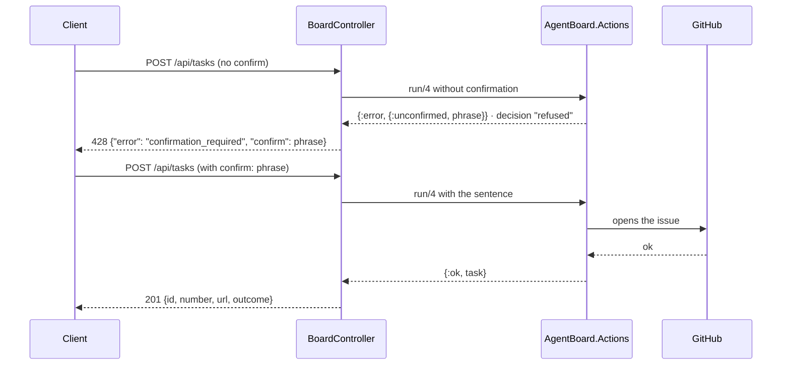

# JSON API

The board exposes HTTP endpoints at `/api`. The explicit responses of the
[controller](../lib/agent_board_web/controllers/board_controller.ex) are JSON;
handled errors have an `error` field with a message. The LiveView interface calls
the Board context directly. The request examples below are illustrative: use a
real repository and a real task when running a request.

| Method | Route | What it does |
|---|---|---|
| GET | `/api/board?repo=<owner>/<name>` | Board state of the tracked repository |
| GET | `/api/repos` | List of tracked repositories |
| POST | `/api/repos` | Tracks a new repository |
| POST | `/api/tasks` | Creates a task (a GitHub issue that mentions the agent) |
| PATCH | `/api/tasks/:id` | Action on a task: `stop`, `archive` or `resume` |

## GET /api/board

Required query parameter: `repo` in the `owner/name` format.

- `200` — the repository board (task columns by state).
- `404` — `{"error": "repository not tracked"}` when the repository is not tracked.

## GET /api/repos

- `200` — list of tracked repositories.

## POST /api/repos

Illustrative body: `{"owner": "example", "name": "project"}`.

- `201` — object with `id` (integer), `owner` and `name` (strings) of the created repository.
- `400` — `{"error": "invalid"}` when the creation is not valid.

## Confirming red actions

Every API write goes through the action registry (`AgentBoard.Actions`,
contract, "Board actions"). Creating a task and stopping a task are **red**: they
open or close a GitHub issue. The first call does nothing and answers `428` with
the sentence that confirms the action, with the real values; the call only acts
when it repeats the request with that sentence in `confirm`. Both responses are
recorded as decisions (`action_decisions`), refused and confirmed, `via: api`.

- `428` — `{"error": "confirmation_required", "confirm": "<phrase>"}`: nothing ran;
  repeat the request with `"confirm": "<phrase>"`.
- `428` — `{"error": "confirmation_mismatch", "confirm": "<current phrase>"}`: the
  sentence sent belongs to other values (another title, the task was renamed);
  nothing ran.

## POST /api/tasks

Illustrative body: `{"repo": "example/project", "title": "Corrigir link da documentação"}`; optional `body` (issue details); `confirm` with the sentence from the `428` response.

- `201` — object with `id` (local integer), `number` (issue integer), `url` (string) and `outcome: "created"`. The issue mentions the agent automatically.
- `200` — the same object with `outcome: "existing"` when the same title and body had already come in (the request key, `Board.request_key/3`): no new issue.
- `428` — without `confirm`, or with the sentence for other values (above).
- `400` — `{"error": "a repository and a title are required"}` when the repository is not tracked, the slug is invalid or the title is empty; with the reason when GitHub refuses.
- Real effect: opens an issue in the GitHub repository that is tracked.

## PATCH /api/tasks/:id

Body: `{"action": "stop"}`. The value of `action` can also be `"archive"` or `"resume"`; send one action per request. `stop` is red and asks for `confirm`; `archive` and `resume` are yellow and act directly.

- `200` — `{"ok": true}`.
- `428` — `stop` without `confirm`, or with the sentence for other values.
- `404` — `{"error": "task not found"}` for a missing task, an unknown action or a GitHub failure when closing the issue.
- Real effects: `stop` closes the issue and sets the stop flag; `archive` archives the task; `resume` clears the stop/archive flags and puts the task back in `queued` locally. It does not reopen the issue on GitHub (see [Board.resume_task/1](../lib/agent_board/board.ex)).

## Contract and limits

- The `:api` pipeline accepts JSON only — **there is no authentication**; the API is meant for the board itself and the tests. Any exposed use would need an auth plug first.
- The GitHub client is injectable via `Application.get_env(:agent_board, :github_client)`, which allows testing the endpoints without the network (see `test/agent_board_web/controllers/board_controller_test.exs`).
- The format of the handled errors above does not guarantee a JSON contract for any exception. The GitHub client may raise an exception, which the context converts into an error; the endpoints may still fail while consuming that result. Do not assume every network failure maps to the documented validation status.

## Voice (ElevenLabs)

| Method | Route | What it does |
|---|---|---|
| GET | `/api/voice/status` | What is configured (without the key) |
| GET | `/api/voice/voices` | The account's voices, for the picker |
| PUT | `/api/voice/settings` | Saves voice, model, language, volume and when to speak (empty clears the voice) |
| GET/POST | `/api/voice/speech?text=...` | The spoken audio (mp3) |
| POST | `/api/voice/transcribe` | The transcribed audio body (JSON) |

### GET /api/voice/status

- `200` — `{"configured": true|false, "status": "logged_in"|"not_configured", "voice_id": "...", "voice_source": "environment"|"saved"|"default", "tts_model": "...", "tts_source": "environment"|"saved"|"default", "stt_model": "...", "speak_events": true|false, "language": "pt-BR"|"en-US", "volume": 0..100, "attention": true|false, "speed": 0.8..1.2, "style": "steady"|"natural"|"expressive", "pause": "short"|"normal"|"long", "usage": {"day": "2026-11-07", "tts_characters": 3420, "tts_requests": 41, "cache_hits": 18, "stt_seconds": 72.0, "stt_requests": 9}, "daily_char_cap": 20000}`. It never exposes the key. The `*_source` fields say where each choice comes from: the environment variable, the choice saved in the UI or the default; `speak_events` narrates the rest of the board (on by default); `attention` are the calls when a task needs the owner (question, block, review; on by default); `language` is the language of everything the agent speaks, `volume` the playback volume, `speed` the speech rate, `style` the intonation (stability 0.7 / 0.5 / 0.3 on ElevenLabs) and `pause` how much silence ends an owner's turn (0.8 / 1.2 / 1.8 s). `usage` is today's spend on ElevenLabs (UTC day, `AgentBoard.ElevenLabs.Usage`): TTS characters billed (the `x-character-count` header, or the text length without it), paid TTS requests, turns served from the cache (zero cost), seconds of audio transcribed (`audio_duration_secs`) and transcriptions. `daily_char_cap` is the daily character ceiling (`ELEVENLABS_DAILY_CHAR_CAP`, default 20000, `0` = no ceiling); reaching it changes nothing by itself, it only records an event in "Bastidores da voz".

### GET /api/voice/voices

- `200` — `{"voices": [{"id": "...", "name": "..."}]}` — the account's voices.
- Errors follow the same error mapping as speech (401/429/502/503).

### PUT /api/voice/settings

Body: any combination of `{"voice_id": "..."}`, `{"tts_model": "..."}`, `{"speak_events": true|false}`, `{"attention": true|false}`, `{"language": "pt-BR"|"en-US"}`, `{"volume": 0..100}`, `{"speed": 0.8..1.2}`, `{"style": "steady"|"natural"|"expressive"}` and `{"pause": "short"|"normal"|"long"}`. An empty or blank `voice_id` clears the choice (back to the default); `tts_model` must be one of the offered models (`eleven_flash_v2_5`, `eleven_v4`, `eleven_multilingual_v2`); `speak_events` turns the board's automatic speech on and off.

- `200` — `{"voice_id": "...", "voice_source": "saved"|"default", "tts_model": "...", "tts_source": "saved"|"default"}`. The choices persist in the `settings` table and apply immediately; `ELEVENLABS_VOICE_ID` / `ELEVENLABS_TTS_MODEL` in the environment still take precedence.
- `400` — `{"error": "a valid voice id is required"}` for an id longer than 64 characters; `{"error": "an offered TTS model is required"}` for a model outside the catalog; `{"error": "an offered voice language is required"}` and `{"error": "the volume must be 0 to 100"}`, `{"error": "the speed must be 0.8 to 1.2"}`, `{"error": "the style must be steady, natural or expressive"}` and `{"error": "the pause must be short, normal or long"}` for values outside the offer. The keys are written in body order; one refused does not undo the previous ones.

### GET/POST /api/voice/speech

Parameter: `text` (query on GET, JSON body `{"text": "..."}` on POST); optional `voice` selects the voice for the request (the UI picker uses this for the preview). Synthesis asks for `optimize_streaming_latency=3` so the first byte arrives fast. With Flash v2.5, synthesis sends the `language_code` of the voice language (`pt`/`en`), so the text is read and normalized in that language.

- `200` — the audio bytes in `audio/mpeg` (mp3 44.1kHz 128kbps).
- `400` — `{"error": "a text is required"}` without text; `{"error": "the text is too long for one request"}` above 5000 characters; `{"error": "a valid voice id is required"}` for a `voice` that does not look like an id.
- `401` — `{"error": "ElevenLabs rejected the key"}`.
- `429` — `{"error": "ElevenLabs usage limit reached"}`.
- `503` — `{"error": "voice not configured"}` without a key (`ELEVENLABS_API_KEY`).

The spoken text uses the saved speed and intonation. A short text (up to 300 characters) already spoken with the same voice, model, language and adjustments comes from the cache without a new charge: in memory (`SpeechCache`, 150 entries, one week) and in the `voice_speech_cache` table (1000 rows, 30 days since the last use), which survives a restart.

### GET /api/voice/stream

The same parameters, validations and errors as `GET /api/voice/speech`, but the audio is sent in chunks while ElevenLabs generates it (`/v1/text-to-speech/{voz}/stream`): the first sound arrives in ~0.4 s against 0.6–1.1 s for the whole file. An error before the first byte returns as JSON; an error in the middle ends the stream. A cache response comes whole, with `content-length` and the header `x-voice-cache: hit`. It is the path the board uses to play the agent's voice.

### POST /api/voice/transcribe

Body: the raw audio bytes (content-type `audio/*`); optional query: `language` (ISO 639 code, e.g. `pt`) and `filename`.

- `200` — `{"text": "...", "language_code": "...", "language_probability": <0-1>, "audio_duration_secs": <seconds>}`.
- `400` — `{"error": "an audio body is required"}` without a body.
- `413` — `{"error": "the audio is too large"}` above the limit (10MB by default, configurable via `:voice_audio_max_bytes`).
- ElevenLabs errors follow the same error mapping as speech (401/429/502/503).

### Contract

- The ElevenLabs client is injectable via `Application.get_env(:agent_board, :elevenlabs_client)`; the tests use `Req.Test` without the network (see `test/agent_board_web/controllers/voice_controller_test.exs`).
- The key never leaves the server: these endpoints answer with audio or a transcript, not with the key.
- ElevenLabs failures do not become a response body: the client returns `{:error, reason}` (`:not_configured`, `:auth_expired`, `:usage_limit`, `{:http, status}`), and never raises.
