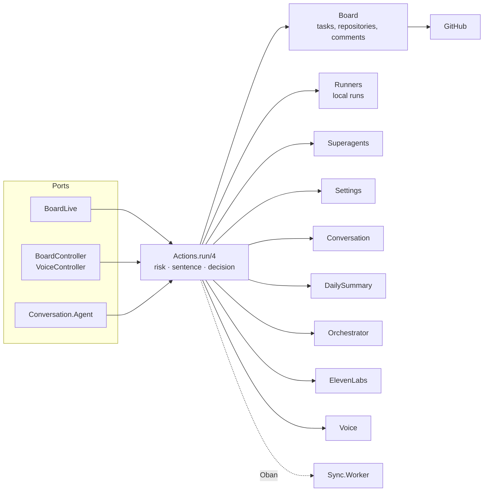
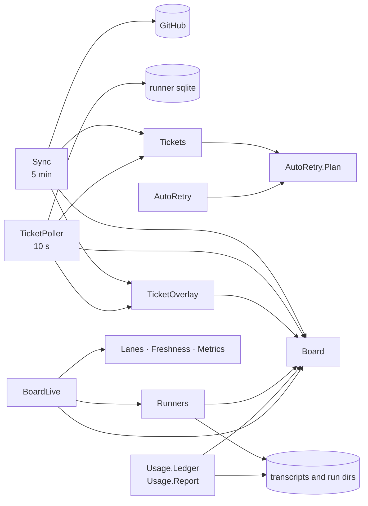
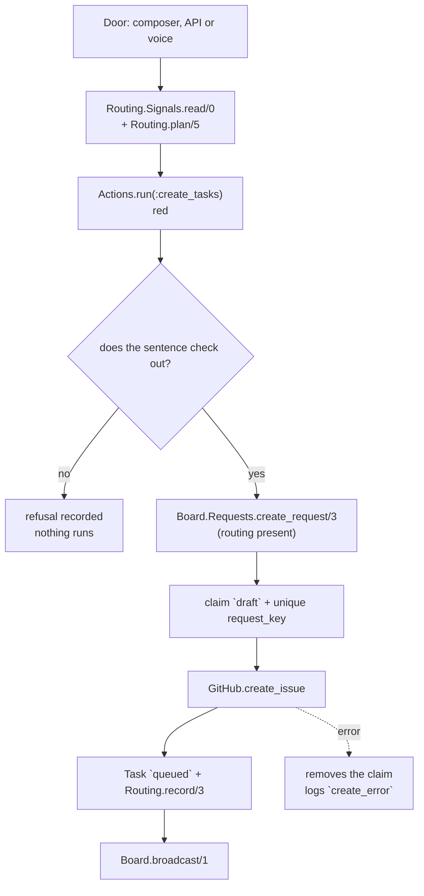
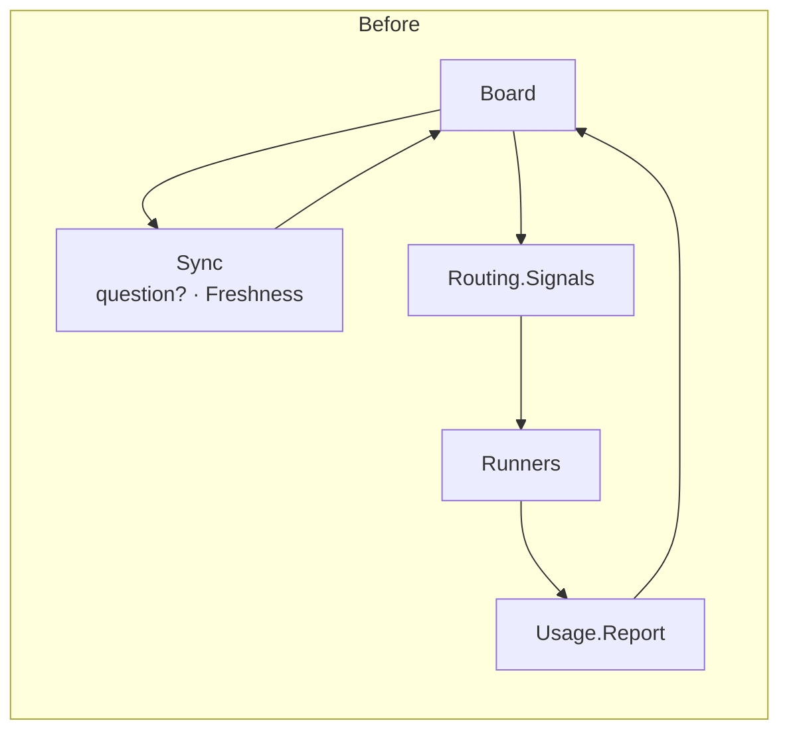
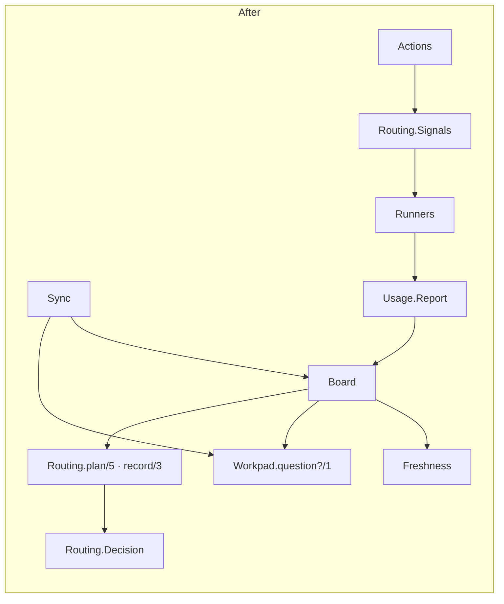

# Board architecture

This document is the map that was missing: where each responsibility lives, who
may write each table, how the flows cross the contexts and where a new change
should enter. It describes the code **after** the 2026-11-08 review; the section
[What changed](#5-what-changed-in-this-review) shows what it was before.

> **A context is not a page.** The board is a single page (`AgentBoardWeb.BoardLive`),
> but it has several domain contexts. `Board`, `Sync`, `Runners`, `Superagents`,
> `Usage`, `AI`, `Conversation` and `Voice` are not UI tabs: they own different
> data, rules and effects.

## 1. What runs

| Entry point | Module | Cadence / trigger |
|---|---|---|
| Browser | `AgentBoardWeb.BoardLive` | one read per `handle_params/3` and per `:board_updated` |
| JSON API | `AgentBoardWeb.BoardController` | `/api/...` |
| Voice API | `AgentBoardWeb.VoiceController` | `/api/voice/...` |
| Durable sync | `AgentBoard.Sync.Worker` (Oban) | cron every 5 min |
| Usage ledger | `AgentBoard.Usage.Worker` (Oban) | cron every 5 min |
| Runner tickets | `AgentBoard.TicketPoller` | 10 s (`:ticket_poll_interval`) |
| Automatic retry | `AgentBoard.AutoRetry` | 30 s (`:auto_retry_interval`) |
| Local runs | `AgentBoard.Runners.Ticker` | 15 s (`:runner_tick_interval`) |
| Superagents | `AgentBoard.Superagents.Ticker` | 30 s (`:superagent_tick_interval`) |
| Daily summary | `AgentBoard.DailySummary` | 60 s (`:daily_summary_interval`) |

External effects live at the edges: `GitHub` (HTTP), `Orchestrator` (runner
API), `Superagents.DshManager`/`DshProvisioner` (DSH process and API),
`AI` (providers), `ElevenLabs` (voice), `Runners` (tmux/CLI), `System.*` (git,
release). None of them is called from inside a UI component.

## 2. Context map

### Writes: everything goes through `Actions`

`Actions` is not a generic "service layer": it is the **risk registry**. Every
write declares the risk (green/yellow/red), the sentence that confirms it with
the real values, and the effect. The door (UI, voice, API) only presents the
sentence and returns the confirmation; the code refuses a red action without
it. The effect itself lives in the owning context (`Board`, `Runners`,
`Superagents`...).

### Observation: the mirrors write to the board

Two independent reads of the same fact (the 5 min sync and the 10 s poll) are
deliberate: GitHub is the truth of the issue; the runner's sqlite is the truth
of the ticket. The poller does not replace the sync, it only anticipates the
overlay.

## 3. Table owners

The rule after the review: **the context that reads and writes a table owns the
schema and the write**. The exceptions are the mirrors, which write what they
observed, and they are listed with the reason.

| Table | Schema / owner | Who writes | Note |
|---|---|---|---|
| `repositories` | `Board.Repository` / `Board` | `Board` via `Actions` | sync only reads |
| `tasks` | `Board.Task` / `Board` | `Board`, `Sync`, `TicketPoller`, `Runners` | documented overlays: issue, ticket, local run. `stopped`/`archived` never; `done`/`closed` only the sync, when the issue was reopened (`include_finished`) |
| `comments` | `Board.Comment` / `Board` | `Board.upsert_comment/3` (the sync calls it) | task conversation |
| `pull_requests`, `reviews`, `commits` | schemas in `Board.*` | `Sync` | GitHub mirror; the board does not write |
| `events` | `Board.Event` / `Board` | `Board.log_event/4` | append-only; every context calls the owner |
| `objectives` | `Board.Objective` / `Board` | `Board` | groups tasks |
| `settings` | `Settings.Setting` / `Settings` | `Settings` (voice and summary call it) | schema moved out of `Board` in the review |
| `action_decisions` | `Actions.Decision` / `Actions` | `Actions` | one row per decision, before the effect |
| `routing_decisions` | `Routing.Decision` / `Routing` | `Routing.record/3` (the board calls it) | write moved to the owner in the review |
| `agent_retries` | `AutoRetry.Attempt` / `AutoRetry` | `AutoRetry` | a single claim per assignment |
| `ai_calls`, `ai_cache` | `AI.*` / `AI` | `AI` | every paid call is a row |
| `voice_turns` | `Conversation.Turn` / `Conversation` | `Conversation` | voice memory and proposals |
| `daily_summaries` | `DailySummary.Entry` / `DailySummary` | `DailySummary` | one per local day |
| `eleven_labs_usage` | `ElevenLabs.Usage` | `ElevenLabs.Usage` | TTS/STT spend per UTC day |
| `usage_ledger`, `usage_messages`, `usage_limits` | `Usage.Ledger` | `Usage.Ledger` | read from the transcripts |
| `voice_speech_cache` | `ElevenLabs.SpeechCache` | `ElevenLabs.SpeechCache` | audio already paid for |
| `runner_executions` | `Runners.Execution` / `Runners` | `Runners` | one local run per row |
| `superagents`, `superagent_events` | `Superagents.*` / `Superagents` | `Superagents` | one per repository; append-only events |

The test `test/agent_board/write_boundary_test.exs` fixes two parts of this: the
web does not write directly and does not use `Repo`; `test/agent_board/actions_test.exs`
verifies that the registered effects are only called by `Actions`.

## 4. One traced flow: creating a task

What each layer hides from the others:

- **Door**: reads the signals and calls `Routing.plan/5` to show the suggestion
  and the sentence; it does not decide risk and does not open an issue. A
  request that arrives with only `executor` (the voice) is planned by `Actions`,
  which is the write door.
- **`Actions`**: applies the risk, records the decision, plans the request that
  has no row yet and calls the effect; it does not know how the board persists
  the task.
- **`Board.Requests.create_request/3`**: guarantees "once" (claim, `request_key`,
  race, receipt), talks to GitHub and writes the row that already arrived. It
  requires `:routing` for a named executor and answers `{:error, :not_routed}`
  before the claim; it is context orchestration, not a pure function.
- **`TicketOverlay`/`Sync`**: later, the issue and the ticket become task state.

The failure path is part of the contract: a request with an executor and no row
is refused before the claim; if GitHub fails, the claim is removed and an event
is recorded; if the insert of the routing decision fails, the task stays and the
error becomes an event (a retry would open a second issue).

## 5. What changed in this review

| PR | Problem | Change | Evidence |
|---|---|---|---|
| #401 | `Board` called `Sync` through two helpers; the web read `Repo` | `Freshness` and `Workpad.question?/1` left `Sync`; web reads now use context functions | `mix xref`: the `board -> sync` edge is gone; new boundary test |
| #402 | the ticket overlay had two writes with divergent guards | `TicketOverlay.apply/5`; the sync uses `include_finished: true`, the poll uses the default | 6 new tests, including the sync path that had no direct test |
| #404 | `Board` wrote `routing_decisions`; `Board.Setting` lived in the wrong context | `Routing.record/3`; `Settings.Setting` | `create_request` and `settings` tests green |
| #406 | the `changes_since` test raced the truncation of seconds | cutoff after the insert | removed the intermittent failure seen during validation |
| #409 | `Live` collided with `BoardLive`; `Work` collided with `Workpad`/`Worktree` | `TicketPoller` and `Lanes` (+ `:ticket_poll_interval`) | full suite green |
| routing (this round) | `Board.route/5` read `Routing.Signals` in a default; `Board` took part in the read cycle | pure `Routing.plan/5`; `Actions` plans a request that only has an executor; `Board` refuses without a row (`:not_routed`); `snapshot/1` left `Signals` | `mix xref`: the `Board/Signals/Runners/Usage.Report` cycle is gone; plan and refusal tests |
| Today (Hoje) view (this round) | the "Hoje" (cross-repo) view lived in the context of one repository | `AgentBoard.Overview` for `today/0` and `repo_overview/0` | overview/board and query-budget tests green |
| Harness usage (this round) | `ExecutorUsage` did not say which source it read and lived outside `Usage` | `AgentBoard.Usage.Harness`; per-task reader separate from the Ledger/Report | harness, ledger and report tests green |
| request creation (this round) | `create_request`, `create_task` and the claim lived in `Board` next to the reads | `AgentBoard.Board.Requests`; `Board` is called back only to persist, record and broadcast | requests and boundary tests green |
| ticket state (this round) | `Sync` owned the state rule and the poller depended on it; the retry plan mixed decision and effect | `AgentBoard.Tickets` for the rule; `AutoRetry.Plan` for the pure decision; the poller reads `AgentState` directly | `mix xref`: no domain cycle left; sync/ticket/retry tests green |

### Coupling before and after

`mix xref graph --format cycles` before: 6 cycles, the domain one with 11
modules. After: 5 cycles; the SCC of 11 no longer exists and **no domain cycle
remains**. The web cycle (36) is Phoenix's router/endpoint direction, the
schema cycle (6) is Ecto associations and the three `Superagents` pairs are
behaviour ↔ implementation; none has a compile edge (`--label
compile-connected` still has no cycles).

## 6. Decisions, with the why

### 6.1 Moving `Freshness` and `question?` out of `Sync`

**Problem.** `Board` depended on `Sync` through `Sync.Freshness.stale_ttl/0` and
`Sync.question?/1`; `Sync` already depended on `Board` to write. It was a cycle
kept by two details that were not "sync".

**Evidence.** `mix xref` showed the SCC of 11; `Board` had a single call to
`Sync.question?` (`comment_asks?/1`) and one to `Freshness.stale_ttl/0`
(`repo_overview/0`).

**Alternatives.** (a) leave the cycle and document it; (b) move the two functions
to `Board`; (c) give both their own owner.

**Choice.** (c): `Freshness` is a board read (how fresh the data is), not a sync
operation; `Workpad.question?/1` is semantics of the agent's communication, used
by `Sync`, `Board` and `Lanes`. The direction became `Sync -> Board`.

**What got simpler.** The board does not recompile or break when the sync
changes; the question rule has one place. **Cost.** One more file in `lib/` and
two updated call sites; no compatibility was needed because nothing persisted
stores those names.

### 6.2 The web reads through the context, not through `Repo`

**Problem.** `BoardLive`, `BoardController`, `BoardNavigation` and `AgentAction`
did `Repo.get`/`Repo.preload` of `Task`, `Repository`, `Execution` and
`Superagent`. The same "task + repository" was reassembled in four places.

**Evidence.** 20 `Repo` calls in `lib/agent_board_web/**`; the `:repository`
preload repeated.

**Alternatives.** (a) keep it and trust discipline; (b) create a new `ReadModel`;
(c) expose reads in the contexts that already own them.

**Choice.** (c): `Board.task/1`, `Board.task_of/2`, `Board.repository/1`,
`Board.find_repository/2`, `Runners.get_execution/1`, `Superagents.get/1`
(with repository). The test `write_boundary_test.exs` now fails if the web
mentions `Repo` again.

**What got simpler.** A preload/query change happens in the context, not in the
3 thousand line LiveView. **Cost.** A few more small functions in the public
API; the web still knows the structs (`%Task{}`) for pattern matching, which is
acceptable — the struct is the context's vocabulary.

### 6.3 One write for the ticket overlay

**Problem.** `Sync.apply_overlay/5` and `TicketPoller.overlay_number/4` had the
same `update_all` and different guards: the sync could move a `done` task after
the issue reopened; the poll could not. Two sources for the same rule.

**Evidence.** The SQL was identical; the difference was `include_finished` (sync)
and `state not in done/closed` (poll).

**Alternatives.** (a) leave it duplicated; (b) unify everything and pick one
guard; (c) unify the write and let each caller declare its scope.

**Choice.** (c): `TicketOverlay.apply/5` with `:include_finished`. The sync keeps
the closed-issue guard; the poll keeps the default. The rule "how the state
becomes a row" has one owner; the policy of when to apply it stays with whoever
has the fact.

**What got simpler.** A new field (`finished_at`, for example) enters once.
**Cost.** The `include_finished` option has to be understood by whoever touches
the sync; the tests name both scopes.

### 6.4 The table owner writes the table

**Problem.** `Board.record_routing/4` inserted into `routing_decisions`, whose
schema and type belong to `Routing`; `Board.Setting` was a `Settings` schema
living in the `Board` namespace.

**Evidence.** `Routing.Decision` already existed with the changeset; `Settings`
was the only reader/writer of `settings`.

**Choice.** `Routing.record/3` and `Settings.Setting`. `Board` still decides
**when** to write the row and turns a failure into an event — the task is never
discarded for lack of an audit.

**What got simpler.** Finding who writes a table means looking for the owner.
**Cost.** `Routing` is no longer 100% pure; the pure part (`suggest/2`) stays
separate from the persistence part (`record/3`).

### 6.5 Names that say the work

**Problem.** `AgentBoard.Live` looked like a LiveView next to `BoardLive` and did
not say it reads tickets; `AgentBoard.Work` did not say it builds the lanes and
collided with `Workpad` and `AgentWorktree`.

**Choice.** `TicketPoller` (what and how) and `Lanes` (the concept the UI already
uses). Persisted names? None: they are not Oban workers or database values.
Internal configuration changed with them (`:ticket_poll_interval`).

**What got simpler.** Searching for "who polls" and "who builds the Fila"
(Queue) finds the module. **Cost.** A large mechanical rename; git history
follows the file and the boundary test guarantees nothing was left behind.

### 6.6 The routing decision leaves `Board`

**Problem.** `Board.route/5` had `Routing.Signals.read/0` as a default value.
Calling a context function triggered a read of the runner API and of the ledger;
`Board` also entered the cycle `Board -> Signals -> Runners -> Usage.Report ->
Board`.

**Evidence.** The default was in the signature of `route/5`; `Board` does not
need the signals to write the task, only to decide the executor. The cycle
showed up in `mix xref` (5 modules) after `Sync` left the path.

**Alternatives.** (a) keep it and document it; (b) only remove the default and
pass `Signals.read()` at each call, keeping the decision in `Board`; (c) move the
decision to `Routing` and the read to the door.

**Choice.** (c): `Routing.plan/5` is pure (it receives `signals`), `Routing.snapshot/1`
left `Signals` so `Routing` is not coupled to the reader, and `Actions` plans the
request that arrives with only `executor`. `Board.Requests.create_request/3`
requires the row for a named executor and refuses `{:error, :not_routed}` before
the claim. The doors (composer, API, voice) read the signals and call `plan/5`
before showing the sentence.

**What got simpler.** `Board` left the cycle; the decision is testable without
the network; the request that reaches the context is already complete. **Cost.**
The `create_request/3` contract became stricter: a direct call with an executor
must pass the row, and the new test fixes that refusal.

### 6.7 The Today (Hoje) view is a read model, not `Board`

**Problem.** `Board.today/0` and `Board.repo_overview/0` read **all**
repositories, with their own `@today_states` and `@need_rank`, inside the context
that is scoped to one repository. It was the only part of `Board` that answered
"in all, now" — a screen responsibility, not a write one.

**Evidence.** `BoardLive` called `Board.today/0` in both board reads;
`repo_overview/0` was only used by `today/0` and the tests. `Board` also kept two
attributes that no other function used.

**Alternatives.** (a) leave it in `Board`; (b) move it to `BoardLive`; (c) create
a cross-repository read model.

**Choice.** (c): `AgentBoard.Overview` reads the board tables and calls the
context's public functions (`Board.list_repositories/0`,
`Board.resolved_task_ids/1`). `Board` remains the owner of the tables and of the
operations of one repository; `Overview` is the read of all, as `Lanes` is the
read of one.

**What got simpler.** The "Hoje" screen changes without touching the
task/repository context; the query-budget test lives next to the read model.
**Cost.** One UI call changed module and the read path gained one more name to
learn (`Board` per repository, `Overview` for all).

### 6.8 Request creation is a context command

**Problem.** `Board.create_request/3`, `Board.create_task/5` and the claim
(`draft` + `request_key` + receipt) lived in the same module as the reads of
tasks, comments and PRs, which change for other reasons. The "once" guarantee
was hidden among pagination, workpad and activity.

**Evidence.** The creation functions and the claim took ~200 contiguous lines;
`Actions` was the only caller of `create_request/3`; the idempotency tests formed
their own file (`create_request_test.exs`).

**Alternatives.** (a) keep it in `Board`; (b) create a new context, with the
table and the schema; (c) create a command inside the context.

**Choice.** (c): `AgentBoard.Board.Requests` receives the request already routed,
makes the claim, calls GitHub, writes the task, records the row and broadcasts.
It calls back `Board.log_event/4`, `Board.broadcast/1` and
`Board.request_key/3`; `Board` does not call `Requests`. The table and the schema
stay in the context.

**What got simpler.** Idempotency has one file and one test; `Board` kept the
reads and the task writes that do not create an issue. **Cost.** One more public
path (`Board.Requests.create_request/3`) and one call site in `Actions`; the
boundary test had to point to the new module.

### 6.9 Ticket state and the retry decision leave `Sync`

**Problem.** `Sync.ticket_state/2` was the ticket state rule, but its main user
was the 10 s poller — which therefore depended on the sync context. And
`AutoRetry` mixed the decision (`plan/2`, pure) with the tick, the claim and the
write.

**Evidence.** `TicketPoller` called `Sync.ticket_state/2` and
`Sync.normalized_tickets/0`; `Sync` called `AutoRetry.plan/1` and
`queued_retry?/1` only to decide `retrying`; `mix xref` showed the cycle
`Actions/AutoRetry/Sync/Worker`.

**Alternatives.** (a) leave the cycle documented; (b) move the rule to the
poller, duplicating it; (c) give the rule one owner and the decision another.

**Choice.** (c): `AgentBoard.Tickets.state/2` is the rule (it receives the
workpad and the `asked?` as values/functions, it does not read the board);
`AutoRetry.Plan` is the pure decision, without `Actions`; `AutoRetry` keeps the
tick, the claim and the effect. The poller reads `AgentState.tickets/0` and
`Tickets.state/2` directly; `Sync` keeps `ticket_state/2` as a delegate so old
callers do not break. `Sync` no longer calls `AutoRetry`.

**Gain.** The poller stops depending on the sync and the last domain cycle
disappears; the retry decision is testable without a database/network. **Cost.**
Two new modules and a compatibility delegate in `Sync` (kept because the test
and the contract still name it; it can go when nobody uses it anymore).

### 6.10 What was kept on purpose

- **`Board` remains a single context.** The task, comment and PR tables share
  invariants (the two-layer state, the `request_key`, the PR resolution).
  Splitting by size would create new transactions and contracts without removing
  coupling.
- **`Usage.Harness` stays separate from `Usage.Ledger`/`Report`.** It reads the
  transcript of **one task** for the inspector; the Ledger and the Report talk
  about the day and the executor. They stay in the same namespace because the
  source is the same (the Harness), but they remain different modules because the
  jobs are different.
- **`BoardLive` remains the owner of the events.** Pages are not domains; the
  component does not decide a rule. If the LiveView starts to block changes, the
  cut is by panel (events in the component), not by "screen context".
- **The web cycle is not a defect.** `router -> endpoint -> router` is Phoenix's
  direction; `mix xref --label compile-connected` does not report a cycle.

## 7. Stratified design: data, calculations and actions

The reference is *Grokking Simplicity* (Eric Normand): data are facts;
calculations are pure functions over data; actions depend on the world (time,
network, database) and are not idempotent by themselves. The adaptation to the
project:

| Level | Examples | Rule |
|---|---|---|
| Data | `Board.Task`, `Routing.Decision` structs, ticket maps | no effect; the format is the contract |
| Calculations | `Routing.suggest/2`, `Routing.plan/5`, `Routing.snapshot/1`, `Tickets.state/2`, `AutoRetry.Plan.plan/2`, `Metrics.throughput/3`, `AgentBlock`, `AgentFailure`, `Workpad.parse/1`, `Freshness.snapshot/1`, `Announcer` | testable without a database/network; an error is a value |
| Reads | `Board.board/3`, `Overview.today/0`, `Overview.repo_overview/0`, `Lanes.needs/3`, `Metrics.Observations`, `Usage.Report`, `AgentSignal`, `AgentWorktree` | read the database, git or files; they may be cached, but they do not decide a write |
| Actions | `Actions.run/4`, `Sync.sync_repo/2`, `TicketPoller.poll/1`, `Runners.dispatch/3`, `AI.call`, `ElevenLabs`, `Superagents` | effect at the edges; decision before the effect; a failure becomes a reason, not an invented answer |

Two concrete examples:

- `TicketOverlay.apply/5` is an action (it writes), but the decision "what state
  the ticket imposes" is `Tickets.state/2`; `TicketPoller` and `Sync` only
  orchestrate. The decision is almost all calculation, with one optional
  filesystem read: when the report is a prepare failure, `AutoRetry.Plan.plan/2`
  looks at whether files were left in the run directory. This allows testing the
  rule with a map and the write with a single task.
- `Board.Requests.create_request/3` mixes levels on purpose: it is the creation
  boundary that guarantees "once". The effect (GitHub) is isolated in `GitHub`
  and the claim is a row with a unique key; the pure part (`Board.request_key/3`)
  stays in the context. The routing decision no longer lives here: it arrives
  ready and is refused when missing. The "claim + receipt" already has its own
  module; it is not a generic layer.

## 8. Where future changes enter

- **New field in `tasks`**: migration → `Board.Task` (schema/changeset) → read in
  `Board` → whoever writes the field (`Board`, `Sync` or `TicketOverlay`) → UI.
  Do not write `Repo` in the web.
- **New write action**: `Actions` (risk, sentence, effect), test in
  `actions_test.exs`, confirmation at every door that offers it. If it is red,
  the sentence is mandatory; a permanent authorization only enters the contract.
- **New read for the UI**: a function in the owning context (`Board`, `Runners`,
  `Superagents`, `Lanes`...). If the query is presentation only, it lives in the
  read module (`Lanes` per repository, `Overview` for all, `Metrics`), never in
  the component.
- **New external integration**: client/adapter behind a behaviour when there is
  a swap (the `Superagents.Manager`/`Provisioner` pattern); no LiveView calling a
  process or HTTP directly.
- **New asynchronous job**: Oban (`Worker`) when it needs a durable retry; a
  GenServer ticker only for cheap and idempotent observation. The interval knob
  goes into `config/test.exs` as `:manual`/one hour and the test calls the tick.
- **New executor**: `Executors` (label and body), `Runners`/superagent,
  `Usage.*` for the spend and `Routing` for the suggestion. The board still does
  not write to the runner's sqlite.
- **New table**: schema in the owning context, migration, a single write; if it
  is a mirror, document the exception in the contract and test the guard.

## 9. Limits and next steps

- **No domain cycle remains.** `xref` only shows the web, the Ecto associations
  and the `Superagents` behaviour ↔ implementation pairs.
- **`BoardLive` has ~3 thousand lines.** It is not the bottleneck yet; the next
  cut, if needed, is by panel (move the `handle_event` callbacks to the
  component), with a render test per panel.
- **Historical references.** `docs/decisions/0003-...` and the UI audit keep old
  names (`work.ex`, `live.ex`, `sync/freshness.ex`) because they are a record of
  what existed; the current guides point to the new names.

## 10. Validation evidence

- `MIX_ENV=test mix gate` in the final commit: 982 tests, 0 failures; compilation
  with warnings as errors, format, credo and `agent_kit.check` green.
- `mix xref graph --format cycles` before/after (section 5) and
  `mix xref graph --format cycles --label compile-connected`: no compile cycles.
- PRs: #401, #402, #404, #406, #409, the routing delivery, the Today view
  extraction, the `Usage.Harness` rename, the `Board.Requests` extraction, the
  `Tickets`/`AutoRetry.Plan` extraction and this document. Each went through CI
  (backend in four partitions, gates, frontend, library, release).
- The test defect in #406 was found while validating the PRs and handled
  separately; no product behavior changed in this review.
