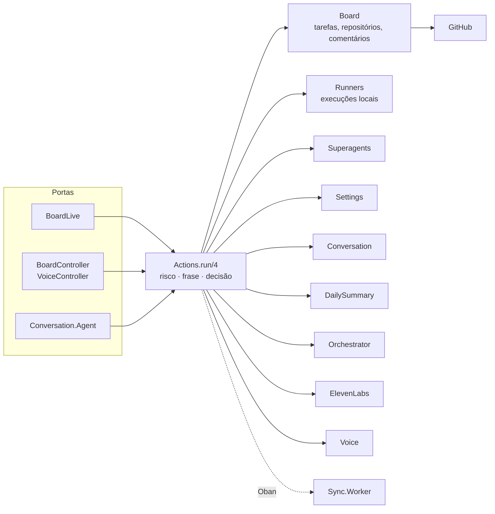
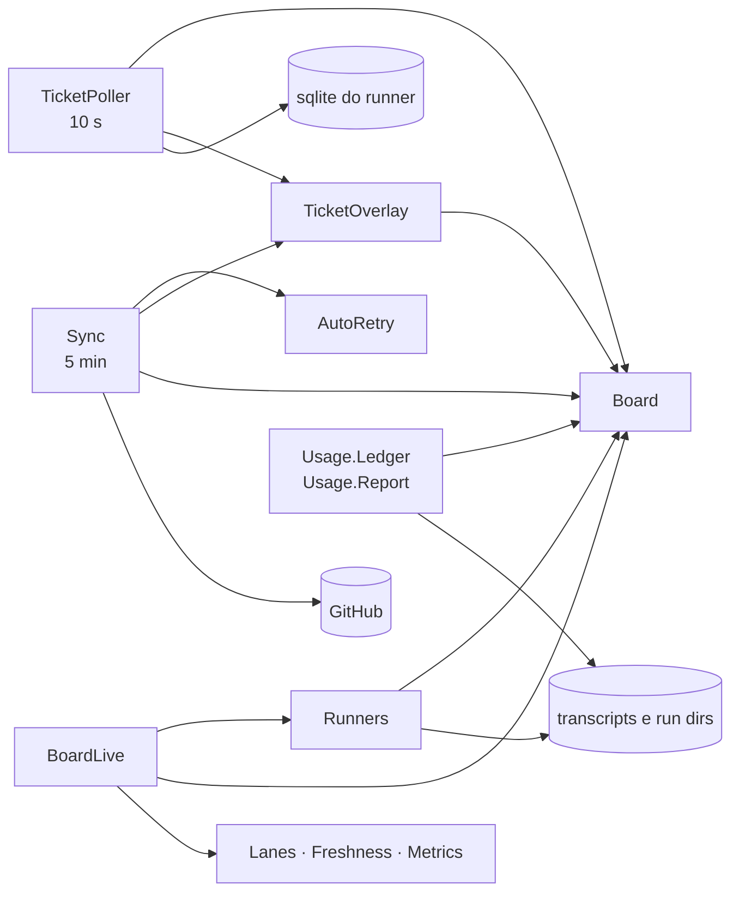
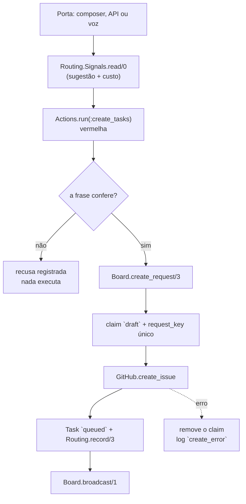
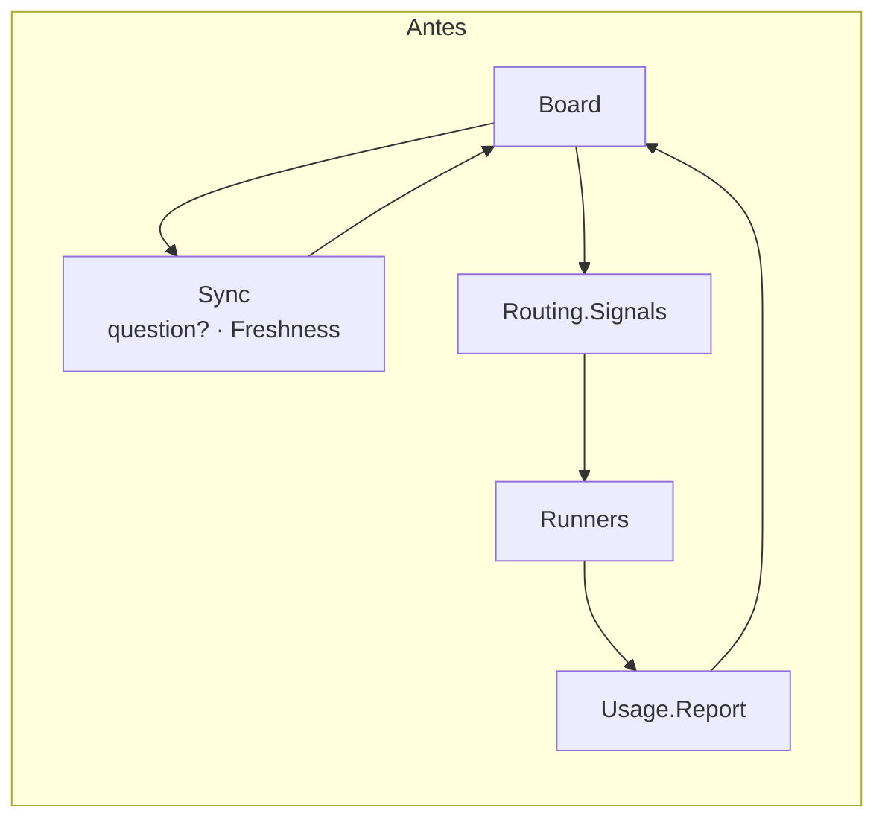
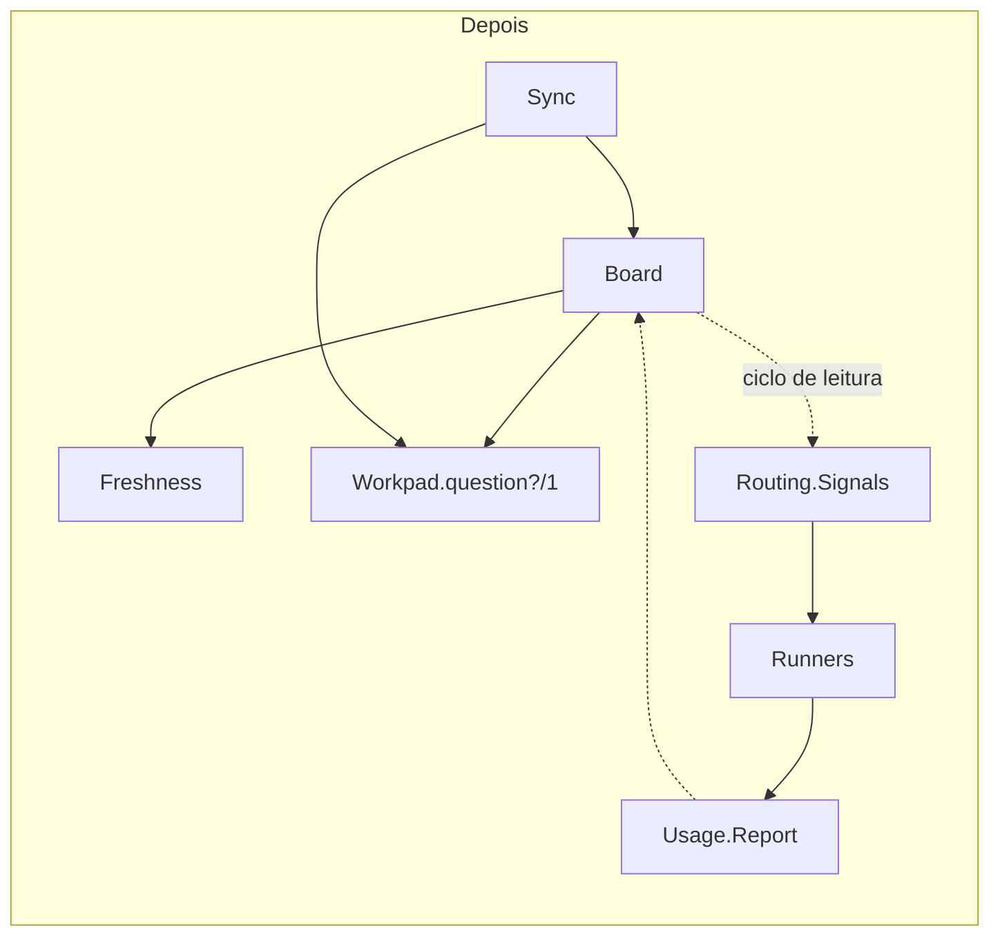

# Arquitetura do board

Este documento é o mapa que faltava: onde cada responsabilidade mora, quem
pode escrever cada tabela, como os fluxos atravessam os contextos e onde uma
mudança nova deve entrar. Ele descreve o código **depois** da revisão de
2026-11-08; a seção [O que mudou](#5-o-que-mudou-nesta-revisão) aponta o antes.

> **Contexto não é página.** O board é uma página só (`AgentBoardWeb.BoardLive`),
> mas tem vários contextos de domínio. `Board`, `Sync`, `Runners`, `Superagents`,
> `Usage`, `AI`, `Conversation` e `Voice` não são abas da interface: são donos de
> dados, regras e efeitos diferentes.

## 1. O que roda

| Entrada | Módulo | Cadência / gatilho |
|---|---|---|
| Navegador | `AgentBoardWeb.BoardLive` | uma leitura por `handle_params/3` e por `:board_updated` |
| API JSON | `AgentBoardWeb.BoardController` | `/api/...` |
| API de voz | `AgentBoardWeb.VoiceController` | `/api/voice/...` |
| Sync durável | `AgentBoard.Sync.Worker` (Oban) | cron a cada 5 min |
| Ledger de uso | `AgentBoard.Usage.Worker` (Oban) | cron a cada 5 min |
| Tickets do runner | `AgentBoard.TicketPoller` | 10 s (`:ticket_poll_interval`) |
| Retentativa automática | `AgentBoard.AutoRetry` | 30 s (`:auto_retry_interval`) |
| Execuções locais | `AgentBoard.Runners.Ticker` | 15 s (`:runner_tick_interval`) |
| Superagents | `AgentBoard.Superagents.Ticker` | 30 s (`:superagent_tick_interval`) |
| Resumo do dia | `AgentBoard.DailySummary` | 60 s (`:daily_summary_interval`) |

Os efeitos externos ficam nas bordas: `GitHub` (HTTP), `Orchestrator` (API do
runner), `Superagents.DshManager`/`DshProvisioner` (processo e API do DSH),
`AI` (provedores), `ElevenLabs` (voz), `Runners` (tmux/CLI), `System.*` (git,
release). Nenhum deles é chamado de dentro de um componente de UI.

## 2. Mapa dos contextos

### Escrita: tudo passa por `Actions`

`Actions` não é um "service layer" genérico: é o **registro de risco**. Toda
escrita declara o risco (verde/amarelo/vermelho), a frase que a confirma com os
valores reais e o efeito. A porta (UI, voz, API) só apresenta a frase e devolve
a confirmação; o código recusa uma ação vermelha sem ela. O efeito em si mora no
contexto dono (`Board`, `Runners`, `Superagents`...).

### Observação: os espelhos escrevem no board

Duas leituras independentes do mesmo fato (sync de 5 min e poll de 10 s) são
propositais: o GitHub é a verdade do issue; o sqlite do runner é a verdade do
ticket. O poller não substitui o sync, só antecipa o overlay.

## 3. Donos das tabelas

A regra depois da revisão: **o contexto que lê e escreve uma tabela é o dono do
schema e da escrita**. Exceções são os espelhos, que escrevem o que observaram,
e estão listadas com o motivo.

| Tabela | Schema / dono | Quem escreve | Observação |
|---|---|---|---|
| `repositories` | `Board.Repository` / `Board` | `Board` via `Actions` | sync só lê |
| `tasks` | `Board.Task` / `Board` | `Board`, `Sync`, `TicketPoller`, `Runners` | overlays documentados: issue, ticket, execução local. `stopped`/`archived` nunca; `done`/`closed` só o sync, quando o issue foi reaberto (`include_finished`) |
| `comments` | `Board.Comment` / `Board` | `Board.upsert_comment/3` (o sync chama) | conversa da tarefa |
| `pull_requests`, `reviews`, `commits` | schemas em `Board.*` | `Sync` | espelho do GitHub; o board não escreve |
| `events` | `Board.Event` / `Board` | `Board.log_event/4` | append-only; todo contexto chama o dono |
| `objectives` | `Board.Objective` / `Board` | `Board` | agrupa tarefas |
| `settings` | `Settings.Setting` / `Settings` | `Settings` (voz e resumo chamam) | schema movido de `Board` na revisão |
| `action_decisions` | `Actions.Decision` / `Actions` | `Actions` | uma linha por decisão, antes do efeito |
| `routing_decisions` | `Routing.Decision` / `Routing` | `Routing.record/3` (o board chama) | escrita movida para o dono na revisão |
| `agent_retries` | `AutoRetry.Attempt` / `AutoRetry` | `AutoRetry` | claim único por assignment |
| `ai_calls`, `ai_cache` | `AI.*` / `AI` | `AI` | toda chamada paga é uma linha |
| `voice_turns` | `Conversation.Turn` / `Conversation` | `Conversation` | memória e propostas da voz |
| `daily_summaries` | `DailySummary.Entry` / `DailySummary` | `DailySummary` | uma por dia local |
| `eleven_labs_usage` | `ElevenLabs.Usage` | `ElevenLabs.Usage` | gasto de TTS/STT por dia UTC |
| `usage_ledger`, `usage_messages`, `usage_limits` | `Usage.Ledger` | `Usage.Ledger` | lido dos transcripts |
| `voice_speech_cache` | `ElevenLabs.SpeechCache` | `ElevenLabs.SpeechCache` | áudio já pago |
| `runner_executions` | `Runners.Execution` / `Runners` | `Runners` | uma execução local por linha |
| `superagents`, `superagent_events` | `Superagents.*` / `Superagents` | `Superagents` | um por repositório; eventos append-only |

O teste `test/agent_board/write_boundary_test.exs` fixa duas partes disso: a
web não escreve direto e não usa `Repo`; `test/agent_board/actions_test.exs`
verifica que os efeitos registrados só são chamados por `Actions`.

## 4. Um fluxo traçado: criar uma tarefa

O que cada camada esconde:

- **Porta**: mostra a frase e coleta a confirmação; não decide risco nem abre
  issue.
- **`Actions`**: aplica o risco, grava a decisão e chama o efeito; não sabe como
  o board persiste a tarefa.
- **`Board.create_request/3`**: garante "uma vez" (claim, `request_key`, corrida,
  receipt), fala com o GitHub e mantém a linha de roteamento. É orquestração de
  contexto, não uma função pura.
- **`TicketOverlay`/`Sync`**: depois, o issue e o ticket viram estado da tarefa.

O caminho de falha é parte do contrato: se o GitHub falha, o claim é removido e
um evento é gravado; se o insert da decisão de roteamento falha, a tarefa fica e
o erro vira evento (uma retentativa abriria um segundo issue).

## 5. O que mudou nesta revisão

| PR | Problema | Mudança | Evidência |
|---|---|---|---|
| #401 | `Board` chamava `Sync` por dois helpers; a web lia `Repo` | `Freshness` e `Workpad.question?/1` saíram de `Sync`; leituras da web passaram a usar funções de contexto | `mix xref`: aresta `board -> sync` sumiu; teste de fronteira novo |
| #402 | o overlay do ticket tinha duas escritas com guardas divergentes | `TicketOverlay.apply/5`; sync usa `include_finished: true`, poll usa o padrão | 6 testes novos, incluindo o caminho do sync que não tinha teste direto |
| #404 | `Board` escrevia `routing_decisions`; `Board.Setting` morava no contexto errado | `Routing.record/3`; `Settings.Setting` | testes de `create_request` e `settings` verdes |
| #406 | teste do `changes_since` corria com a truncagem de segundos | cutoff depois do insert | removeu a falha intermitente observada na validação |
| #409 | `Live` colidia com `BoardLive`; `Work` colidia com `Workpad`/`Worktree` | `TicketPoller` e `Lanes` (+ `:ticket_poll_interval`) | suíte completa verde |

### Antes e depois do acoplamento

`mix xref graph --format cycles` antes: 6 ciclos, o de domínio com 11 módulos.
Depois: 7 ciclos; o SCC de 11 se desfez e sobraram dois ciclos de 4
(`Actions/AutoRetry/Sync/Worker` e `Board/Signals/Runners/Usage.Report`). O ciclo da web (36) é a direção
router ↔ endpoint do Phoenix, sem aresta de compilação (`--label
compile-connected` continua sem ciclos). O ciclo que sobrou é conhecido e está
em [Limites](#9-limites-e-próximos-passos).

## 6. Decisões, com o porquê

### 6.1 Tirar `Freshness` e `question?` de `Sync`

**Problema.** `Board` dependia de `Sync` por `Sync.Freshness.stale_ttl/0` e
`Sync.question?/1`; `Sync` já dependia de `Board` para escrever. Era um ciclo
mantido por dois detalhes que não eram "sync".

**Evidência.** `mix xref` mostrava o SCC de 11; `Board` tinha uma única chamada a
`Sync.question?` (`comment_asks?/1`) e uma a `Freshness.stale_ttl/0`
(`repo_overview/0`).

**Alternativas.** (a) deixar o ciclo e documentar; (b) mover as duas funções
para `Board`; (c) dar às duas um dono próprio.

**Escolha.** (c): `Freshness` é leitura do board (o quanto os dados estão
frescos), não uma operação do sync; `Workpad.question?/1` é semântica da
comunicação do agente, usada por `Sync`, `Board` e `Lanes`. A direção virou
`Sync -> Board`.

**O que ficou mais simples.** O board não recompila nem quebra quando o sync
muda; a regra de pergunta tem um lugar. **Custo.** Um arquivo a mais em `lib/` e
dois call sites atualizados; nenhuma compatibilidade foi necessária porque nada
persistido guarda esses nomes.

### 6.2 A web lê pelo contexto, não por `Repo`

**Problema.** `BoardLive`, `BoardController`, `BoardNavigation` e `AgentAction`
faziam `Repo.get`/`Repo.preload` de `Task`, `Repository`, `Execution` e
`Superagent`. O mesmo "tarefa + repositório" era remontado em quatro lugares.

**Evidência.** 20 chamadas a `Repo` em `lib/agent_board_web/**`; o preload de
`:repository` repetido.

**Alternativas.** (a) manter e confiar na disciplina; (b) criar um `ReadModel`
novo; (c) expor leituras nos contextos que já são donos.

**Escolha.** (c): `Board.task/1`, `Board.task_of/2`, `Board.repository/1`,
`Board.find_repository/2`, `Runners.get_execution/1`, `Superagents.get/1`
(com repositório). O teste `write_boundary_test.exs` agora falha se a web voltar
a citar `Repo`.

**O que ficou mais simples.** Uma mudança de preload/consulta acontece no
contexto, não na LiveView de 3 mil linhas. **Custo.** Funções pequenas a mais na
API pública; a web ainda conhece os structs (`%Task{}`) para pattern matching,
o que é aceitável — struct é o vocabulário do contexto.

### 6.3 Uma escrita para o overlay do ticket

**Problema.** `Sync.apply_overlay/5` e `TicketPoller.overlay_number/4` tinham o
mesmo `update_all` e guardas diferentes: o sync podia mover uma tarefa `done`
depois de o issue reabrir; o poll não. Duas fontes para a mesma regra.

**Evidência.** O SQL era idêntico; a diferença era `include_finished` (sync) e
`state not in done/closed` (poll).

**Alternativas.** (a) deixar duplicado; (b) unificar tudo e escolher uma guarda;
(c) unificar a escrita e deixar cada chamador declarar seu alcance.

**Escolha.** (c): `TicketOverlay.apply/5` com `:include_finished`. O sync mantém
a guarda do issue fechado; o poll mantém o padrão. A regra "como o estado vira
linha" tem um dono; a política de quando aplicar continua com quem tem o fato.

**O que ficou mais simples.** Um campo novo (`finished_at`, por exemplo) entra
uma vez. **Custo.** A opção `include_finished` precisa ser entendida por quem
mexer no sync; os testes nomeiam os dois alcances.

### 6.4 O dono da tabela escreve a tabela

**Problema.** `Board.record_routing/4` inseria em `routing_decisions`, cujo
schema e cujo tipo são de `Routing`; `Board.Setting` era um schema de `Settings`
morando no namespace de `Board`.

**Evidência.** `Routing.Decision` já existia com o changeset; `Settings` era o
único leitor/escritor de `settings`.

**Escolha.** `Routing.record/3` e `Settings.Setting`. `Board` continua decidindo
**quando** gravar a linha e transforma uma falha em evento — a tarefa nunca é
descartada por falta de auditoria.

**O que ficou mais simples.** Achar quem escreve uma tabela é procurar o dono.
**Custo.** `Routing` deixou de ser 100% puro; a parte pura (`suggest/2`)
continua separada da parte de persistência (`record/3`).

### 6.5 Nomes que dizem o trabalho

**Problema.** `AgentBoard.Live` parecia um LiveView ao lado de `BoardLive` e não
dizia que lê tickets; `AgentBoard.Work` não dizia que constrói as raias e
colidia com `Workpad` e `AgentWorktree`.

**Escolha.** `TicketPoller` (o quê e como) e `Lanes` (o conceito que a UI já
usa). Nomes persistidos? Nenhum: não são workers do Oban nem valores de banco.
Configuração interna mudou junto (`:ticket_poll_interval`).

**O que ficou mais simples.** A busca por "quem faz o poll" e "quem monta a
Fila" acha o módulo. **Custo.** Um rename mecânico grande; o histórico do git
segue o arquivo e o teste de fronteira garante que nada ficou para trás.

### 6.6 O que foi mantido de propósito

- **`Board` continua um contexto só.** As tabelas de tarefa, comentário e PR
  compartilham invariantes (o estado de duas camadas, o `request_key`, a
  resolução de PR). Dividir por tamanho criaria transações e contratos novos sem
  remover acoplamento.
- **`ExecutorUsage` fica no topo.** Ele lê o transcript de **uma tarefa** para o
  inspetor; `Usage.Ledger`/`Report` falam do dia e do executor. São dois
  trabalhos; juntar só para uniformizar o namespace esconderia isso.
- **`BoardLive` continua dono dos eventos.** As páginas não são domínios; o
  componente não decide regra. Se a LiveView começar a bloquear mudanças, o
  corte é por painel (eventos no componente), não por "contexto de tela".
- **O ciclo da web não é um defeito.** `router -> endpoint -> router` é a
  direção do Phoenix; `mix xref --label compile-connected` não acusa ciclo.

## 7. Desenho estratificado: dados, cálculos e ações

A referência é *Grokking Simplicity* (Eric Normand): dados são fatos; cálculos
são funções puras sobre dados; ações dependem do mundo (tempo, rede, banco) e
não são idempotentes por si. A adaptação ao projeto:

| Nível | Exemplos | Regra |
|---|---|---|
| Dados | structs `Board.Task`, `Routing.Decision`, mapas de ticket | sem efeito; o formato é o contrato |
| Cálculos | `Routing.suggest/2`, `Metrics.throughput/3`, `AgentBlock`, `AgentFailure`, `Workpad.parse/1`, `Freshness.snapshot/1`, `Announcer` | testáveis sem banco/rede; erro é valor |
| Leituras | `Board.board/3`, `Board.today/0`, `Lanes.needs/3`, `Metrics.Observations`, `Usage.Report`, `AgentSignal`, `AgentWorktree` | leem banco, git ou arquivos; podem ser cacheadas, mas não decidem escrita |
| Ações | `Actions.run/4`, `Sync.sync_repo/2`, `TicketPoller.poll/1`, `Runners.dispatch/3`, `AI.call`, `ElevenLabs`, `Superagents` | efeito nas bordas; decisão antes do efeito; falha vira motivo, não resposta inventada |

Dois exemplos concretos:

- `TicketOverlay.apply/5` é ação (escreve), mas a decisão "que estado o ticket
  impõe" é `Sync.ticket_state/2`; `TicketPoller` e `Sync` só orquestram. A
  decisão é quase toda cálculo, com uma leitura opcional de filesystem: quando
  o relatório é uma falha de prepare, `AutoRetry.plan/2` olha se sobraram
  arquivos no diretório da execução. Isso permite testar a regra com um mapa e
  a escrita com uma tarefa só.
- `Board.create_request/3` mistura níveis de propósito: é a fronteira do
  contexto que garante "uma vez". O efeito (GitHub) está isolado em `GitHub` e
  o claim é uma linha com chave única; a parte pura (`request_key/3`) é
  separada. Se crescer, o próximo corte é extrair o "claim + receipt" para um
  módulo próprio, não criar uma camada genérica.

## 8. Onde futuras mudanças entram

- **Novo campo em `tasks`**: migração → `Board.Task` (schema/changeset) →
  leitura em `Board` → quem escreve o campo (`Board`, `Sync` ou
  `TicketOverlay`) → UI. Não escreva `Repo` na web.
- **Nova ação de escrita**: `Actions` (risco, frase, efeito), teste em
  `actions_test.exs`, confirmação em cada porta que a oferece. Se for vermelha,
  a frase é obrigatória; uma autorização permanente só entra no contrato.
- **Nova leitura para a UI**: função no contexto dono (`Board`, `Runners`,
  `Superagents`, `Lanes`...). Se a consulta é só de apresentação, ela fica no
  módulo de leitura (`Lanes`/`Metrics`), nunca no componente.
- **Nova integração externa**: cliente/adaptador atrás de um behaviour quando há
  troca (o padrão de `Superagents.Manager`/`Provisioner`); nada de LiveView
  chamando processo ou HTTP direto.
- **Novo job assíncrono**: Oban (`Worker`) quando precisa de retentativa
  durável; GenServer ticker só para observação barata e idempotente. O knob de
  intervalo entra em `config/test.exs` como `:manual`/uma hora e o teste chama
  o tick.
- **Novo executor**: `Executors` (rótulo e corpo), `Runners`/superagent,
  `Usage.*` para o gasto e `Routing` para a sugestão. O board continua sem
  escrever no sqlite do runner.
- **Nova tabela**: schema no contexto dono, migração, uma única escrita; se for
  espelho, documente a exceção no contrato e teste a guarda.

## 9. Limites e próximos passos

- **`Board.route/5` ainda tem um default efeitual** (`Routing.Signals.read/0`).
  A chamada lê a API do runner e o ledger dentro do contexto. Para remover,
  as portas precisam passar `signals`/`routing` até `create_tasks` e o
  `decided_by` de cada porta precisa ficar explícito. É a próxima correção de
  fronteira, não uma mudança de comportamento.
- **O ciclo `Board ↔ Routing.Signals ↔ Runners/Usage.Report`** permanece. Os
  leitores chamam `Board` e o `Board` chama os sinais para rotear. Cortar exige
  decidir se o estado da tarefa sai do `Board` ou se o roteamento passa a ser
  input explícito; nenhum dos dois cabe numa refatoração silenciosa.
- **`BoardLive` tem ~3 mil linhas.** Ainda não é o gargalo; o próximo corte, se
  necessário, é por painel (mover os `handle_event` para o componente), com
  teste de renderização por painel.
- **Referências históricas.** `docs/decisions/0003-...` e a auditoria de UI
  mantêm nomes antigos (`work.ex`, `live.ex`, `sync/freshness.ex`) porque são
  registro do que existia; os guias atuais apontam para os nomes novos.

## 10. Evidência de validação

- `MIX_ENV=test mix gate` no commit final: 976 testes, 0 falhas; compilação com
  warnings como erro, formato, credo e `agent_kit.check` verdes.
- `mix xref graph --format cycles` antes/depois (seção 5) e
  `mix xref graph --format cycles --label compile-connected`: sem ciclos de
  compilação.
- PRs: #401, #402, #404, #406, #409 e este documento. Cada um passou a CI
  (backend em quatro partições, gates, frontend, biblioteca, release).
- O defeito de teste de #406 foi encontrado validando os PRs e tratado em
  separado; nenhum comportamento de produto mudou nesta revisão.
