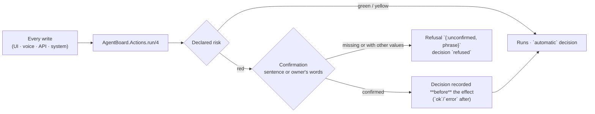

# Maintainer contract

Binding implementation rules for agent-board. [AGENTS.md](../AGENTS.md)
requires this guide when changing application behavior. Operator setup lives
in [README.md](../README.md); validation lives in [PIPELINES.md](../PIPELINES.md).
The general Elixir patterns behind these rules (network clients, per-item sync
isolation, LiveView loading and async jobs, claims before effects, test knobs) are
in the kit's [Elixir references](https://github.com/sallaumen/elixir-agent-kit/blob/v0.8.0/priv/library/ELIXIR.md);
this contract fixes the board's own values, events and limits, and wins where they
differ. Change a general rule upstream, not here.

## Main entry points

| Module | Role |
|---|---|
| `AgentBoard.Actions` | the one door for every write: each action's risk, its confirming sentence and its effect; refuses a red action without a confirmation; every decision a row |
| `AgentBoard.Board` | the context: repositories, tasks, comments, events, broadcast |
| `AgentBoard.Board.Requests` | opens a board request once: claim, receipt, issue, router line |
| `AgentBoard.Sync` | the GitHub sync: issues, pulls, reviews, checks, comments |
| `AgentBoard.Tickets` | what a runner ticket says about the task: the live state rule, pure but for the prepare-directory check |
| `AgentBoard.Sync.Worker` | the Oban job that runs the sync |
| `AgentBoard.TicketPoller` | the 10s poller that reads the runner's tickets |
| `AgentBoard.GitHub` | the HTTP client (`body!/1`, rate limits) |
| `AgentBoard.Orchestrator` | the runner's HTTP API: the load (`running`, `queued`, `maxWorkers`) and its two writes, `retry/2` and `set_max_workers/2` |
| `AgentBoard.AgentFailure` | what a `failed` report means: transient (network, provider) or a person's, pure |
| `AgentBoard.AutoRetry` | the automatic retry of a transient failure: `AutoRetry.Plan` (pure decision), the claim and the 30 s tick |
| `AgentBoard.AgentBlock` | what the board says about a failed ticket: the card line, what the system does, what is left to the owner, the attempts; pure |
| `AgentBoard.AgentControl` | the owner's two confirmed asks, run by `Actions`: "Tentar de novo" (`retry/2`) and "Religar o agente" (`start_agent/1`) |
| `AgentBoard.Metrics` | the throughput arithmetic, pure; `Metrics.Observations` reads what it counts |
| `AgentBoard.AI` | the door to a model: registered calls only, every one a row |
| `AgentBoard.Usage.Harness` | what the executor spent on a task, read from the harness transcripts; tokens measured, cost estimated |
| `AgentBoard.Executors` | who a task is for (`dsh`, `claude`, `codex`): the label and the issue body each gets; pure |
| `AgentBoard.Routing` | where a new task should go: `suggest/2` and `plan/5` (pure), `Signals` (what the door reads) and `record/3` (one `Decision` row per created task) |
| `AgentBoard.Attribution` | which task a session or a PR worked for: exact, `pr-link`, branch, repository or outside; pure |
| `AgentBoard.Usage.ClaudeCode` | what Claude Code spent, read from its transcripts (`~/.claude/projects`); one count per `message.id` across files, numbers and named metadata only (`Usage.Fields`) |
| `AgentBoard.Usage.Codex` | what Codex spent: the `threads` table by named columns (never `title`, `preview`, `name`, `first_user_message`) and the rollouts' cumulative totals as daily differences, plus the last `rate_limits`; zstd rollouts through `Usage.Lines` |
| `AgentBoard.DailySummary` | the summary of the day on a wall clock: the tick, the settings, one row per local day; `DailySummary.Facts` collects what it says |
| `AgentBoard.Usage.Ledger` | the usage ledger: one row per execution and UTC day for Claude Code, Codex and the harness, read from changed files only; `daily/1`, `limits/0` |
| `AgentBoard.Usage.Worker` | the Oban job (queue `usage`, every five minutes) that runs `Ledger.refresh/0` |
| `AgentBoard.Intake` | a free-text request -> refined spec -> tasks |
| `AgentBoard.Settings` | board-wide settings, one row per key (the voice picks) |
| `AgentBoard.Voice` | the spoken summary and the voice settings (language, volume, attention) |
| `AgentBoard.Voice.Phrases` | every sentence the agent speaks, per language |
| `AgentBoard.ElevenLabs` | the server-side voice client: TTS, STT, voices |
| `AgentBoardWeb.BoardLive` | the real-time UI |
| `AgentBoardWeb.BoardController` | the JSON API (`/api/...`) |
| `AgentBoardWeb.VoiceController` | the voice API (`/api/voice/...`) |

## The data

### Interface language

- The board interface defaults to English for a browser without a supported
  `board_locale` cookie. The only supported choices are `en` and `pt-BR`;
  unknown cookie values fall back to English, and the language form rejects
  unknown values. The form's return path is restricted to the board route.
- The browser pipeline sets the request locale and passes the validated value
  to the LiveView session. The LiveView sets its own Gettext locale on mount,
  because the HTTP request and connected LiveView run in different processes.
  The root HTML `lang` attribute follows the same validated preference.
- Interface language is per browser, and **the voice speaks it** (owner's
  decision, 2026-11-10; before, a board-wide `voice_language` setting spoke
  Portuguese under an English interface). There is no separate spoken-language
  setting: `BoardLive` reads the tab's language (`Locale.language/0`,
  `pt-BR` or `en-US`) into `@voice.language`, and every stage takes it from
  there: the phrases and the Announcer, the `language` given to the voice
  agent and to the inspector's answer, the transcription hint, the browser
  voice and the `language` of the speech URL, and what "What can I ask?"
  tells the owner to say. Code that runs outside the LiveView process (an
  async turn, a Task) carries the language in and sets its own locale. A
  saved `voice_language` row from an older version is ignored, never
  deleted. Changing the interface language never changes stored task data
  or anything the JSON API stores.
- User-facing interface copy uses Gettext, with English as the default message
  and `priv/gettext/pt_BR/LC_MESSAGES/default.po` for Brazilian Portuguese.
  Keep both languages complete when adding or changing a control, status,
  error, empty state, or accessible name.
- The rule for a sentence written outside the screens is **who reads it**.
  Text the LiveView renders from its own process goes through Gettext even
  when a domain module writes it (`Lanes`, `AgentBlock`, `Board.task_activity`,
  `Logs`, `Metrics.reason/1`, `Runners.fallback/1`). A confirmation sentence
  comes from `Actions.phrase/3` in the interface language
  (`AgentBoardWeb.Locale.language/0`); the gate accepts it in either
  supported language and records the one the person read. Text that is
  stored (events, retry notes, a superagent's last error), posted to GitHub
  or answered by the JSON API does not follow the interface language;
  spoken text does (above).
- Text written for no reader in particular is **English** (owner's decision,
  2026-11-10): what the board stores or logs once and shows later to any
  viewer. That is the voice activity's details and reasons
  (`Voice.Activity.record/4`), the subject of a retry event (`AutoRetry`,
  `AgentControl`, `AgentFailure.describe/1`), and the stored error of a
  superagent or a runner execution (`BotAccess`, `DshManager`, `Runners`). It
  is written in English whoever caused it and never translated at storage;
  rows written before that date stay in Portuguese. A screen that must read
  in the viewer's language words the fact from the row's kind and values
  (`Board.task_activity`, `AgentFailure.headline/1`), not from the stored
  sentence.
- What an action answers (`{:ok, text}` or `{:error, text}` from a retry, a
  restart, a grant, a dispatch) is written in the language of its
  confirmation: `Actions.run/4` runs the effect under that language, read
  from the sentence it was given or from `language:` for an action that asks
  nothing. A caller in a Task reads `Locale.language/0` before entering it.
- The routing reasons the composer shows ("You asked for Claude Code.") are
  the same value `Routing.record/3` stores with the task, so a decision is
  stored in the language it was shown in (owner's decision, 2026-11-10), as
  a confirmation sentence is. A reader without an interface language sets
  one: the JSON API plans under `pt_BR`, and the task that reads the
  signals for the composer carries the LiveView's locale.

- **Ecto migrations** own the schema. Never edit a migrated table by hand; add a
  migration.
- The task state is two-layered: the **issue** is the baseline (`open` →
  `queued`, `closed` → `done`) and the **ticket** is the overlay (`running`,
  `retrying`, `ready`, `blocked`) while the issue is open. `retrying` is a
  failure `AgentBoard.AutoRetry` will retry by itself, or a retry waiting
  for a worker ("Automatic retry" below). A ticket that ended `merged` is
  `done` whatever its last report said. An issue keeps every ticket it ever
  had, and one speaks for it: the open one, else the most recently updated
  (`Tickets.by_number/1`, used by the sync, the ticket poll, the board and
  the voice lookups, each over its own repository's tickets). A stopped or
  archived task keeps its state.
- The sync's insert sets the baseline once and keeps the state on conflict,
  so an overlay is not reset to `queued` every five minutes. A **closed
  issue** is the exception: every sync moves its task to `done`, unless it
  is stopped or archived (`Sync.close_task/2`). Before this, an issue closed
  after it entered the board stayed in Fila (the queue) while the runner had
  nothing to do (`sync_repo_test.exs`). A **reopened issue** moves its `done`
  task back to `queued`, unless it is stopped or archived
  (`Sync.reopen_task/3`); the tickets and `Board.reconcile_resolved_tasks/1`
  run after it in the same sync, so a merged ticket still makes it `done`.
  Only an issue whose `updated_at` is newer than the task's
  `state_changed_at` is reopened, so that `done` is not redone every sync.
- A **blocker task** points at the task it unblocks through
  `tasks.blocker_for_task_id`. It is created through the same `create_tasks`
  action as any request, with the agent's mention and the link; the queue
  puts it ahead of ordinary queued work and the board shows "desbloqueia #N".
  The blocked task stays blocked until a person answers or the agent retries;
  the blocker task is a separate issue, not a state change on the original.
- A review rollup is the strongest review (`changes_requested` beats `approved`);
  a check rollup names the failing check.

## Board actions (the action registry)

Every write the board makes goes through `AgentBoard.Actions.run/4`: the
interface, the voice, the API and the board's own automatic work. Each action
declares its **risk**, the **sentence that confirms it with the real values**
(what, for whom, where) and the function that runs it. Decided with the owner
on 2026-11-07 (`docs/research/alfred.md`, F2.3): the gate is in the code, not
in a prompt, and it is the prerequisite of any dispatch that spends money.

- **Risk.** Green only reads. Yellow changes something the board can change
  back. Red sends something outside, spends money or has no way back.
- **A red action always needs a confirmation, and the code refuses it
  without one**: `run/4` answers `{:error, {:unconfirmed, phrase}}`, records
  the refusal and runs nothing. A confirmation is either the **sentence**
  the person saw or heard (`confirm: phrase`; it is rebuilt from the values
  at run time, so a task renamed or another repository since the question
  is refused with `{:phrase_changed, phrase}`) or, for the two actions that
  take it, the **owner's own words** ("cria direto" for a voice create,
  "desfaz" for its undo), checked by `Actions.direct_order?/2` and never
  taken from the model's flag alone. In the task conversation, the owner
  confirms `ask_task` by writing the message in the open task and pressing
  **Enviar** beside the visible GitHub destination note. The UI builds the
  phrase from that exact task and message for the gate in the same submit;
  there is no second confirmation card.
- **The one exception is a standing authorization written here**: the
  automatic retry of a transient failure (below), for the actor
  `auto_retry` only. A new one is an owner's decision recorded in this
  contract first.
- **One sentence on the screen and in the voice**: `Actions.phrase/3`. The
  confirmation in the interface shows it, the voice proposal says it (in the
  tab's language; `Speakable` reads `#12` as "12"), the API answers it.
- **Every decision is a row** in `action_decisions`
  (`AgentBoard.Actions.Decision`): `confirmed`, `automatic` or `refused`;
  by whom (`owner`, `auto_retry`) and through which door (`ui`, `voice`,
  `api`, `system`); the evidence (`phrase`, `words`, `standing`); the
  sentence; the subject; and the outcome. An executed decision is written
  before the effect and gets `ok` or `error` after. A person's no (Cancelar,
  "não", "Voltar e editar") is `refused` with `declined`.
- **A new write is a new action**: its risk, its sentence and its effect in
  `Actions`, a test in `actions_test.exs`, and, when red, a confirmation on
  every door that offers it.



The single exception is the standing authorization written in this contract
(the automatic retry of a transient failure, actor `auto_retry`): it waives
the question, but still records the decision as `automatic` with the evidence
`standing`.

The inventory (2026-11-07). The Confirmation column says where the
confirmation lives on each door; a yellow or green action runs on the click
and is recorded as `automatic`.

| Action | Risk | Effect | Confirmation |
|---|---|---|---|
| `create_tasks` | red | opens GitHub issues that mention the agent (`Board.Requests.create_request/3`, once per request key while its task has not ended) | UI: the composer shows the sentence above the send button and the send carries it; the intake panel's Create asks it in the browser (`data-confirm`). Voice: proposal and yes, or "cria direto". API: `428` then `confirm` |
| `ask_task` | red | comments on the issue with the mention | UI: the message form names the GitHub destination; Enviar confirms the typed text in one step. Voice: proposal and yes |
| `stop_task` | red | closes the issue and marks the task stopped | UI: `AgentAction` "Parar". Voice: proposal and yes. API: `428` then `confirm` |
| `undo_created_task` | red | closes the issue the voice just opened | Voice: "desfaz" within 10 minutes; a proposal when the model read an undo without the word |
| `archive_task` | yellow | takes the task off the board (Retomar undoes it) | UI: one click. Voice: proposal (kept). API: direct |
| `resume_task` | yellow | puts the task back in the board's queue (does not reopen the issue) | UI: one click. API: direct |
| `retry_ticket` | red | `POST tickets/<id>/retry` asked by the owner; the executor spends tokens | UI: `AgentAction` "Tentar de novo" / "Tentar agora" |
| `auto_retry_ticket` | red | the same request, asked by the board after a transient failure | System: the standing authorization ("Automatic retry"), `auto_retry` only |
| `release_task` | red | comments the mention that starts a task that was waiting, or again on a called task still in the queue; standing authorization for `release` (ADR 0005) | System: the standing authorization ("Release in order"), `release` only. UI: "Chamar o agente" in the tree and "Chamar de novo" in Precisa de você ask the sentence in the browser (`data-confirm`) |
| `dispatch_task` | red | starts Claude Code or Codex in a worktree; spends the owner's subscription | UI: `AgentAction` "Despachar" in two steps, with the sentence, executor, task, repository and ceiling; voice/API: `428` then `confirm` |
| `stop_execution` | red | kills the active tmux session, records `stopped` and leaves the task blocked | UI: `AgentAction` "Parar execução" in two steps; voice/API: `428` then `confirm` |
| `provision_superagent` | red | creates the profile, port, state and setup of a new DeepSeek project | UI: the Superagentes panel's "Adicionar projeto", preview then confirm |
| `start_superagent` | red | starts the DeepSeek superagent of one project | UI: `AgentAction` "Ligar" in the Superagentes panel, two steps |
| `stop_superagent` | red | stops that superagent; in-flight work is interrupted | UI: `AgentAction` "Parar", two steps |
| `pause_superagent` / `resume_superagent` | yellow | pauses/resumes new work without killing the process | UI: one click |
| `retry_provision_superagent` | red | runs a failed provisioning again with the stored source and checkout, one attempt at a time; it refuses a profile or state it did not create | UI: `AgentAction` "Tentar de novo" on the failed project, two steps |
| `remove_superagent` | red | stops the agent, archives profile/state and removes the project from the board | UI: `AgentAction` "Remover", two steps |
| `scale_superagent` | yellow | changes `maxWorkers` through the DSH settings API | UI: −/+ on the project card |
| `grant_agent_access` | red | puts a person on one project's `allowed` list through the DSH settings API and, when the sentence names issues, requeues their refused mentions | UI: `AgentAction` "Liberar" / "Liberar e rodar" on the project in Configurações → Projetos |
| `revoke_agent_access` | red | takes a person off that list and sets their old mentions aside; mentions on issues without a ticket are ignored, those on issues with a ticket may still be weighed as a follow-up, and their open tickets may be refused (the repository owner cannot be removed) | UI: `AgentAction` "Revogar" |
| `dismiss_access_request` | yellow | sets a request aside until the person mentions the bot again (`agent_access_dismissals`) | UI: one click on "Dispensar" |
| `start_agent` | red | runs `dsh-superagent start` on this machine; clears a stop made on purpose | UI: `AgentAction` "Religar o agente" |
| `set_max_workers` | yellow | `PUT settings/executor` with the new ceiling (− and + undo it) | UI: one click on the Paralelismo tile |
| `add_repository` | yellow | tracks a repository | UI: settings menu. API: direct |
| `change_setting` | yellow | one board preference: the voice (language, volume, speed, engine, voice, model…; a paid engine stays under its daily cap) or the daily summary (on/off, the hour) | UI: voice menu and daily summary settings. Voice: "mais devagar/alto" (slower/louder). API: `PUT /api/voice/settings` |
| `dismiss_summary` | yellow | takes the day's summary off the screen (the row stays) | UI: one click on the summary card |
| `forget_conversation` | red | deletes the voice conversation's memory | UI: "Esquecer conversa" asks the sentence in the browser. Voice: proposal and yes |
| `sync_now` | green | queues a sync (a read of GitHub) | UI: one click |
| `update_board` | yellow | fast-forwards this checkout to `origin/main` | UI: "Atualizar", shown only when behind |
| `restart_board` | yellow | restarts the board's server | UI: "Reiniciar", and after an update |

Outside the registry, on purpose:

- **Paid reads** change nothing outside the board and have their own gates:
  the model calls (`AI.Registry`, `Budget.check/1`, a row in `ai_calls`) and
  the ElevenLabs speech (`ElevenLabs.Usage`, the daily cap).
- **The mirror** stores what it read: the sync, the 10 s poller,
  `Sync.close_task/2`, `Board.reconcile_resolved_tasks/1`.
- **The board's own records**: events (`Board.log_event/4`), the voice
  turns and their proposal states (`Conversation.record/3`, `settle/2`,
  `mark_*`), the claims in `agent_retries`, the day's summary row and its
  spoken claim (`DailySummary.tick/1`, `claim_spoken/1`), the ledgers, the
  caches and the voice activity ring.

The tests: `actions_test.exs` (one test per action, every red action
refused without a confirmation, a sentence for other values refused, the
standing authorization scoped to its actor, the words, the record written
before the effect, and a read of `lib/` that fails on an effect called
outside `Actions`), `board_actions_test.exs` (the screen: a stop event
without the sentence refused, the registry's sentence in "Parar", the
question in two steps, a no recorded), `board_controller_test.exs` (the
`428` and the echo), `conversation/agent_test.exs` (the proposal's
sentence, a changed task refused on the yes, the model's `direct` flag
without the words still asks, forget asks first) and the existing
`board_agent_failure_test.exs` and `commands_test.exs` (the confirmations
that already worked).

## Workpad

- The agent keeps one comment per issue, edited in place, headed
  `## Relatório do agente` (Agent report) with the sections `### Plano`
  (Plan), `### Validação` (Validation), `### Pergunta` (Question) and
  `### Bloqueio` (Block), from the Communication prompt
  (`docs/agent/prompts/communication.md`). `AgentBoard.Workpad.parse/1` reads
  it by section name; any other comment is `nil`, and an empty section is
  `nil`: the parser never invents a question, a block or a gate.
- When the newest agent comment on a task is a workpad, its fields decide: a
  filled Pergunta (Question) makes a `waiting` ticket a `question` with or
  without a "?" (`Board.agent_asked?/2`, `Sync.waiting_state/2`), a filled
  Bloqueio (Block) makes it `blocked` even when the ticket opened a PR, and
  the item in Precisa de você (Needs you) quotes the section, never the whole
  comment.
- A person's answer puts the task back to work. The runner records each
  message it delivered to a worker in the ticket's `inputs[]` (`kind:
  "trigger"`, `human: true`, `deliveredTo`, `readAt`); `AgentState` keeps the
  newest one the current Assignment read as `answered_at`. A `waiting` or
  `blocked` report older than that answer no longer decides: the task is
  `running` (`Tickets.answered_at/1`), its card in Agora (Now) says when the
  answer was read, and the silence clock counts from it. A newer report, a
  worker idle after the answer, or an ended ticket decide again. The evidence
  is the runner's record, never a comment's text: the owner's comment before
  it is read, or the agent's "On it" reply, change nothing by themselves. The
  board only reads this; it asks nothing of the runner
  (`sync_test.exs`, `ticket_poller_test.exs`, `board_stall_test.exs`).
- Validação (validation) is the local CI of the PRs the ticket and the
  workpad name (`LocalCI.by_pr/3`, scope `:workpad`): the command, its result
  and the sha it ran on. Without a `mix precommit` line, any failing gate is the result. The sha is checked against the PR's head
  (`pull_requests.head_sha`, written by the sync): a gate on another commit
  is `:stale`, shown as `CI local ?` with both shas in the tooltip, never as
  a pass. A head the sync has not written yet cannot contradict the gate.
- Without a workpad, or with the section empty, the text heuristics stay
  exactly as before: a "?" in the summary or in the newest comment, "PR" with
  "review" in the report, `mix precommit` sentences in the reports.
- The tests: `workpad_test.exs` (the parser), `sync_test.exs`,
  `board_test.exs`, `local_ci_test.exs` and `work_test.exs` (preference and
  fallback), `board_live_test.exs` and `board_workpad_test.exs` (the item
  quotes the question; the gate reaches the card from a waiting ticket).

## Real-time

- The sync (the Oban `Sync.Worker`, every five minutes) and every task action call
  `Board.broadcast/1`; the LiveView subscribes with `Board.subscribe/1` and
  reloads on `:board_updated`.
- `AgentBoard.TicketPoller` polls the agent's tickets every 10s and broadcasts only
  when their hash changed — the runner state reaches the board without waiting
  for the sync. It is idempotent: the same tickets never broadcast twice and
  are never written twice; the hash covers the overlay it computes (which
  reads the agent's comments), so a new comment still moves the task, and a
  task changed by another writer is set back by the next sync
  (`ticket_poller_test.exs`). The interval is the `:ticket_poll_interval` knob; the test
  environment stretches it to an hour so the supervised poller never ticks
  into the sandboxed database mid-suite.
- **The sync's GitHub budget.** The account's 5000 REST calls an hour are shared
  by every repository and every tool using the token. A pull stored as merged or
  closed at the same commit is not read again (reviews, checks) unless its checks
  were still pending; an open pull is read on every sync (`sync_repo_test.exs`,
  "the GitHub quota"). Reading every recent pull cost about 600 calls per run with
  three repositories, and the board froze for the rest of each hour. Issues
  and pulls are read past the first page, so nothing updated since the last
  completed sync (an hour early) is skipped; each read stops at 10 pages, which
  bounds a first import (`sync_pages_test.exs`).
- `AgentBoard.MessagePoller` reads recently updated GitHub issue comments once
  per active repository every 30s when a GitHub token is configured. It follows
  pagination, stores only comments for tracked tasks, broadcasts only for new
  or edited content, and keeps its cursor and last good messages on failure.
  The cursor lives in memory: after a restart the first read goes back to the
  repository's last successful sync before the boot, never less than ten minutes,
  so a reply posted while the board was down is read; a long backlog is read
  in page-limited steps (`message_poller_test.exs`). GitHub's rate-limit response delays that repository's next read. The normal
  five-minute sync remains the fallback, including without a token.
- The top-right message window reads the newest agent reply per task from the
  board's comments and uses a browser-local read version. Editing a workpad
  therefore marks that conversation new again. “Marcar todas como vistas” saves
  the versions of the conversations currently in its 30-item window; the unread
  filter follows that same browser-local state. This action does not change
  comments or task status. Each unread row also has a quick read action that
  checks the latest reply and accepts only the version shown when clicked, so
  an edited reply stays unread. The header controls remain reachable while
  scrolling the board. The separate bell counts active
  blocked, question, review and long-running tasks across projects; it is a
  pending-work count, not an unread count. Both lists follow the board's PubSub broadcasts.
  Before them sits DeepSeek's rate (`BoardComponents.PeakRate`): a flame
  while `Providers.peak?/1` holds, a moon while every token costs half, the
  sentence on hover and, opened, the owner's day in local time with its peak
  windows and the next change (`Providers.next_rate_change/1`). The rate
  hour broadcasts nothing, so the page's one timer also covers it; the
  browser polls nothing (`peak_rate_test.exs`, `board_live_test.exs`).
- Never poll the database from the browser; push.
- The board is read once per render of the page (in `handle_params/3`, never
  also in `mount/3`), again on every task action and once per burst of
  `:board_updated` (and of Hoje's `{:today_updated, _}`), and never for a
  patch inside the same repository: opening a task, a panel or a tab changes
  only the panel. The first broadcast schedules the reload `:board_reload_ms`
  later (300 ms; 0 in tests, which reloads at once) and the broadcasts until
  then join it, so a burst costs one read and one announcement of the whole
  change. Every read is the `[:agent_board, :board, :load]` telemetry span, on
  the dashboard as `agent_board.board.load` (`board_load_test.exs`).
- The **runner** writes its status in a run directory; `Runners.Ticker`
  reads it and calls `Board.broadcast/1` on the task's repository, so the
  inspector and the Execuções (Executions) tab follow without a reload.
- The **Hoje** (Today) view reads every repository in the same board load
  (`Overview.today/0` and `Usage.Report.today/0`), never in a render. Because it
  shows all repositories, `Board.broadcast/1` also emits
  `{:today_updated, repository_id}` on the `board_today` topic; the view
  reloads on the other repository's change, and the current repository's
  change already arrives as `:board_updated`. A board on a repository does
  not listen to that topic for work it does not show.

## Silence

- A running ticket's **last signal** is derived on every render by
  `AgentBoard.AgentSignal`: the newest of the runner's own timestamps
  (`report.at`, `idleAt`, `startedAt`) and the worktree's last change
  (`AgentWorktree.last_activity_at/1`: the newest uncommitted file, else the
  last commit; ignored files such as `_build` are not evidence). It is
  written nowhere: not in `tasks`, never in the runner's sqlite.
- The worktree is observed once for both the signal and the card's step (one
  `git status`, at most one `git log`), and the observation is shared by
  every render for `:worktree_ttl_ms` (10 s, the poll interval; 0 in tests),
  in memory only (`AgentWorktree.Cache`). A render therefore shows the
  worktree as it was at most 10 s earlier; a fresh read per render cost 40 ms
  of `git` per running ticket, per LiveView, per broadcast.
- Past `:stall_after_ms` (default 15 min) the silence is shown: the Agora (Now)
  card says "sem sinal há N min" ("no signal for N min") and its glyph stops
  pulsing, and the task enters Precisa de você as `:stalled`, after blocks and
  before reviews, with the moment it crossed the threshold as its age and as
  what "novo" (new) means. The item's DOM id is `silence-<id>`: the task's
  card is still in Agora.
- The voice says it once, when the item first appears in the needs list
  (`Announcer`, the `:needs` option), and stays quiet while it remains.
- The item says what the board saw last (a report, a worktree change or the
  start) and when; it never says the agent died. A long model turn with no
  file change is a silence too (ADR-0003, "não verificado (a)").
- Its only action opens the task. The board does not retry or stop the
  ticket in the runner: the automatic retry (below) covers only a `failed`
  report, never a silence, and the runner refuses a retry
  while a ticket runs (`canRetry` in `dsh: src/core/stage.ts`).
- A long run is the other derived item, and only a heads-up. A `running`
  task whose work has lasted past the time its size allows
  (`Lanes.slow_after/1`: S 20 min, M 40, L 60, no size 60; the owner's
  numbers of 2026-11-10) enters Precisa de você as `:slow` ("Demorando",
  "Taking long"), last in the list, in the stale tone, with since when it
  works, the limit that made it an item and the last signal when there is
  one. The work counts from `state_changed_at`, the moment the task last
  became `running`: a retry or the owner's answer starts it again, and time
  spent waiting is not work; the Now card's clock counts the same span. It never says the agent is stuck, and a task
  that is also silent shows only the silence. Derived on each read and
  written nowhere: it leaves when the task leaves `running`. The voice says
  it once, like the silence. Its DOM id is `slow-<id>`. The bell lists it
  too, on every project, with the moment the limit passed. Nothing broadcasts
  a task that goes quiet, so each open page holds one server timer for the
  next long run or silence (`Lanes.next_attention_in/4`) and reloads at that
  moment; the browser polls nothing (`lanes_test.exs`, `announcer_test.exs`,
  `inbox_test.exs`, `board_live_test.exs`).
- The tests: `agent_signal_test.exs` and `agent_worktree_test.exs` (the
  signal), `work_test.exs` (the lane, its text and its order),
  `announcer_test.exs` (spoken once) and `board_stall_test.exs` (rendered in
  both lanes).

## Automatic retry

The board's first write in the runner (the ceiling, under Boundaries, is the
other), authorized by the owner on
2026-11-07 after a reboot left six tickets `failed` on a dead network
(ADR-0003, "Retentativa automática"). `AgentBoard.AutoRetry` asks
`POST tickets/<id>/retry` (`Orchestrator.retry/2`) and nothing else; the
board still never writes the runner's sqlite. The request is the registry's
red action `auto_retry_ticket`, and this and `release_task` (ADR 0005) are the only standing
authorizations the gate knows ("Board actions" above): it covers the actor
`auto_retry`, each request is an `automatic` decision with the evidence
`standing`, and nothing else may ask for a retry without a person.

- **Only a transient failure.** The latest Assignment's report is `failed`
  and `AgentFailure.classify/1` reads its summary as the network or the
  provider: the model's transport, a host that did not resolve, a
  connection refused or reset, a timeout, a rate limit, a 5xx. An unknown
  text, a refused credential, a test failure or a command the runner
  aborted at its own deadline need a person. A prepare failure that left
  files in the ticket's directory needs a person too: the runner would
  take them for a prepared worktree (`dsh: src/executor/dsh.ts`,
  `PrepareFailed`).
- **Three retries per streak, after 1, 5 and 15 minutes.** The streak is
  the trailing Assignments that failed, counted from the runner's own
  `endedReason: "retried"` (whoever asked), back to the last report that
  was not a failure. A fourth failure is `:exhausted`: the owner decides.
- **Once per Assignment.** A row in `agent_retries` (unique
  `assignment_id`) is claimed before the request; a board restart or a
  second board on the same database cannot ask twice. Only an unanswered
  request (`unreachable`, `timeout`) may be claimed again, after 60 s and
  while the same Assignment is still the latest failure. The runner's
  `canRetry` is the second guard: it refuses a ticket whose latest
  Assignment did not fail.
- **Only when the ticket's agent answers.** A tick with something due asks
  each agent that holds a due ticket `GET /state` first and sends that agent
  nothing when it fails; a tick with nothing due sends nothing at all.
- **Every request is recorded**: the row, a log line `auto_retry ticket=…
  outcome=…`, and an `agent_retry` event (`agent_retry_error` when the
  runner refused or did not answer) in the activity of each repository the
  ticket worked.
- **Switch:** `AGENT_BOARD_AUTO_RETRY=0` (`config :agent_board,
  auto_retry: false`) makes a board read-only again, for a second board on
  another database.
- **Why not the runner's own retry:** the runner retries a turn that failed
  for a passing reason three times within about two minutes (15/30/60 s,
  constants in `dsh: src/executor/dsh.ts`, not configurable) and never
  retries a failed prepare on purpose; an outage longer than that, like a
  boot without network, ends in `failed` and waits for a person.
- The tests: `agent_failure_test.exs` (the classification),
  `auto_retry_test.exs` (plan, delays, streak, limit, once per Assignment,
  orchestrator down, unanswered and refused requests, the switch) and
  `orchestrator_test.exs` (the request and its reasons).

**What the board shows** (`AgentBoard.AgentBlock`, one source for the card,
Agora and the detail):

- A ticket the board retries by itself is `retrying` (`Tickets.state/2`
  asks `AutoRetry.Plan.plan/2`; a retry still waiting for a worker is
  `retrying` too). It is a row in **Agora**, after the running cards, not an
  item in Precisa de você: nobody has to act, the system is on it, and
  Agora is where the board says what is happening now. The row says what
  failed and when the next attempt goes out ("Falha de rede ao chamar o
  modelo. Nova tentativa automática às 14:20 (2 de 3)." — "Network failure
  calling the model. Automatic retry at 14:20 (2 of 3)."). Entering
  `retrying` is silent (`Announcer`); leaving it for `blocked` is the call.
- When the retries ran out or the failure is not transient, the task is
  `blocked` and its item in Precisa de você says what failed and the step
  left to the owner, never only the raw error.
- When the orchestrator does not answer `GET /state` (asked in the background
  once per load, the same answer as the throughput strip), the blocks and
  silences collapse into **one** item, "Agente fora do ar" ("Agent offline"), with "Religar o
  agente" ("Restart the agent"). A board with the API switched off does not
  know, and collapses nothing.
- The detail of a failed task shows the headline, what the system will do,
  what is left to the owner, the whole error and every Assignment as an
  attempt (when, what happened, whether the board or a person asked for the
  retry).
- **Every action asks first** (`AgentBoardWeb.BoardComponents.AgentAction`):
  the first click shows the registry's sentence (`Actions.phrase/3`), only
  the confirmation acts and carries that sentence to the gate, Cancelar is a
  recorded refusal, the button shows a loading state and the result stays
  in place.
  "Tentar de novo" / "Tentar agora" is the same `POST tickets/<id>/retry`,
  asked by the owner and recorded as `agent_retry_manual`; "Parar" keeps
  the board's stop (`act`), now behind a confirmation; "Religar o agente"
  runs the prototype's manager (`python3 scripts/dsh-superagent start`,
  idempotent, `DSH_SUPERAGENT_HOME`) on this machine, never from the
  browser, and clears a stop made on purpose because the owner asked.
- The tests: `agent_block_test.exs` (every sentence), `sync_test.exs`
  (`retrying`), `work_test.exs` (the item, the Agora row, the collapse),
  `announcer_test.exs` (quiet, then the call), `agent_control_test.exs`
  (both actions and their sentences) and `board_agent_failure_test.exs`
  (rendered lanes, confirm, cancel, loading, result, Parar, Religar).

## The voice

- The server builds the summary (`AgentBoard.Voice` — the model writes it
  when it can, the template is the fallback) and pushes it with
  `push_event/3`; the browser speaks it with the Web Speech API. That path
  runs no TTS engine on the server.
- `AgentBoard.ElevenLabs` is the server-side voice (TTS, STT and voices),
  exposed by `AgentBoardWeb.VoiceController` at `/api/voice/...`. It reads
  `ELEVENLABS_API_KEY` from the environment, never from code, and returns
  `{:ok, ...}` or a reason (`:not_configured`, `:auth_expired`,
  `:usage_limit`, `{:http, status}`) — a raise never reaches the caller.
  **Bounded retry** (`AgentBoard.ElevenLabs.Retry`, decided with the owner
  on 2026-11-07): only failures with nothing to pay for are retried — a
  transport error where the connection never opened (refused, unknown host,
  no route; a timeout or a closed connection may already be billed and is
  final), a 429 (honoring `retry-after` up to 2 s) and a 500/502/503/504 —
  at most twice, with a growing delay; a 4xx
  about the key, voice or text is final, and a stream is never retried after
  its first chunk reached the browser. Every retry is a voice activity
  event. The AI calls keep "no retry" below. The key never reaches the
  browser: the endpoints answer with audio or a transcript.
- **ElevenLabs spending is a ledger** (`AgentBoard.ElevenLabs.Usage`, table
  `eleven_labs_usage`, one row per UTC day): the client records every paid
  TTS answer (characters from `x-character-count`, else the text length) and
  every transcription (`audio_duration_secs`) where the 200 arrives; the
  controller records cache hits at zero cost. A retried failure records
  nothing. `over_cap?/0` compares today with `ELEVENLABS_DAILY_CHAR_CAP`
  (default 20000, 0 = none) and the call that crosses it records one voice
  activity event a day; the cap itself never refuses a call, the voice
  routing reads `over_cap?/0`. A ledger write that fails is logged and
  skipped, never a failed speech. `GET /api/voice/status` and the
  "Bastidores da voz" (Voice backstage) summary show today's totals.
- **Voice activity** (`AgentBoard.Voice.Activity`): each stage of a turn,
  every retry and every failure (server, or browser via
  `voice_client_error`) is one event: a log line `voice stage=… status=…`,
  a broadcast on the `"voice:activity"` PubSub topic shown live in the
  voice panel ("Bastidores da voz"), and an entry in a 60-event ring. It
  never carries a secret or a whole utterance.
- **Settings forms opt out of form recovery** (`phx-auto-recover="ignore"`):
  they mirror saved settings, and recovery re-sent them on every reconnect
  (a picker without a value crashed the board; the language confirmation
  replayed). `BoardLive.handle_event/3` ends with a clause that records an
  unexpected event instead of raising.
- The voice the agent speaks with resolves in this order: the environment
  (`ELEVENLABS_VOICE_ID`) → the pick saved in the UI (`AgentBoard.Settings`,
  key `elevenlabs_voice_id`) → the default (George). The TTS model resolves
  the same way (`ELEVENLABS_TTS_MODEL` → `elevenlabs_tts_model` → the
  default `eleven_flash_v2_5`); a saved model must be one of the offered
  `AgentBoard.ElevenLabs.tts_models/0`. The Voice section of the settings
  menu lists the account's voices and **saves a voice when it is picked**,
  like every other field there (a separate "Salvar" left picks unsaved);
  the name is kept with it (`elevenlabs_voice_name`, filled from the list
  when missing) so the picker names the voice in use after a reload, and a
  note says what that voice speaks under the chosen engine. It previews
  through `/api/voice/speech?voice=...`, the API saves with
  `PUT /api/voice/settings`,
  speaks the board status in the agent's voice and dictates a task through
  `/api/voice/transcribe` (MediaRecorder → Scribe). The controls are
  `AgentBoardWeb.Components.VoicePanel` (rendered by the settings menu) and
  its two JS hooks (`VoicePlayer`, `VoiceRecorder`) live in
  `assets/js/hooks/`; the presentation stays out of `BoardLive`.
- The endpoints refuse what would cost a wrong request before the network:
  a text over 5000 characters (400), an audio body over the cap (413,
  `:voice_audio_max_bytes`), a voice id that is not voice-shaped (400) and
  a TTS model outside the catalog (400).
- The account's voices are cached for the `:voice_voices_ttl` window
  (default 5 minutes, 0 disables — the test env disables it); a browse
  does not pay a request every time.
- **Settings are board-wide and live**: `AgentBoard.Settings.put/2`
  broadcasts `{:setting_changed, key}` on the `"settings"` topic and every
  `BoardLive` re-reads its voice assign, so a change in another tab, by the
  API or by a spoken command reaches every open board without a reload.
- **Every spoken word comes from `AgentBoard.Voice.Phrases`**, or from
  Gettext under the turn's language (the replies given without a model,
  `VoiceCommands`), in the language of the tab that speaks ("Interface
  language" above). A sentence typed in one language inside a caller is the
  mix this rule prevents. The prompts receive the language and name both;
  the speech endpoint takes the `language` of the request and sends
  `language_code` only to Flash v2.5 (another model answers 400); without
  one it sends no hint and the model reads the language from the text. The greeting uses the
  browser's clock (`tz_offset`), never the UTC hour.
- **Automatic speech** is `AgentBoard.Announcer`: a pure diff between the
  previous and the current board, spoken as **one utterance per update**
  (a second `voice_play` cuts the first off), capped at two sentences and
  deduped for a short window. Two kinds:
  - **attention**: a task entering `question`, `blocked` or `ready`. It
    comes first, rotates through ten phrases per kind (`voice_turn`, a
    random start per socket) and has its own toggle (`voice_attention`,
    `"0"` disables). Without an ElevenLabs key it falls back to the
    browser's voice, in the tab's language.
  - **events**: a task starting or going back to the queue and sync
    outcomes getting worse, plus the confirmations of user actions and the
    spoken answers; toggled by `elevenlabs_speak_events` (`"0"` disables,
    absent is on). User actions speak their own confirmations, so they are
    not announced twice.
  The volume (`voice_volume`, 0..100) rides on `#voice-panel[data-volume]`;
  the `VoicePlayer` hook and the browser fallback read it, so a change
  applies to the audio already playing. `PUT /api/voice/settings` accepts
  `speak_events`, `attention`, `language` and `volume`.
- **The spoken conversation** (`docs/voice-conversation.md`) is the default
  for a double Space outside the composer: the `VoiceCommand` hook ends the
  turn on silence and pushes `voice_turn`; `AgentBoardWeb.VoiceConversation`
  records it, runs `AgentBoard.Conversation.Agent` keyed by a `ref` (a newer
  turn cancels an older one, `:voice_turn_timeout_ms` drops a slow one) and
  speaks the reply. Memory is `voice_turns` (summary + recent turns); the
  model call is `:voice_agent`, the summary `:summarize_conversation`.
  **Writes wait for a spoken yes**: create, stop, archive, ask and forget
  become a proposal (`proposal_status`) that says the registry's sentence
  (`Actions.phrase/3`, kept in the proposal with its language), settled
  once by a conditional update; yes and no are recognized locally. A yes is
  an answer made only of affirmative and filler words ("ok, valeu"), a no
  word anywhere is a no ("pode cancelar"; English "no" only alone, it is
  Portuguese for "in the"), anything else goes to the model. A proposal
  waits only while it is the agent's last turn ("repete" keeps it). The yes
  passes that sentence to `AgentBoard.Actions`, so a task that changed in
  between is refused ("Não fiz nada: algo mudou desde que perguntei" — "I did
  nothing: something changed since I asked") and the no is a recorded
  refusal. The model's `confirm` runs nothing (a real yes is answered before
  the model): the proposal is said again. `:voice_agent` refines a request itself (title, acceptance
  criteria, or one question): no second model call.
  The one exception is a **direct create**: only when the owner says so
  ("cria direto", "já cria", "sem perguntar": the model's `direct` flag
  **and** the owner's words, checked by `Actions.direct_order?/2`) the task
  is created at once,
  recorded as `%{"kind" => "created"}` with `proposal_status` `done`, and
  "desfaz" closes it (`Board.stop_task/2`) within 10 minutes, claimed once
  (`done` → `undone`). A task that already existed is never undoable.
  A project named out loud that matches nothing is said ("Não acompanho
  nenhum projeto chamado…" — "I don't follow a project called…"), never
  replaced by the one on screen; stop, archive and ask resolve it the way
  create does, and the proposal says which when it is not the one on screen.
- **Voice reads** (`look`) never write: `AgentBoard.Conversation.Lookup`
  reads the board's own data (tasks, PRs, the runner's tickets, the voice
  activity ring) and the registered `:voice_explain` call answers only from
  those facts, with ages precomputed in minutes. A missing task, an empty
  search or no project is said without a model call. The catalog the owner
  sees ("O que posso pedir" ("What can I ask"), the spoken "ajuda" (help)) is
  `AgentBoard.Voice.Commands`; a new lookup kind is added there and to the
  `:voice_agent` schema together (a test compares them). "Status",
  "ajuda", "desfaz", "repete" and the voice adjustments are local: no
  model, no cost.
- **Playback** goes through `/api/voice/stream` (ElevenLabs streaming) and
  `AgentBoard.ElevenLabs.SpeechCache` (short texts, keyed by every input
  that changes the audio, bounded, off in tests; ETS in front of the
  durable `voice_speech_cache` table, so a fixed phrase is paid once, not
  once per restart). Every spoken text passes
  `AgentBoard.Voice.Speakable.clean/1` (via `AgentBoardWeb.VoiceSpeech`).
  Speed (`voice_speed`), intonation (`voice_style` → stability), pause
  (`voice_pause`) and microphone sounds (`voice_earcons`) are settings. The conversation never reaches the coding
  agent except through the board actions a button would take.
- **Input default** (owner's decision, 2026-11-09): text uses a visible field
  (`voice_input` = `text`) without opening a dictation window. Wispr Flow
  typing into the board (`voice_input` = `wispr`, the `VoiceWispr` hook sends
  dictated text once it settles) and the board's recorder with ElevenLabs
  Scribe (`microphone`) remain explicit settings; saved `wispr` preferences
  remain valid. Every
  utterance is routed by `AgentBoardWeb.VoiceSpeech.push/3`: the free browser
  voice by default (`voice_engine` = `browser`), ElevenLabs only for calls in
  `mixed` or for everything in `elevenlabs`, and never without a key or past
  the day's cap. Free replies speak their first sentence (`voice_replies` =
  `short`); narration (`voice_narrate`) is off by default.
- **Voice asks** are a write and always confirmed: the conversation's
  `ask_task` action becomes a proposal naming the task and the question,
  and only the spoken yes posts it (`Board.ask/3`, a comment with
  `@sallaumen-agent`). Its reply — the first new agent comment on the task
  after the confirmation that is not the workpad, within a day — is spoken
  once on a board update (`Conversation.arrived_answers/1`, claimed by the
  conditional `mark_answered/1` so a second tab stays quiet), joins the
  memory and is silenced by `voice_attention`. "Repete" (repeat) and "mais
  devagar/rápido/alto/baixo" (slower/faster/louder/quieter) are local commands
  of the conversation, no model. The old draft panel
  (`VoiceCommand.draft`, `VoiceMutations`, `VoiceActionConfirmation`) was
  removed; `AgentBoardWeb.VoiceCommands` stays as the no-model fallback and
  `AgentBoardWeb.VoiceAnswer` only feeds the board AI evaluation.

## AI calls

- **A call must exist in `AgentBoard.AI.Registry`.** The prompt comes from
  code; a caller cannot invent one. Adding a call is a PR with a test.
- **Every call is a row** in `ai_calls` -- engine, model, tier, tokens,
  latency, parse state. A paid answer without a row is a bug.
- **No retry.** A retried paid request is a second charge.
- **The fast tier is the default.** `:deep` only when the result itself says
  the fast one was not enough.
- **A failure is a reason**, never a fabricated answer: `:not_configured`,
  `:auth_expired`, `:usage_limit`, `{:http, status}`.
- **`Budget.check/1` runs before the network.** Over the cap answers
  `:budget_exhausted` and records nothing.
- **A task that cannot close on its own is dropped**, not created
  half-written (see `AgentBoard.Intake`).

## Release in order

`AgentBoard.Release` (ADR 0005). The agent has no queue and a mention starts it
at once, so a split's task that waits for others opens without the mention
(`tasks.held`). Sending the split, with a sentence that says so, approves the
tree; `release_task` is the second standing authorization, for the actor
`release`.

- **Due:** held, not yet claimed, `queued`, not stopped or archived, with stored
  edges and every dependency `done` or `closed`. An issue closed without a merge
  counts.
- **Once.** `released_at` is claimed before the comment. A comment that failed
  may have landed, so nothing repeats it: the task stays held, the tree says so,
  a `release_error` event has the reason and the owner decides.
- **Only the DeepSeek runner.** Claude Code and Codex keep `dispatch_task`.
- **The owner can call the agent sooner** from the tree, with a confirmation.
- **Switch:** `AGENT_BOARD_AUTO_RELEASE=0`. A board with no GitHub token does not
  release either.
- **A comment that landed is not a start.** On 2026-11-09 the runner ingested
  nothing for two hours and three release comments were never read; three
  identical calls written by hand afterwards were weighed as one batch and
  routed to each other's tickets, so #182 never got one and sat in Fila with
  no reason for 14 h. Two rules came out of it:
  - **The comment names its task** (`IssueBody.release_comment/2`: `#182
    <title>` on the first line), so calls that arrive together differ.
  - **A call nobody answered is shown** (`Release.called_at/1`,
    `Lanes.needs/3`): a queued task the board called (the release comment, or
    a `dsh` issue opened with the mention) longer ago than `:stall_after_ms`
    and that no ticket names is an `:unanswered` item in Precisa de você
    ("Sem resposta", DOM id `unanswered-<id>`), ranked with the silences, and
    its row in Fila says "chamado há N, o agente não começou". The item says
    what the board knows (it called, no ticket names the issue) and never why:
    that is in the runner. With the orchestrator down it collapses into
    "Agente fora do ar" like a block. A held row in Fila names the open
    dependencies it waits for.
  - **"Chamar de novo" is `release_task` again**, by the owner, with the
    sentence: `Release.call_agent/3` takes a held task or a called one still
    `queued`, and refuses anything else with `:not_waiting`. It moves
    `released_at`, so the item leaves and comes back if that call is not
    answered either. The board still repeats no call by itself.
- The tests: `release_test.exs` (once, the failed comment, the comment's
  first line, calling again, what is refused), `lanes_test.exs` ("a task the
  board called and no ticket answered") and `objective_tree_test.exs` (the
  item, the row and the click on the rendered board).

## Executor usage

- The board's own calls are rows in `ai_calls` (above). The **executor's**
  calls are not the board's: `AgentBoard.Usage.Harness` reads them from the
  harness transcripts, `~/.dsh/sessions/<ticket directory with / as ->/<session>/session.v4.jsonl.zstd`
  (`:dsh_sessions_dir`), one per worker and one per subagent. It only reads;
  nothing is stored in `tasks`, `ai_calls` or the runner's sqlite. The
  usage ledger (below) stores the same counts per day through the same
  parser (`read_transcript/1`), so the inspector and the ledger count the
  same messages the same way.
- **Tokens are measured**: each `assistant/message` counts once (by
  `data.message.id`), summing `data.usage` input, output, cache read and
  cache write. Input excludes cache reads.
- A session that switched models pays each model's price (`Harness.parse/2`,
  `parts`), as the ledger does, which groups by model.
- **Cost is an estimate** from `AI.Providers` prices, matched by model id
  (`prices_for_model/1`), the rates DeepSeek publishes (source and date in the
  table). DeepSeek charges half outside its peak hours (`Providers.peak?/1`):
  every token pays the rate of its own hour, from the message's time, in the
  inspector, the ledger (`Report.rows/2` gives each day-long row its peak
  tokens) and the summary of the day. Chinese public holidays, off-peak for
  DeepSeek, are priced as peak: the board has no such calendar. A token kind
  without a price, or a message with no time, makes the cost a minimum, shown
  `≥`; a model without a price makes it unknown, shown `—`. Never zero for
  "no price". A price change reaches every ledger reading at once; a board
  call stores the price of its moment.
- It is read only while a task is open in the inspector, and a reading is
  reused while no transcript changed (same files, sizes, mtimes). The one
  other reader is the summary of the day, once a day (`window/2`, below). Without
  `zstd` on the PATH (the launchd service's PATH includes Homebrew) the
  transcripts are `:unavailable`, not empty. OTP 27 has no native zstd.
- The encoded folder name was observed in `~/.dsh/sessions`, not documented
  by the harness; a harness upgrade can move it. Reconciled on 2026-11-07
  against an independent count of one finished ticket (302 requests,
  232,749 input, 238,848 output tokens in its worker).
- The tests: `executor_usage_test.exs` (parsing, dedupe, folder name, cost,
  no `zstd`, reuse) and `inspector_test.exs` (rendered states).

## Executors

A task the board creates can be for the DeepSeek runner (`dsh`), Claude
Code (`claude`) or Codex (`codex`): `tasks.executor`, nil for an issue the
sync found or a task created before the choice existed.

- **The runner is dispatched by the mention, and only the runner.** Its
  issue ends with `@sallaumen-agent`; anyone else's mentions nobody, and a
  mention inside the text loses its `@` (`Executors.issue_body/2`). Every
  board issue for an executor carries the label `executor:<name>`, which
  GitHub creates on first use.
- **Choosing Claude Code or Codex records the choice; the owner dispatches it
  from the task inspector** with a confirmed action (see "Dispatch" below).
  D1, D2, D3 and D5 were decided by the owner on 2026-11-08
  (`docs/decisions/0004-o-board-despacha-para-executores-locais.md`).
- **Where the choice is made.** The composer shows the three executors as
  one radio group (`ExecutorPicker`) with the router's suggestion checked,
  its reasons and the expected cost; the person's pick is the request's
  executor and the confirmation sentence names it ("… para o Claude Code?
  O board abre com o rótulo executor:claude; nada começa sozinho."). Picking
  an executor the router ruled out is allowed and warned in the form ("O
  DeepSeek só atende o … A issue abre, mas não anda."). The
  voice fills `executor` only when the owner names one ("manda pro
  Claude"), else the proposal carries the suggestion, read when the voice
  proposes. The API takes `executor` (`dsh`, `claude`, `codex`; anything
  else is a 400), else the suggestion. A voice task for the runner now
  carries the mention its confirmation always promised; before, a voice
  issue had none and the runner only observed it.
- **Why the runner leaves those issues alone, and its limit.** The board
  opens issues as `sallaumen`, a listed sender. An issue without the
  mention is a `listedUnaddressed` message: the runner admits it as an
  *inferred* candidate and runs its evaluation, and with `eval.mode`
  `observe` (read 2026-11-07) an inferred acceptance only becomes
  `observed`, never a ticket (`dsh: src/policy.ts`, `assessmentOutcome`).
  Observed live on 2026-11-07 with `sallaumen/arena-rogue#69` (decision
  `ignore`, strength `inferred`, no ticket) and before on `#14`. With
  `eval.mode` `auto`, an issue matching the copy or visual rule would become
  an inferred ticket; the unconditional guard is the runner's setting
  `listedUnaddressed: ignore` for issues, which belongs to the owner.
- The tests: `executors_test.exs` and `create_request_test.exs` (the body
  and the label GitHub receives, the stored executor, a repeat).

## Dispatch (local dispatch)

Phase 3 of the Alfred plan (`docs/research/alfred.md`, 3.6 and F3.1–F3.3):
`AgentBoard.Runners` starts Claude Code (`claude -p`) or Codex
(`codex exec`). The decision is the owner's, recorded in
[ADR 0004](decisions/0004-o-board-despacha-para-executores-locais.md):
the owner's `gh` account, US$ 300/month, US$ 5 per Claude Code task, 30
minutes for Codex and 50 % of the Codex weekly window reserved; all are
settings (`dispatch_*`); both the global pause and the numbers have a form
in Configurações → Execução (Settings → Execution).

- **The process is not a child of the board.** `dispatch/3` writes a run
  directory (`~/.agent_board/runs/<uuid>`), a prompt and a `launch.sh`, and
  starts `scripts/runners/run.sh` in a `tmux` session (a `nohup` fallback).
  The runner creates a worktree from `origin/main`, runs the CLI, and writes
  `status`, `session_id`, `result` and `error`. `Runners.Ticker` reads those
  files every 15 s; the board never waits on the process.

```mermaid
flowchart LR
    A["`dispatch/3`<br/>confirmed red action"] --> D["run directory<br/>`~/.agent_board/runs/&lt;uuid&gt;`<br/>prompt + launch.sh"]
    D --> T["`scripts/runners/run.sh`<br/>in tmux (nohup fallback)"]
    T --> W["worktree from<br/>`origin/main`"]
    W --> C["CLI: `claude -p` / `codex exec`<br/>(stdin closed)"]
    C --> S["status files<br/>`status · session_id · result · error`"]
    S --> K["`Runners.Ticker`<br/>reads every 15 s"]
    K --> B["board: lane + Execuções tab"]
    K -->|"Parar execução (red)"| X["kills the tmux session `ab-&lt;uuid&gt;`<br/>records `stopped`"]
```

- **The dispatch is the red action `dispatch_task`.** Its sentence names the
  task, the executor, the repository and the ceiling; the table of actions
  above is the inventory. The effect re-checks every gate, so a forged or
  stale event cannot start a runner.
- **The gates, in this order:** the task is not closed/stopped/archived; the
  executor is the task's (`tasks.executor`); the global pause
  (`dispatch_paused`) is off; the task has no `starting`/`running` row (a
  partial unique index enforces it); the Claude Code month is under the cap
  **when a cap is set** (`0` disables the monthly gate; only the per-task
  ceiling applies) and priced (an unpriced row refuses rather than pretending
  the budget is zero); the Codex weekly quota, when read, is outside the
  reserve. The ceiling the owner saw is the one the action passes to the
  runner.
- **A board restart does not kill the execution**: the runner is a tmux
  session, not a child. On boot `Runners.Ticker` reads every `starting`/`running`
  row and finishes it from the status files; `runners_test.exs` covers a tick
  from a new boot and the manual E2E killed port 4200 mid-run and saw the new
  boot mark the task ready.
- **A run can be stopped by the owner.** `stop_execution` is red and names the
  task and executor. `Runners.stop/1` reads the status file first: if the
  runner already wrote `done`/`failed`, the tick's observation wins and
  nothing is killed; otherwise it kills the `ab-<uuid>` tmux session, records
  `stopped` with the partial cost and blocks the task. A failed kill keeps
  the row active rather than pretending the process ended.
- **Finished runs are cleanable.** `scripts/runners/cleanup.sh [--apply]
  [--force] [--days=N]` lists `done`/`failed`/`stopped` run directories older
  than 7 days and removes the worktree first (only if clean unless `--force`)
  and then the run directory; active/unknown runs are never touched. The
  default is a dry-run. `runners_cleanup_test.exs` covers dry-run and apply.
- **The lane follows the execution**: starting puts the task in `running`
  (Agora), a finished execution puts it in `ready` (Para revisar, To review),
  and a failure puts it in `blocked` (Precisa de você) until a new confirmed
  dispatch; a task already done, closed, stopped or archived is never moved.
- **One execution, one row** in `runner_executions`: task, repository,
  executor, status (`starting`, `running`, `done`, `failed`, `stopped`),
  session id (the Claude `--session-id` or the Codex `thread_id`), worktree,
  branch, model, ceiling, result, error and the CLI's own `total_cost_usd`
  (a list-price reference, not a bill; the ledger keeps its estimate). A later dispatch is a new row and
  a new decision; nothing retries a paid execution by itself.
- **The delivery contract is the same for the three.** The prompt tells the
  runner to read the repository's AGENTS.md, work only in the worktree, run
  `scripts/ci-local.sh all` on the head, open the PR with `Closes #n` and
  merge it with the owner's `gh` after the gate. The sync then reads the PR,
  the ledger reads the transcript and the board shows both.
- **The inspector** shows the dispatch block for a task whose executor is
  Claude Code or Codex (not for `dsh`, not for a finished task), the
  confirmation, the pause switch, and every dispatch in the Execuções tab
  with its session and result. The Executores (Executors) panel and the
  ledger keep their currencies: the runner row says nothing about US$ by
  itself.
- **The runner never reads stdin**: both CLIs run with `</dev/null`; the
  prompt is the file/argument. The real Codex smoke (2026-11-08) printed
  "Reading additional input from stdin" when its stdin was a pipe, so the
  redirect is required and `runners_script_test.exs` covers it.
- **A missing executor binary refuses before starting** (`:runner_missing`);
  Configurações shows the two paths and whether they exist on this Mac.
- **A runner that cannot start fails the row**, never silently: the run
  directory keeps the error and the next tick records it. A Claude Code
  `is_error`/`error_max_budget_usd` answer is kept as the execution error,
  not as an empty stderr.
- **A failure is classified, never retried by the board** (`Runners.fallback/1`):
  a transient network/timeout failure proposes the same executor; an
  availability failure (quota, rate limit, login) proposes the other one with
  the reason and the cost; a budget-ceiling failure (`error_max_budget_usd`)
  is `:budget` and asks the owner to raise the ceiling (no automatic retry);
  a content failure (tests, block, question) is `:none` and goes to the owner. A retry or a switch is a **new confirmed
  `dispatch_task`**: the phrase names the previous failure, the switch updates
  `tasks.executor` and the execution row records the new executor.
- The tests: `runners_test.exs` (dispatch, one per task, pause, budget,
  quota, tick, stop, the action), `runners_script_test.exs` (the real shell
  script against a fake CLI and a real worktree), `dispatch_test.exs` (the
  sentence, the confirmed start, stop, the pause on the board).

## DeepSeek and the superagents

DeepSeek is the board's default executor (`Executors.default/0`), and its
work does not go through `Runners`: it is a separate `dsh-superagent` process
that watches one GitHub repository and picks the issues whose body mentions
`sallaumen-agent`. Claude Code and Codex are the opt-in local runners.

- **One superagent per repository.** The primary profile (`superagent`, port
  3082) watches `sallaumen/arena-rogue`; the `superagent-colmex` profile
  (port 3083, state `~/.dsh/state/superagent-colmex`) watches
  `sallaumen/o_colmex`. Each has its own LaunchAgent
  (`ops/com.dsh.superagent*.plist`) running `scripts/agent/keepalive.sh`, and
  the second profile is set through `DSH_SUPERAGENT_PROFILE`,
  `DSH_SUPERAGENT_PORT` and `SUPERAGENT_STATE_DIR`.
- **The board reads every local superagent state database**
  (`~/.dsh/state/superagent*/orchestrator.sqlite`); tickets are merged by
  repository, so the DeepSeek lane shows both. `AgentState.paths/0` also
  accepts an explicit `:state_dbs` list.
- **A retry, the load and the ceiling go to the repository's agent.**
  `Orchestrator.client_for/1` binds the client to the port of the repository's
  superagent row, and a repository without a row uses the primary
  (`Orchestrator.client/0`). The board drops an answer that is not about the
  repository it shows.
- **A new project is provisioned from the panel.** The form picks an existing
  repository, a ready source profile, the local checkout and the initial
  workers. The red `provision_superagent` action reserves the row, copies the
  source profile/port/state (standard DSH location), starts the manager and
  copies source/executor/policy/prompts through the DSH API. Before anything is
  created the board gives the bot write access if it lacks it, as the source
  refuses a repository it cannot push to (`BotAccess`); the owner's confirmation
  says so. A failure undoes only what this attempt created (a profile already on
  disk is refused, a state directory from before it stays, and a link into the
  agent's code is never followed), keeps the row in `error` with the agent's own
  reason, and records it in the repository's activity. A failed project is not
  started by the ticker or by "Ligar": "Tentar de novo" runs it again with the
  source and checkout stored on the row, one attempt at a time. A checkout that
  is not there removes the row instead, so the path can be typed again. An agent that
  will not stop keeps its files and an ordinary row in `error`, desired
  `stopped`. The work outlives the page that started it; a board restart in the
  middle is not undone, and **Arquivar** clears what it leaves.
  `DshProvisioner` is the real adapter; `FakeProvisioner` covers the tests.
- **Removal preserves the state.** `remove_superagent` stops the process and
  copies the state (and moves the profile) under
  `~/.agent_board/archived-superagents/<profile>-<unix>`; the row leaves the
  board, so the repository can be provisioned again. Nothing is deleted.
- **The board owns the boot.** The ticker reconciles `desired=running` rows
  after a board restart: a process that is stopped/unknown, or an
  `econnrefused` error, is started again, at most once every ten minutes
  (each automatic start is a `start` event by `board`): a start whose health
  check times out still answers `:ok`, and an agent that dies at boot would
  otherwise be started on every tick. One reconcile runs at a time: a tick
  that finds the previous one still waiting on the manager starts none, so
  the same agent is never stopped or started twice. Per-profile LaunchAgents are no
  longer required; the board LaunchAgent is the single boot entry.
- **The board has a Superagentes (Superagents) panel.** It lists one card per
  registered project (repository, profile, port, workers, desired/observed
  state, last read and error) and exposes **Ligar**, **Parar**, **Pausar**,
  **Retomar** (Start, Stop, Pause, Resume) and the worker ceiling. The ticker
  reads the manager API every 30 s; the actions are `start_superagent`,
  `stop_superagent`, `pause_superagent`, `resume_superagent` and
  `scale_superagent`.
- **Who may start work is per project and per person** (Configurações → Projetos,
  `AgentBoard.AgentAccess`). The list belongs to the agent
  (`policy.sources.github.allowed`); a change is read, edited and saved at the
  revision it was read, so a change made elsewhere is a conflict, and only the
  list changes. A mention from someone not listed is recorded by the agent as
  `ignore` / `not_a_member`; the board reads those from the agent's database,
  read-only, because `GET decisions` does not carry the author. Only a person
  who addressed the bot is a request: the same reason code also marks issues
  that never mentioned it. "Liberar e rodar" reevaluates the original mention
  (`POST triggers/<id>/requeue`, at most 10 issues per confirmation), skipping
  an issue already finished or accepted later. The overview uses only loopback
  and the local database; the collaborators list is the one GitHub read, made
  while the section is on screen, at most once per 10 minutes. The ticker
  compares a fingerprint every 30 s and announces `:agent_access_changed`, which
  moves the badge and the note on a refused issue ("Queued" remains the task's
  state, per the sync baseline).
- **The routing list comes from Projects.** Every registered superagent's
  repository is a repository the DeepSeek agents watch; the router only
  suggests DeepSeek for those. The primary orchestrator's repository is always
  included. A task for any other repository is ruled out with the reason and
  falls to Claude/Codex. `dsh_repositories` is no longer a setting.
- **Creating a dsh task is the dispatch**: the board opens the issue with the
  mention and the superagent picks it up. There is no per-task process to
  start, stop or budget; the `/state` read is the availability signal.

## Routing (mode "suggest")

`AgentBoard.Routing.suggest/2` is pure: rules in the plan's order
(`docs/research/alfred.md`, 3.5), no model, a suggestion and never a
dispatch.

| Rule | Signal | Effect |
|---|---|---|
| hard restriction | the runner's `setup.accounts.repository` (`Orchestrator.dispatch_state/1`) | the DeepSeek runner is out in any other repository the board read; when the orchestrator does not answer the repository is unknown and the runner stays the default, as before the router (a mention waits for it to come back, and does nothing where it does not watch), with the reason said |
| explicit choice | the owner named an executor | decides, unless the restriction rules it out; then the reason says so |
| availability | the runner paused | out (the owner paused it); Claude Code and Codex have no reader yet: `:unknown`, which never rules them out and never counts as available |
| budget, kind and size, history | the usage ledger (F1.3) | the expected cost (`Usage.Report.expected_costs/0`); the other signals do not order yet |
| order | — | the runner first (the only executor the board dispatches), then `Executors.all/0` |

- **The expected cost is the median cost of a recent execution of that
  executor**, in the executor's own currency (`AgentBoard.Usage.Report`):
  estimated US$ for the harness, the Max subscription's list price as a
  reference for Claude Code, and `:unknown` for Codex, which has no US$.
  With no priced history it is `:unknown`, shown as "desconhecido" (unknown),
  never zero.
- **Every task the board creates for an executor has one row** in
  `routing_decisions`: suggested (nil when nobody could take it), chosen,
  mode, reasons in Portuguese, alternatives, the snapshot of the signals
  (`Routing.snapshot/1`) and who decided (`composer`, `voice`, `api`). A
  caller that showed the suggestion passes it; a request for a named
  executor without one is planned by the write door (`Actions`,
  `Routing.plan/5`) before it reaches `Board.Requests.create_request/3`, which
  refuses a named-executor request without a line (`:not_routed`). A request
  without an executor is opened as given, with no label and no line. A
  repeat of the same words writes no second row.
- The row is written after the task row and outside its transaction: the
  issue already exists, so a decision that fails is a `routing_error`
  event, never a dropped task (a retry without the row would open a second
  issue).
- The signals are read once per opening of the composer in a repository
  (a background `start_async`, never per render), once per voice proposal
  and once per API call; a runner that does not answer costs at most the
  orchestrator's 500 ms connect and 1 s receive timeouts. A composer submit
  before the background read answered reads them then.
- The tests: `routing_test.exs` (each rule), `routing_signals_test.exs`,
  `orchestrator_test.exs` (`dispatch_state/1`) and `create_request_test.exs`
  (the row, the repeat, the row computed without a shown suggestion).

## Usage ledger

What Claude Code, Codex and the harness spent, kept by the board so a screen
never reads hundreds of transcripts on render (`docs/research/alfred.md`,
3.3 and 3.4). `AgentBoard.Usage.Ledger` writes `usage_ledger`, one row per
**execution** and UTC day; `AgentBoard.Usage.Worker` runs it every five
minutes in its own Oban queue, `usage`. An execution is a Claude Code
session (`sessionId`), a Codex thread (its id) or a harness ticket (its
folder under `~/.dsh/sessions`). A row also keeps the cwd, branch and model,
and counts messages (`requests`), input without the cache, output, cache
read and cache write tokens, with the first and last time. For Claude Code
it also keeps the part of the cache write that was a 1-hour write
(`cache_write_1h_tokens`, part of `cache_write_tokens`, never added to it):
Claude Code charges it at twice the input price and a 5-minute write at
1.25 times, and `Usage.Costs` prices each at its own rate.

| Source | Files | Reader | Rule |
|---|---|---|---|
| `claude_code` | `~/.claude/projects/**/*.jsonl` (`:claude_projects_dir`) | `Usage.ClaudeCode` | one row per `message.id` across every file in `usage_messages`; a later copy merges by the largest count and keeps the session stored first |
| `codex` | `~/.codex/sessions/**/rollout-*.jsonl[.zst]`, `~/.codex/archived_sessions` and `state_5.sqlite` (`:codex_sessions_dir`, `:codex_archived_dir`, `:codex_state_db`) | `Usage.Codex` | a day is the growth of the thread's cumulative total, read across all the thread's files (a long thread continues in `rollout-<time>-<thread>_<id>.jsonl`, counting on from the first file); input is `input_tokens − cached_input_tokens`; cwd, branch and model come from `threads` |
| `dsh` | `~/.dsh/sessions/*/*/session.v4.jsonl.zstd` (`:dsh_sessions_dir`) | `Usage.Harness.read_transcript/1` | one row per `data.message.id` (else `seq`) per session in `usage_messages` |

- **Only changed files are read.** `usage_files` keeps each path's size and
  mtime; a new run reads the files oldest by creation/rename (`ctime`), so a
  moved copy is read after the original even when its mtime is older. A Claude Code transcript that only grew is read from the end of its
  last complete line, when the 4 KB before that point still hash the same;
  otherwise from the start. A transcript read by an older Claude Code reader
  (`usage_files.reader` below the current one) is read once more in full, so
  a count the reader learned later reaches the rows already stored; until
  then those rows hold zero for it and are priced as a minimum. A harness
  session read before the reader took the model from `request/context` (a
  subagent's transcript has no `model/selection`) is read once more the same
  way: the read fills a stored message's missing model, never replaces one,
  and that execution's ledger rows are rebuilt from the messages, so no count
  changes; until then the row has no model and no price. A Codex
  thread is read whole when any of its files changed. Files are read oldest first, so a session's original is
  stored before a later copy.
- **Reading the same files again changes no row.** A ledger row is written
  only when its numbers change, and a message only when a count grows
  (`ledger_test.exs` forces every file to be read again and compares). Two
  boards refreshing the same database insert with `on_conflict: :nothing`:
  the row the other one wrote first is not an error.
- **A file that cannot be read is not a gap filled with zero**: its reason
  stays in `usage_files.error`, it is logged, and the next run tries it
  again; the other files go on. Without `zstd` on the PATH the zstd files
  fail with `:zstd_missing`. A transcript that disappears (Claude Code
  deletes old sessions) keeps its rows: the ledger is history.
- **Tokens are measured and stored; the cost is computed when read**
  (`AgentBoard.Usage.Costs`, `Usage.Report`). Each source has its own
  currency and the ledger never adds two sources together (`daily/1` keeps
  one row per source and day): the harness spends DeepSeek balance (US$
  estimated from `AI.Providers`, "Executor usage" above), Claude Code runs
  on the Claude Max subscription (the list-price US$ of its `cost-state` is
  a reference, not a bill; the real cost is a quota the files do not hold,
  unknown and never zero), and Codex on the ChatGPT plan (only the share of
  the weekly window: `usage_limits`, the newest `rate_limits` per limit,
  `limits/0`). Input excludes the cache in all three so the counts line up;
  output includes reasoning in Codex and thinking in Claude Code. A session
  that switched models is unpriced (unknown), never priced at its last
  selection. Claude Code's US$ uses a list-price table per model read from its own `cost-state`
  entries (observed 2026-11-07; `claude-opus-4-8`, `claude-fable-5-2` and `claude-haiku-5-5` on 2026-11-10; `claude-opus-5` is Anthropic's published price, which its `cost-state` agrees with): an estimate, never the bill. Codex has no
  US$ and is read as the share of its weekly window.
- Days are UTC, like the AI budget and the ElevenLabs ledger.
- A run a restart interrupts is discarded, not repeated; the next run picks
  up the files it did not commit ("Jobs a restart interrupts").
- **No conversation text is read or stored.** The readers keep numbers and
  named metadata only (`Usage.Fields`); the `threads` query names its
  columns and never reads `title`, `preview`, `name` or
  `first_user_message`. The privacy tests fail if a reader touches them.
- **Codex restarts and forks its count.** Inside one file, a total below
  the previous one is a new count (one thread went from 51,126,844 to 0):
  each count's growth is credited, while `threads.tokens_used` keeps only
  the last count. A continuation file can fork the thread's count from
  before the previous file's end: its first total is credited with that
  response's own `last_token_usage`, so the abandoned tail of the previous
  file stays counted once and nothing is counted twice. A subagent's first
  file inherits its parent's count the same way, so every file's first
  total is credited like that (a fresh thread's first total is its last).
  A thread read before this (`usage_files.reader` below 3 for Codex) is read
  once more and its rows replaced; one the state database no longer gives
  keeps the cwd, branch and model it already had.
- Reconciled on 2026-11-07 against the real files (4,523 Claude Code
  transcripts, 1,387 Codex rollouts, 100 harness sessions, 16 GB; a full
  read takes 3–4 minutes on this Mac): Claude Code session `76474110…` (26
  files, one process) matches its `cost-state` on all three models exactly;
  1,309 of 1,315 Codex threads summed to `threads.tokens_used` then, among
  them `01a0cf47…` (two files) at 1,954,165,348 and `01a0150a…` at
  1,798,055,349. The other six were the restarts and forks above: four
  threads restarted their count (the ledger held 21.9 M to 183.8 M more
  than `tokens_used`), two continuations forked (1.2 M and 5.0 M more).
  That sum no longer holds for a subagent: its `tokens_used` includes the
  count inherited from its parent, which the ledger does not credit (on
  2026-11-10, 181 threads held 75.8 B inherited tokens of the ledger's
  125.4 B), so a subagent's ledger total is below its `tokens_used`. Forcing
  the 5,969 files untouched for two hours to be read again changed none of
  their 5,843 rows.
- **The screens read `AgentBoard.Usage.Report`**, never the ledger tables.
  The `Executores` panel (7 or 30 days) shows, per executor, sessions, tasks,
  requests/tokens, the cost in its own currency, the direct sessions per
  repository, the ones outside the board, the merged-task rate and the median
  time to merge. The inspector's `Execuções` tab lists one task's executions,
  attributed by `AgentBoard.Attribution` (the session's cwd and branch, and a
  live harness ticket's folder for the exact rule). The panel reads once when
  it opens or when the window changes; the tab reads when it opens and reuses
  the reading while the task stays open, so a board render adds no query.
  Every value says **medido** (measured), **estimado** (estimated) or
  **desconhecido** (unknown); "fora do board" (outside the board) carries no
  task.
- The tests: `ledger_test.exs` (the reader's groups, no change on a second
  read, a grown and a rewritten transcript, a copy that never counts twice,
  Codex days against `tokens_used`, the newest quota, the harness through
  `Usage.Harness`, an unreadable file, one row per source and day),
  `claude_code_test.exs`, `codex_test.exs` and `report_test.exs` (the three
  currencies, the minimum and the unknown, the median, the window, the
  executor summary), and `executors_test.exs` (the panel and the tab).

## Attribution

Which task an executor's session or a PR worked for
(`AgentBoard.Attribution`, pure; `docs/research/alfred.md`, 3.4). The sync
writes what it needs from the pull it already fetches, at no extra call:
`pull_requests.head_ref` (`head.ref`, `nil` for a fork's branch, which does
not exist in this repository) and `pull_requests.closes_issues` (the issues
the body closes with GitHub's keywords, `Closes #n`, `owner/repo#n` or the
issue URL of the same repository, in the order named).

| Rule | Holds when | Result |
|---|---|---|
| exact | the session carries its task id (dispatched, or a DSH ticket's issue) | `{:task, id, :exact}` |
| pr-link | a Claude Code `pr-link` names a stored PR whose body closes a task's issue | `{:task, id, :pr_link}` |
| branch | the session's branch is the `head_ref` of a PR in the same repository that closes a task's issue (`HEAD` is not a branch) | `{:task, id, :branch}` |
| repository | the remote, a `pr-link` or the project folder names one board repository | `{:repository, id}` |
| outside | none of the above | `{:outside, folder}`, or `:unknown` with no folder |

```mermaid
flowchart TB
    S["executor session<br/>or PR"] --> R1{"exact<br/>does the session carry the task id?"}
    R1 -- yes --> T1["`{:task, id, :exact}`"]
    R1 -- no --> R2{"pr-link<br/>does a `pr-link` name a PR<br/>that closes the task's issue?"}
    R2 -- yes --> T2["`{:task, id, :pr_link}`"]
    R2 -- no --> R3{"branch<br/>is the branch the `head_ref` of a PR<br/>that closes the task's issue?"}
    R3 -- yes --> T3["`{:task, id, :branch}`"]
    R3 -- no --> R4{"repository<br/>do the remote, `pr-link` or folder<br/>name a board repository?"}
    R4 -- yes --> T4["`{:repository, id}`"]
    R4 -- no --> T5["`{:outside, folder}`<br/>or `:unknown` with no folder"]
```

- **A PR without `Closes #n` has no task.** The board never guesses by
  title, branch name or the conversation: a session is metadata the reader
  chose field by field.
- The first closed issue that is a task wins; a folder name two board
  repositories share picks neither.
- **A merged PR opens its task.** In the merge log and in History a PR whose
  body closes an issue opens that task in the inspector, where its whole
  conversation, activity, executions and PR are (owner's decision,
  2026-11-10; before, the row opened GitHub). GitHub is the small "GitHub"
  link beside the row. The click (`open_pr_task`) reads the PR and the first
  closed issue the board tracks, so the board load reads nothing more. An
  issue the board does not track answers with a notice; a PR that closes no
  issue has no task, and its row stays the GitHub link.
- A merged task's inspector offers no Stop: its issue is already closed.
- **An ended task's row shows what its executors cost** (History → Ended
  tasks; audit P3b, owner's choice 2026-11-10). The value is the
  Executions tab's (`Usage.Report.executions/2`, the ledger's last 90 UTC
  days with this attribution), summed per task and per executor, never
  across executors: DeepSeek `≈` or `≥` (a message with no model), Claude
  Code a list price, Codex "cost unknown". `Usage.TaskCosts.refresh/1`
  computes it after each ledger refresh (`Usage.Worker`, five minutes) and
  keeps it in memory, so a render reads no ledger; after a boot, until the
  first run, a row shows "—" and its tooltip says why, never a zero. No
  attributed execution in the window is "—" too. The board's own calls stay
  in the task's inspector (`ended_cost_test.exs`, `task_costs_test.exs`).
  A merged PR's rows, in Merged and in History, show the same value for the
  task the row opens (`TaskCosts.for_pulls/1`), and print nothing when none
  is attributed; a task delivered by several PRs shows its whole cost on
  each (`pr_row_cost_test.exs`).
- **Delivered issues lead the count.** An issue is delivered when a merged
  PR closes it (`Closes #n`), counted once however many PRs closed it; a PR
  that closes nothing delivers none (`Lanes.delivered/1`). Merged's header
  says "N issues delivered · M PRs in 7 days", and Today shows "Issues
  delivered today" before "PRs merged today" (owner's decision, 2026-11-10:
  an issue is the delivery of value, a PR is how it got there). The
  Throughput tile "Completed" still counts every task that ended done,
  closed without a merge included. Each day in Merged says "N issues
  delivered · M PRs" too, and the daily summary stores `merged.issues`
  (distinct repository and issue) and leads its line and its spoken
  sentence with it; a summary stored before that key falls back to PRs.
- The tests: `attribution_test.exs` (each rule and keyword) and
  `sync_repo_test.exs` (the columns through the sync, the fork, a session
  attributed by branch).

## Summary of the day

The Alfred's daily report on a wall clock (`docs/research/alfred.md`, F1.6).
`Oban.Cron` only inserts a job when its expression matches the minute it
evaluates (`deps/oban/lib/oban/cron.ex`), so an 08:00 missed while the Mac
slept is never recovered; this routine asks a question instead.

- **The tick** (`AgentBoard.DailySummary`, every `:daily_summary_interval`,
  60 s; an hour in tests) asks: is it past the configured hour on the
  owner's clock, and does today have no row? Only then it generates. The
  owner's clock is the Mac's zone (`:calendar.universal_time_to_local_time/1`;
  the launchd service reads `/etc/localtime`), never the UTC date.
- **Once per local day.** `daily_summaries` has a unique `local_date`; the
  insert is `on_conflict: :nothing`, so two ticks, a restart, a tick that
  raced another or a second board on the same database find the row and do
  nothing. A Mac asleep at 08:00 gets the summary on the first tick after it
  wakes, once.
- **The window** is everything since the previous summary's end (a day
  missed while asleep is not lost), the last 24 hours for the first one, at
  most seven days.
- **The content is stored, not recomputed** (`DailySummary.Facts`, JSON in
  the row): the PRs merged in the window (GitHub's `merged_at`), what needs
  the owner at generation time (blocked; questions and reviews whose PR is
  still open; stopped and archived tasks left out), the `sync_error` events
  of the window, the automatic retries the board asked for (`agent_retries`:
  sent, tasks, not accepted) and **each executor's spending apart, in its
  own currency, never summed**: DeepSeek from the harness transcripts
  (`Usage.Harness.window/2`: every session changed since the window start,
  the orchestrator's included, counting the messages whose `time` falls in
  the window; US$, estimated, `≥` when a price or a file was missing), Claude
  Code from the usage ledger in US$ at the Max subscription's list price
  (`"reference": "list"`, a reference and not a bill; its real quota stays
  `"quota": "unknown"`), and Codex as the share of the weekly window
  (`usage_limits`, `"currency": "quota"`), with no US$ anywhere. A source the
  board cannot read, and a Codex line without a quota reading, is
  `desconhecido` (unknown), never zero.
- **On the board** it is a discreet block under the digest, today's only,
  that arrives with `{:daily_summary, :generated, id}` on the
  `"daily_summary"` topic and leaves on every board when one dismisses it
  (`dismissed_at`). No motion: data that arrives is not animated.
- **In the voice** it is said once, by template, from the stored facts
  (`Voice.Phrases.daily_summary/2`, sentences in
  `Voice.Phrases.DailySummary`): no model, no cost beyond the voice engine.
  Showing it spends nothing: the browser asks (`daily_summary_claim`, the
  `DailySummaryVoice` hook) only from a tab the owner has clicked or typed
  in, at once or on the first interaction, and never on the click that
  dismisses it. The server claims `spoken_at` with a conditional update;
  the first ask speaks, every other tab, reconnect or later visit stays
  quiet. This is why the claim is not made on mount:
  `com.localwebmonitorex` takes WebKit previews of every dev server on
  4000-4500, the live board included, and would spend it. Its own switch
  governs the voice, not the narration toggle; for the engine choice it is
  narration (the free browser voice unless the engine is `elevenlabs`).
- **Settings** live in Configurações → Voz e resumo (Settings → Voice
  and summary): `daily_summary_enabled`
  (`"false"` switches it off) and `daily_summary_at` (`HH:MM`, default
  08:00); a malformed hour is refused in words and saves nothing.
- The tests: `daily_summary_test.exs` (the wall clock with a controlled
  clock: asleep at 08:00, two ticks, a real restart of the ticker,
  concurrent ticks, the next day, the window, the zone, the settings, the
  content), `daily_summary_phrases_test.exs` (every sentence, both
  languages), `executor_usage_test.exs` (the window) and
  `daily_summary_live_test.exs` (two boards, silent until a tab asks,
  spoken once, dismissed everywhere, the stored facts, the settings fold)
  and `test/assets/daily_summary_voice_test.mjs` (who may ask).

## Today

`Overview.repo_overview/0` reads every repository for the cross-repo view. Its
ready tasks are filtered through **one** linked-PR query for the whole page
(`resolved_task_ids/1`), not one per task; the query-count test
(`overview_query_test.exs`) fixes the budget. `counts` and the newest
sync per repository are separate bounded reads, and the repository list is
one more.

The Alfred's "Hoje" (Today) view (`docs/research/alfred.md`, 3.4 and F2.1):
what needs the owner in every repository, one list, repository on each item.

- **The list** comes from `Overview.today/0`: every task in `blocked`, `question`
  or `ready` (a ready task whose PR already merged is done, as on the board)
  and every `running` task, with the repository, number, title, state, URL and
  the time of the last state change. Stopped and archived tasks are left out.
  The same call returns `Overview.repo_overview/0` for the rail.
- **The spending of the day** is `Usage.Report.today/1`: the owner's local
  day (the browser's `tz_offset`, in minutes west of UTC like
  `Time.local/2`, its two UTC instants) per source, plus the newest weekly
  Codex quota. The ledger stores UTC days; the view does not
  show tomorrow's UTC date to an owner west of UTC. Codex keeps no time per
  message, so a Codex row (one UTC day) counts whole in the local day of its
  `first_at`, never in two (`spend_window/2`, the summary of the day too). Each executor keeps its
  own currency; a source with no row is "não rodou" (did not run), a missing
  reading is "desconhecido" (unknown).
- **It is a view, not a repository**: `/?view=hoje` in the rail; clicking an
  item opens the task in its own repository (and loads that repository). The
  data is read with the board, not per render, and follows the Real-time
  rule above.
- The tests: `today_test.exs` (both repositories, resolved ready, the rail
  summary) and the LiveView `today_test.exs` (the one list, the three
  currencies, the click that changes repository, another repository's
  broadcast).

## History

The History panel (`?panel=history`) is where ended work is found again.

- **Ended tasks** is its first list: every issue task in `done`, `closed`,
  `stopped` or `archived`, newest first by `tasks.state_changed_at` (the instant
  the board observed the end; a row without one comes last and says so), grouped
  by the reader's local day. Each row says how it ended: **merged** only when a
  merged pull request closes the issue (`pull_requests.closes_issues`), else
  **closed, no merged PR**, **stopped** or **archived**. The board does not
  guess a merge from a title or a branch. The row opens the task's inspector.
- **The search** takes a number (`12` or `#12`, the issue's number) or any
  other text (the title, case-insensitive; `%` and `_` are characters). It is
  answered by the server, 50 rows a page (`Board.ended_page/4`), and lives in
  the URL (`q`), so back, a reload and a shared link reopen the same list.
  Typing replaces the history entry instead of adding one per keystroke.
- It is read when the panel shows it, never in the board load: one query for
  the page and one for the pull requests of its rows. It does not refresh on a
  broadcast while open; reopening the panel reads it again.
- **Merged PRs** (`list=prs`) is the other list, as before; "and N more" in the
  merged strip opens that one.
- The tests: `board/ended_test.exs` (order, outcomes, search, cursor) and
  `board_live_test.exs` ("history lists the tasks that ended").

## Objectives

F3.4 of the Alfred plan: a group of tasks with one done criterion, progress
computed from the tasks, never a second project manager.

- **When it exists.** A composer split that creates **more than one task**
  creates one `objectives` row and attaches the created tasks (`tasks.objective_id`);
  a single task, the API and the voice create no objective. The title is the
  first line of the request and the default criterion is "Todas as tarefas
  mescladas." ("All tasks merged."), both stored, not recomputed.
- **Progress** is `merged` tasks (state `done`) over `total` attached tasks;
  the board shows the title, the criterion and "x de y tarefas mescladas"
  ("x of y tasks merged") with a progress bar. The objective has no state of
  its own: it exists only as the criterion and the tasks.
- **A split keeps its graph.** `task_dependencies` holds who waits for whom and
  the objective keeps the request and its specification. Once every task
  exists, `Board.SplitGraph` opens one issue labelled `board:objective`, never
  mentioning the agent, and mirrors sub-issues and blocked-by. The board's rows
  are the record: a mirror GitHub refuses is a `link_error` event and undoes
  nothing. The sync keeps that label out of the queue. A retry finds the same
  objective by `request_key`.
- **The tree** (`BoardComponents.ObjectiveTree`) draws an objective with
  edges: each task one column after the deepest task it waits for. Its text
  repeats the lines, so a phone and a screen reader lose nothing. It says what
  is true: only a held task really waits, and the owner can call the agent on
  it sooner.
- **It does not replace the board's lanes.** Attaching or finishing a task is
  the same write and the same sync; no separate status is written.
- The tests: `objectives_test.exs` (the criterion, progress, one task is not a
  group), `create_request_test.exs` (a split creates one objective) and
  `objectives_live_test.exs` (the board shows the progress).

## The request (composer)

The composer is a view of one lifecycle that `BoardLive` owns; the durable
records are the `ai_calls` rows (the split) and the tasks with their
`request_key` (the enqueue).

| Transition | Owner | Durable record |
|---|---|---|
| draft | the socket (`composer_text`, kept across close/reopen) | none |
| splitting → ready / needs_clarification / no_tasks / failed | `start_async` keyed by a `ref`; a late or cancelled result changes nothing | `ai_calls` |
| enqueuing → receipt | `start_async`, one `Board.Requests.create_request/3` per chosen task | `tasks.request_key` |
| timeout | `{:composer_timeout, ref}` after `:composer_timeout_ms`; cancels the job and names the failure | — |

- **One job at a time.** A second submit while a job runs does nothing; the
  job is the receipt. The submit button is disabled server-side, not only by
  `phx-disable-with`.
- **A request is created once.** `Board.request_key/3` hashes the repository,
  the kind of submit and the words; `Board.Requests.create_request/3` answers
  `{:ok, task, :existing}` for a task with that key or a queued task with the
  same title and body, and opens no second issue. The row is **claimed
  before the GitHub call** (state `draft`, the unique key): two doors that
  submit the same words both reach the database, one opens the issue, the
  other answers `{:error, :in_progress}`. A failed issue call deletes the
  claim; the sync never sees a draft in a lane. A retry after a partial
  split creates only what is missing. A claim older than five minutes lost its
  process and is taken over, at the risk of a second issue if GitHub had
  already answered.
- **The receipt names what happened**: number and link for each task that
  entered, "já estava na fila" ("already in the queue") for a repeat, the
  reason for each failure, and a retry for the failures only. Closing a
  receipt with a failure keeps it.
- **Failures are words**, never `inspect/1`: the model's reason
  (`:malformed_output`, `:usage_limit`, `{:http, status}`, a timeout) maps to
  a sentence and a way out (retry, answer the questions, send as a single
  request).
- **A split issue is whole** (`AgentBoard.Intake.IssueBody`): the task's body
  and acceptance, then the goal, constraints, non-goals, assumptions and open
  questions of the request, because the agent reads one issue and nothing
  else. The headings follow the request's language.
- **In the composer's split, what the model says depends is kept**
  (`Board.Requests.create_requests/3`; the older intake panel creates one task
  at a time and links nothing):
  tasks open blockers first and the body starts with "Depende de #N". A blocker
  that failed holds its dependent back (`:dependency_failed`), and the retry
  opens it with the link. A blocker left out in the review is no dependency; a
  cycle is broken in list order. What waits opens without the mention; see
  "Release in order".
- **The split reads the repository** (`AgentBoard.Intake.RepoDigest`): the
  code paths and `AGENTS.md`, `CLAUDE.md` and `README.md` of the default
  branch, bounded, go to the refine and the split as data. It is help, never
  a gate: a repository the board cannot read splits on the words alone.
- **Files travel with the request** (`AgentBoard.Board.Attachments`): picked,
  dropped or pasted in the composer, stored on send in the target repository's
  `board-attachments` branch under the file's hash (a retry is the same path),
  and listed at the top of each issue with the command that fetches them. A
  file that cannot be stored opens no issue. HTML, SVG and zip are never
  rendered or unpacked by the board. The inspector shows the images through
  `/attachments/...` (`AttachmentController`), which serves only a raster
  image at a path the board could have written; anything else redirects to
  GitHub.
- **The review is the last word.** Each proposed task shows its dependencies
  and opens to edit title, description and acceptance; a chosen task left
  empty holds the send, on the server too. The request key reads the title
  the model proposed (`source_title`), so an edited task is the same request
  on a retry. A blocker left out hands its own dependencies to the tasks after
  it. `blocking_questions` from the refine stop the split even with
  `ready: true`; `open_questions` stay visible and go in each issue.
- **The title is the first sentence**, cut at a clause boundary
  (`Titles.from_request/1`), shown and editable before the submit. Only a
  change of the title field itself (the change's `_target`) is the owner's
  edit: every keystroke in the request also sends the title field as the
  browser last had it, and reading that as an edit froze the title at a
  prefix when the owner typed fast (`composer_lifecycle_test.exs`). The
  send uses the title the screen confirmed, not the field it carried.
- **The split classifies, the task keeps it.** `:propose_tasks` answers each
  task's `kind` (where the work lands: `ui`, `backend`, `docs`, `bug`,
  `research`, `infra`) and `size` (`S`, `M`, `L`), from the lists
  `Task.work_types/0` and `Task.sizes/0` that the registry's schema reads,
  so an answer outside them is `:malformed_output`, never a default. The
  chosen tasks store them in `tasks.work_type` and `tasks.size`; the review
  list, the receipt and the inspector show them in Portuguese ("UI · P",
  `WorkTag`). A single request, a voice task or a synced issue has neither,
  and shows nothing.

## Types at the boundary

- **A field that is a string must receive a string.** The checks rollup returned
  a tuple `{state, failed}` and the caller put it straight into the
  `checks_state` string column. Every pull failed the changeset and nothing was
  stored -- for three rounds, because the tests that did not fetch checks never
  saw it.
- When a function returns a composite, **decompose it at the call site** and let
  the changeset be the second opinion. The test that finally caught it fed a
  pull with checks through the whole sync.
- If a fetch can fail independently (reviews, checks), **guard the fetch**, not
  the caller: log a `review_error`/`check_error` and continue with an empty
  list.

## What the header shows

- **live / static / reconnecting**: whether the browser's LiveView connection
  is active, serving the static render, or reconnecting. Client connection
  events update this indicator between server renders.
- **synced YYYY-MM-DD HH:MM UTC · clean / N errors**: the latest completed
  `sync` event. `clean` means `errors == 0`; `N errors` counts `issue_error`,
  `pull_error`, `comment_error` and `commit_error` in that run.
- **sync failed … · showing saved data**: a newer `sync_error` supersedes the
  completed sync. `Board.latest_sync/1` reads the latest outcome independently
  of the 20-event activity window. With no outcome, it says `no sync yet`.

The header is the health line: if it says errors, open Settings → System →
Activity, where each failing item is one row and repeated errors are grouped.

## Throughput

The strip under the digest (`AgentBoardWeb.BoardComponents.Throughput`) shows
the agent's throughput per hour. Every value is counted from a record the
board holds; a source the board never read shows `?` and names the reason
(`Metrics.reason/1`). Nothing is estimated and nothing is backfilled.

Windows are sliding and end at the render: **última hora** (last hour) is the
last 60 minutes, **24 h** and **7 d** the last 24 hours and 7 days; the delta
chip compares the last 60 minutes with the 60 before. The sparkline is
different on purpose: 24 clock hours in the reader's offset
(`board_tz_offset`), 23 full ones and the current, partial one, so a bar reads
"14:00–15:00". The strip is recomputed on every `:board_updated` (the sync and
the 10 s poller), never on a browser timer, and says when it was computed.

| Tile | Numerator | Instant | Source | Known limits |
|---|---|---|---|---|
| Concluídas (Completed) | tasks with `state == "done"` | `tasks.state_changed_at` | the sync (`reconcile_resolved_tasks`, the ticket overlay) | the instant the **board observed** the close, not GitHub's `closed_at`; rows migrated before the redesign have no instant and are not counted |
| Issues abertas (Open issues) | tasks with `kind == "issue"` | `tasks.inserted_at` | the sync's first sight of the issue | a repository added with a backlog shows that backlog in one hour |
| PRs mesclados (Merged PRs) | pull requests with `merged_at` | `pull_requests.merged_at` | GitHub's own merge time | the sync reads the 100 most recently updated pulls per run |
| Commits | rows in `commits` | `commits.committed_at` (the committer date, when it landed) | `GitHub.commits/5`: the default branch as GitHub resolves it, `since` the newest commit stored (the first read covers 7 days), up to 10 pages per run | merge commits count; a commit stays once seen, even if the branch is later rewritten; `?` until the latest completed `sync` event carries a `commits` count |
| Tickets encerrados (Closed tickets) | the agent's tickets with `ended.outcome` in `merged`, `completed` | `ended.at` (`AgentState`, `"ended_at"`) | the runner's sqlite, read-only, filtered to the tickets whose channel is one of this repository's issues | `?` when the sqlite did not answer (`agent.ok == false`); a ticket with no channel URL belongs to no repository |
| Fila (Queue) | tasks queued at the instant (depth, not a rate) | queued from `inserted_at` until `started_at` (the ticket's clock) or, failing that, `state_changed_at` | tasks | a task that left the queue at an unknown instant is left out; **24 h** and **7 d** are the peak depth at hour ends |
| Ciclo (Cycle) | mean issue → PR and PR → merge | `tasks.inserted_at` → `pull_requests.opened_at` → `pull_requests.merged_at` | one cycle per ticket that ended `merged`: its channel issue, the newest PR in its `own_threads`, that PR's merge | over the tickets whose PR merged in the window; a leg with a missing instant is left out of that mean, never counted as zero |
| Paralelismo (Parallelism) | `load.running` of `load.maxWorkers`, plus `load.queued` | now | `AgentBoard.Orchestrator.load/1` on `client_for(repository)`: `GET /state` on the port of the repository's superagent, or `$SUPERAGENT_API` without one, with `x-orchestrator-request: 1`, 500 ms to connect, 1 s to answer | no history: the value is the runner's last answer; `?` with the reason when the API is off (`orchestrator_api: false`), unreachable or malformed |

- A commit read that fails is one `commit_error` event; the issues, pulls and
  tickets still sync, and the `sync` event has no `commits` key for that run.
  `commit_error` counts in the header's `N errors`.
- The orchestrator is never asked from the browser and never retried in the
  same render. Each load asks it in the background (`start_async`) and renders
  with the last answer (`?`, "no observed data", until the first one); the
  answer then replaces the Parallelism tile, and the lanes only when the agent
  went up or down. A runner that accepts and never answers therefore holds no
  render and no click (`board_agent_failure_test.exs`).
- The tests: `metrics_test.exs` (windows, the reader's clock including a
  half-hour offset, empty and unknown sources), `metrics_observations_test.exs`
  (each source against the tables), `sync_commits_test.exs` (paging, dedupe,
  isolation), `orchestrator_test.exs` and `live/throughput_test.exs` (the strip,
  `?` for the unread, the broadcast).

## Network paths

- Every GitHub call goes through `AgentBoard.GitHub`. A 4xx/5xx is **not** a
  body: `body!/1` raises `GitHub HTTP <status>` (or `GitHub rate limited: retry
  after <n>s` for 403/429), so the caller sees the real cause.
- Every function that touches the network must survive a raise: `Sync.sync_repo`
  logs a `sync_error` event and returns `{:error, exception}` so Oban retries;
  `Board.ask` deletes its optimistic placeholder and returns the error. A raise
  that reaches the caller is a bug — the test suite has a case for each.
- Network failures never erase the board's last good state: the overlay is
  skipped, the previous tasks stay.
- **What repeats by itself** depends on whether repeating can do harm:

| Call | Repeats | Why |
|---|---|---|
| GitHub reads and closing an issue | up to 2 more, 0.3 s then 0.9 s, on a dropped connection or a 500/502/503/504 (`GitHub.retry_options/0`) | the same request has the same effect |
| GitHub creating an issue or a comment | only if the connection never opened | a timeout or a 5xx may have created it: the owner retries, and the composer offers it |
| A sync that failed | Oban, 3 attempts with backoff | `Sync.Worker` returns the failure |
| A sync rate limited | waits as long as GitHub asked (`{:snooze, seconds}`, 60 s to 1 h) | the run stops at the first refusal: the quota is the account's |
| ElevenLabs | up to 2 more, see "The voice" | only what produced nothing to pay for |
| Model calls | never, see "AI calls" | a retried paid request is a second charge |
| The runner's API | never; the next tick or the owner's click | 1 s reads on loopback, and a retry there runs an execution |

- **A 403 is a rate limit only when GitHub says so** (`x-ratelimit-remaining: 0`,
  `Retry-After` or the message); otherwise it is a refused token and is said as one.
- **The panel says what happened in one sentence** (`AgentBoardWeb.FailureText`): no
  Elixir term reaches the screen. A rate limit is `Atrasado`, with the source
  `Limitado`, never "no connection": the board is handling it.
- **A server with no `GITHUB_TOKEN` does not sync** (`{:cancel, ...}`). On the shared
  development database, a worktree without a token used to write `sync_error` rows
  that told the live board GitHub was down.

## Sync isolation

The sync is isolated **per item**, not per repository:

| Failure | Event | The sync... |
|---|---|---|
| an issue fails validation | `issue_error` | continues |
| a pull's reviews/checks fail | `pull_error` | continues |
| a task's comments fail | `comment_error` | continues |
| the commit read fails | `commit_error` | continues, without a `commits` count in the `sync` event |
| the repository itself fails | `sync_error` | returns `{:error, exception}` and Oban retries |
| any call is rate limited | `sync_error` with `rate_limited` | stops, and the job waits as long as GitHub asked |

```mermaid
flowchart TB
    S["sync of one repository"] --> I["issue"]
    S --> P["pull + reviews/checks"]
    S --> C["task comments"]
    S --> M["commits"]
    I -- "validation failure" --> E1["`issue_error` event<br/>continues"]
    P -- "reviews/checks failure" --> E2["`pull_error` event<br/>continues"]
    C -- "failure" --> E3["`comment_error` event<br/>continues"]
    M -- "read failure" --> E4["`commit_error` event<br/>continues, without the count"]
    S -- "the whole repository fails" --> R["`sync_error`<br/>returns `{:error, exception}`<br/>Oban retries"]
```

Every branch returns `:ok` or logs; nothing swallows an error silently and
nothing takes the whole sync down for one bad item. Each branch has a test in
`sync_repo_test.exs`.

## Jobs a restart interrupts

A restart of the service (`launchctl kickstart -k`, a crash) kills the
running job and leaves its row `executing`: nothing will acknowledge it, and
Oban 2.24 starts no rescuer unless configured. On 2026-11-07 the dev
database held 24 such `Sync.Worker` rows, each from a different boot.

- **`Oban.Lifeline` runs with `rescue_after: {30, :minutes}`**
  (`config/config.exs`). Once a minute, on the leader, a job `executing` for
  longer goes back to `available` while it has attempts left, else to
  `discarded`.
- **`rescue_after` stays far above the longest normal run**: a full usage
  read takes 3–4 minutes, a sync seconds. Lifeline judges by time alone, so
  a shorter value would hand a live job to a second run. A new job that can
  run longer raises it first. A rescued live run could not overwrite the
  newer one anyway: Oban acknowledges a job only while its `attempted_at`
  still matches.
- **A rescued sync costs no GitHub call.** It comes back `available`
  (`max_attempts: 3`) with its original `scheduled_at`; `Sync.Worker`
  cancels a job scheduled more than one cron period (five minutes) ago as
  superseded, since the cron has enqueued a newer one. A retry or a snooze
  that woke is scheduled seconds before it runs and syncs.
- **A rescued usage run is discarded, never run again** (`max_attempts:
  1`). Nothing is lost: the ledger commits each file, or Codex thread, with
  its `usage_files` state in one transaction, so the next run reads the
  interrupted file again.
- The tests: `job_rescue_test.exs` (the board's `rescue_after` through the
  engine call Lifeline makes: a sync back and cancelled, a usage run
  discarded, a run past the longest one left alone, the config valid with
  its plugins) and `sync_worker_test.exs` (superseded without a request).

## Boundaries

- The board **reads** the agent's state (the sqlite); it never writes to it.
  It writes to the runner only through the API and only through
  `AgentBoard.Actions`, twice: the automatic retry
  above, and the ceiling when the owner clicks − or + in the Paralelismo
  tile (`set_max_workers/2`: `GET settings`, then `PUT settings/executor`
  with the whole block and the revision it read; a save in between is a
  conflict, never an overwrite; 1..16, the runner's range). Changing only
  `maxWorkers` does not restart the runner (`worker_limit_test.exs`). The
  tile also saves that ceiling in the project's `superagents` row, where the
  card's − and + count from.
- The web layer never talks to GitHub directly: it goes through `AgentBoard.Board`
  and `AgentBoard.GitHub`.
