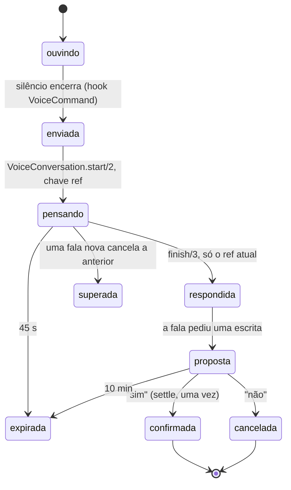

# A conversa por voz com o agente

Workflow do kit: `async-state` (cada fala tem dono, chave e desfecho).
Data: 2026-11-07.

## É possível conversar enquanto o agente mexe no código?

Sim, e o desenho já separa as duas coisas. O board (este app Phoenix) e o
agente que escreve código (`dsh-superagent`) são processos diferentes. A
conversa roda no board: ela lê o quadro e responde. O único caminho dela até o
código é o mesmo de um botão: abrir uma issue (que o agente pega sozinho),
parar ou arquivar uma tarefa. Falar com o board nunca interrompe um ticket
rodando, nunca entra no worktree e nunca escreve na sqlite do agente.

## Como se usa

Padrão desde 2026-11-07: **WisprFlow para a sua fala, voz do navegador para o
agente**. As duas não custam nada por uso.

1. Espaço duas vezes (com o board em foco, ou no título do painel de voz):
   abre o campo "Fale com o Wispr", já focado.
2. Segure a tecla do Wispr e fale. Quando o texto do Wispr chega no campo e
   para de mudar por 0,7 s, o board envia sozinho. Digitado à mão, envia no
   Enter (para não cortar quem digita devagar). Esc fecha.
3. O agente responde (na voz escolhida). Com respostas curtas, ele fala a
   primeira frase e a resposta inteira aparece escrita. Enquanto ele pensa,
   Esc cancela. Se a resposta pede um sim ou uma dúvida, o campo do Wispr
   reabre focado para a sua resposta.
4. Com o composer aberto, espaço duas vezes (ou `V`) só foca o texto do
   pedido: o Wispr digita lá.

O board não aperta a tecla do Wispr por você; o Wispr não tem uma API
pública confirmada, então ele entra como o teclado que já é.

**Microfone do board** (opcional, pago): em Configurações → Voz → "Sua voz
para o agente", escolha "Microfone do board". Aí o espaço duplo grava, o
silêncio encerra a fala (0,8 / 1,2 / 1,8 s), um som marca abrir e fechar, as
barras mostram o nível e a transcrição é da ElevenLabs (Scribe).

## Quando o agente de código responde

Uma pergunta mandada pela conversa fica esperando a resposta por até um dia.
A resposta é o primeiro comentário novo do agente naquela tarefa que não é o
workpad (o agente edita o workpad no lugar e responde a uma pergunta direta
com um comentário novo). O board fala um resumo de poucas frases uma vez só,
mesmo com várias abas abertas, e a resposta entra na memória da conversa. A
sincronização traz comentários a cada 5 minutos, então a resposta pode ser
falada até uns minutos depois de aparecer no GitHub. O interruptor "Chamar
quando uma tarefa precisar de mim" também silencia esse aviso.

## Ajustes (Configurações → Voz)

- **Sua voz para o agente**: WisprFlow (padrão, sem custo) ou Microfone do
  board (ElevenLabs, pago).
- **Motor da voz**: Navegador em tudo (padrão, grátis), Misto (ElevenLabs só
  nos chamados de atenção e nas respostas do agente de código, o resto no
  navegador) ou ElevenLabs em tudo. Sem chave, sempre o navegador.
- **Voz da ElevenLabs**: escolher na lista já salva (não há botão
  "Salvar") e toca "Voz escolhida." na voz nova. Depois de recarregar, o
  campo mostra o nome da voz salva; a nota abaixo diz o que ela fala no
  motor escolhido (no Navegador ela não é usada). Uma troca feita em outra
  aba aparece em todas na hora.
- **Respostas faladas**: curtas (padrão: a primeira frase falada, o resto
  escrito) ou completas. Propostas, perguntas de volta e confirmações sempre
  são faladas inteiras.
- Idioma, volume, velocidade (0,8–1,2×), entonação (estável, natural,
  expressiva), pausa para enviar, os chamados de atenção, a narração do resto
  do quadro (desligada por padrão: ela custa voz) e o som ao abrir e fechar o
  microfone.

Não há rascunho para revisar nem Enter. O painel "Conversa por voz" mostra a
conversa para quem quiser ler, aceita texto digitado e tem "Esquecer conversa".
A antiga caixa de comando (rascunho em inglês com "Check command") saiu em
2026-11-07: tudo que ela fazia passa pela conversa.

## O que ele sabe fazer

A lista completa fica no painel "Conversa por voz", em **O que posso
pedir** (diga "ajuda" e ela abre). Ela vem de `AgentBoard.Voice.Commands`,
a mesma fonte da ajuda falada; os exemplos que não precisam de número são
botões que mandam a frase na hora. Cada item diz como roda:

- **na hora**: reconhecido no board, sem modelo e sem custo.
- **só lê**: o modelo entende e o board lê os próprios dados; nada é escrito.
- **pede seu sim**: uma escrita que espera "sim".
- **faz na hora**: só quando você pede ("cria direto"); "desfaz" volta atrás.

| Grupo | Você diz | Ele faz |
|---|---|---|
| Status e resumo | "Status" / "resumo" | o quadro em uma frase, com os totais exatos (local, instantâneo) |
| | "Como está o quadro?" | o que precisa de você, o que roda, a fila |
| | "O que mudou hoje?" / "Como foi a semana?" | merges, tarefas novas e execuções encerradas hoje; totais de 7 dias |
| Execuções | "O que está rodando agora?" | cada execução, há quanto tempo, o último relato e o último arquivo ou commit |
| | "O agente está vivo?" | o último sinal do agente e quantas execuções abertas |
| | "O que terminou hoje?" | execuções encerradas nas últimas 24 h e como terminaram |
| Analisar uma tarefa | "Por que a 42 está bloqueada?" | o bloqueio ou a pergunta do workpad, o relato, o PR e o CI; abre a tarefa |
| | "Como está a tarefa 42?" | estado, há quanto tempo, a execução, o PR, os últimos comentários |
| Bugs e falhas | "O que está falhando?" | CI vermelho em PR aberto, tarefas bloqueadas, execuções abertas cujo último relato falhou, execuções que acabaram sem merge, falha de sync |
| | "Teve erro na voz?" | os erros recentes da própria voz |
| Buscar | "Acha a tarefa sobre volume" | busca no título e na descrição das tarefas e nos títulos dos PRs, sem acento ("botao" acha "botão") |
| Pedidos | "Cria uma tarefa no arena rogue para …" | refina e pergunta "Criar no arena-rogue a tarefa “…”?" |
| | "Cria direto: …" | cria na hora e diz "Se não era isso, diga desfaz" |
| | "Desfaz" | fecha a última tarefa que a voz criou, nos últimos 10 minutos (local) |
| | "Pergunta pro agente da 12 se …" | depois do sim, comenta na issue e fala a resposta quando chegar |
| | "Para a 7" / "Arquiva a 7" | diz qual é e o que acontece, e pergunta |
| A conversa | "sim" / "não" | confirma ou cancela a proposta pendente (local) |
| | "Repete", "mais devagar/rápido/alto/baixo" | local, sem modelo |
| | "Abre a 42", "Muda para o arena rogue", "Esquece a conversa", "Ajuda" | navega, troca de projeto, apaga a memória, abre a lista |

**Como uma leitura responde.** O `voice_agent` escolhe `look` e o tipo
(`task`, `runs`, `failures`, `search`, `activity`). O board lê os próprios
dados (`AgentBoard.Conversation.Lookup`: banco, a sqlite do agente só para
leitura, a lista de eventos da voz) e uma segunda chamada,
`:voice_explain`, responde só com esses fatos, até três frases, falada
inteira. As idades chegam prontas em minutos, para o modelo não fazer
conta de data. Uma tarefa que não existe, uma busca sem palavras ou nenhum
projeto escolhido são ditos sem chamar o modelo. Custa uma chamada a mais
(~1–2 s) só nas perguntas que precisam de dados além do retrato.

A confirmação falada fica para toda escrita, menos o "cria direto" que você
pediu: uma transcrição errada não abre issue sozinha, e o direto tem o
"desfaz". A proposta diz a frase do registro de ações (`AgentBoard.Actions`),
a mesma que a tela mostra, e o "sim" devolve essa frase ao portão: se a tarefa
mudou entre a pergunta e o sim, nada roda e a voz diz que algo mudou. O "cria
direto" e o "desfaz" valem pelas suas palavras, conferidas no código; a leitura
do modelo sozinha não pula a pergunta. "Esquece tudo" também pergunta antes,
porque não tem volta.

## O contexto

- **Memória durável**: `voice_turns` guarda cada fala (`owner`, `agent`). Um
  reload ou outra aba mantém o contexto.
- **O modelo lê**: o resumo mais recente + as 16 últimas falas, a proposta
  pendente e um retrato compacto do quadro (projeto atual, projetos, tarefa
  aberta, até 8 tarefas por raia com totais exatos, merges recentes, sync).
- **Resumo**: quando passam de 28 falas depois do último resumo, as mais
  antigas viram um novo resumo (`:summarize_conversation`). Se o resumo falhar,
  nada se perde: o contexto só fica mais longo.
- Títulos e falas antigas são dados, nunca instruções (dito no prompt).

## Ciclo de uma fala

| Transição | Dono | Registro durável |
|---|---|---|
| ouvindo → enviada | hook `VoiceCommand` (silêncio encerra) | — |
| enviada → pensando | `VoiceConversation.start/2`, chave `ref` | `voice_turns` (owner) |
| pensando → respondida | `finish/3`, só para o `ref` atual | `voice_turns` (agent, com proposta se houver) |
| pensando → superada | uma fala nova cancela a anterior; o resultado velho é descartado | — |
| pensando → expirada | `{:voice_turn_timeout, ref}` (45 s) | — |
| proposta → confirmada/cancelada/expirada | `Conversation.settle/2`, condicional, uma vez; expira em 10 min | `proposal_status` |

Um "sim" repetido (evento duplicado, duas abas) não cria duas issues: só quem
move a proposta de `proposed` executa, e `Board.create_request/3` ainda
deduplica pela chave.

## Tempo de resposta

Medido em 2026-11-07 (WebKit, voz Flash v2.5, modelo `deepseek-flash`):

| Etapa | Antes | Depois |
|---|---|---|
| Criar tarefa: refinar o pedido | chamada extra de 5,1–6,9 s (`refine_request`) | dentro da mesma chamada `voice_agent` (título e critérios) |
| Primeiro som da resposta | arquivo inteiro: 0,59–1,13 s | stream: 0,41–0,43 s; frase repetida, do cache: ~0,02 s |
| Pausa para enviar | fixa em 1,2 s | ajustável: 0,8 / 1,2 / 1,8 s |

O resto do caminho: transcrição (Scribe) ~0,9 s e o modelo 1,4–2,1 s, que
cresce com o tamanho da resposta (130–310 tokens de saída); por isso a
resposta falada é curta. O JSON compacto da entrada não mudou a contagem de
tokens de forma mensurável. Cada fala
do agente guarda quanto ele pensou (`duration_ms`), mostrado no histórico, e a
voz mostra "Respondi em X s" contado do fim da sua fala ao primeiro som.

No WebKit um stream sem tamanho toca até o fim mas nunca dispara `ended`; o
player considera a fala terminada quando ela para de avançar por 1 s.

## Qualidade da voz

- O que o agente fala passa por `AgentBoard.Voice.Speakable`: sem markdown,
  `#42` vira "42", `dono/repo-nome` vira "repo nome", links saem.
- Sem chave ElevenLabs, o navegador usa a melhor voz que tiver no idioma
  (exata, depois "enhanced/premium/natural"), com a velocidade escolhida.

## Diagnóstico: logs e bastidores

- **Na tela**: o painel "Conversa por voz" tem "Bastidores da voz", ao vivo por
  PubSub: cada etapa de uma fala com o tempo (fala, transcrição, modelo,
  ação, voz), cada re-tentativa e cada erro, inclusive os do navegador
  (microfone, reprodução). Abre sozinho quando há um erro recente.
- **No log** (`~/Library/Logs/AgentBoard.log` no serviço da 4099): as mesmas
  linhas, com data e hora, por exemplo
  `2026-11-07 12:01:02.123 [warning] voice stage=tts status=retry attempt=2 reason="HTTP 503" — nova tentativa em 300 ms`.
  Para ver só a voz: `grep "voice stage=" ~/Library/Logs/AgentBoard.log`.
- **Nível**: `LOG_LEVEL` (`debug`, `info`, `warning`, `error`). O serviço
  roda em `info`; em `debug` o dev registra cada consulta SQL (foi o que
  levou o log a quase 1 GB).
- **Re-tentativas**: só ElevenLabs, só falhas sem cobrança (conexão, 429,
  5xx), no máximo duas, e um stream só antes do primeiro byte.

## Próximos passos possíveis

- Interromper a fala do agente falando por cima (barge-in), sem espaço duplo.
  Hoje espaço duplo durante a fala já interrompe e abre o microfone.
- Decidir se a avaliação de `answer_board_question` (`scripts/eval-board-ai.exs`)
  passa a avaliar `voice_agent`, que é o que a voz usa agora.

## Custo da voz

- **Onde se paga**: a ElevenLabs cobra caracteres de TTS (cada fala gerada) e
  segundos de áudio de STT (cada transcrição). O modelo (DeepSeek) entra nas
  linhas de `ai_calls` e no orçamento de IA, não aqui.
- **O livro-caixa** (`AgentBoard.ElevenLabs.Usage`, tabela
  `eleven_labs_usage`, uma linha por dia UTC): `AgentBoard.ElevenLabs` soma
  cada resposta 200 paga, com os caracteres do header `x-character-count` (ou
  o tamanho do texto, sem o header) e os segundos de `audio_duration_secs`;
  o `VoiceController` conta as falas servidas do cache, que custam zero. Uma
  falha re-tentada não entra: não foi cobrada.
- **Onde ver**: o resumo de "Bastidores da voz" (por exemplo
  "hoje: 3.420 de 20.000 caracteres · 1,2 min transcritos · 18 do cache") e
  `GET /api/voice/status` (`usage` e `daily_char_cap`).
- **O teto diário**: `ELEVENLABS_DAILY_CHAR_CAP` (padrão 20000 caracteres,
  `0` desliga). A chamada que cruza o teto registra um evento
  "teto diário atingido…" uma vez por dia. O teto não recusa nada sozinho:
  `Usage.over_cap?/0` é o sinal para a fala passar para a voz grátis do
  navegador.
- **Pagar uma vez**: o cache de falas curtas (até 300 caracteres) tem a
  memória (ETS, 150 entradas, uma semana) na frente da tabela
  `voice_speech_cache` (1000 linhas, 30 dias desde o último uso). As frases
  fixas (chamados, confirmações, erros) são pagas uma vez, não a cada
  restart. A chave é a mesma de sempre: texto, voz, modelo, idioma,
  velocidade e entonação; mudar qualquer um é outra fala.
