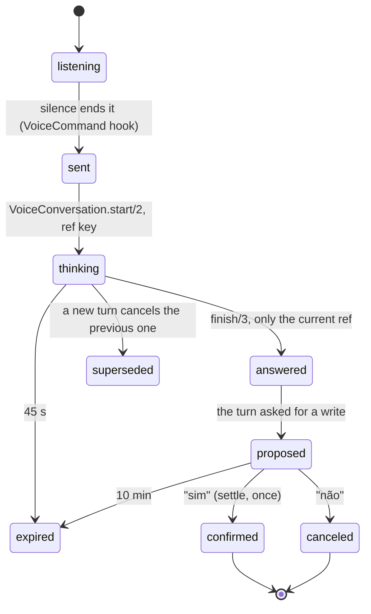

# The voice conversation with the agent

Kit workflow: `async-state` (each turn has an owner, a key and an outcome).
Date: 2026-11-07.

## Can you talk while the agent edits code?

Yes, and the design already separates the two things. The board (this Phoenix
app) and the agent that writes code (`dsh-superagent`) are different processes.
The conversation runs in the board: it reads the board and answers. Its only path
to the code is the same as a button: open an issue (which the agent picks up on
its own), stop or archive a task. Talking to the board never interrupts a running
ticket, never enters the worktree and never writes to the agent's sqlite.

## How to use it

Default since 2026-11-09: **text for your input, the browser voice for the
agent**. Double Space focuses a conversation field that is already visible;
when no field is visible it does not open another window. The voice panel and
task conversation also accept text directly.

**External dictation** (optional): in Configurações → Voz → "Entrada para
conversar com o agente", choose "Ditado externo (Wispr Flow)". Double Space
then opens its focused field. Wispr Flow types as a keyboard: after the dictated
text settles for 0.7 s, the board sends it. Typing manually sends on Enter, and
Esc closes. With the composer open, Double Space focuses its request field.
The board does not invoke the Wispr app or its shortcut.

**Board microphone** (optional, paid): in Configurações → Voz → "Entrada para
conversar com o agente", choose "Microfone do board" (board
microphone). Then double Space records, silence ends the turn (0.8 / 1.2 / 1.8 s),
a sound marks opening and closing, the bars show the level and the transcript is
ElevenLabs' (Scribe).

## When the coding agent answers

A question sent through the conversation waits for the answer for up to a day.
The answer is the agent's first new comment on that task that is not the workpad
(the agent edits the workpad in place and answers a direct question with a new
comment). The board speaks a summary of a few sentences once, even with several
tabs open, and the answer joins the conversation memory. The sync brings comments
every 5 minutes, so the answer may be spoken a few minutes after it appears on
GitHub. The "Chamar quando uma tarefa precisar de mim" toggle also silences that
notice.

## Settings (Configurações → Voz)

- **Entrada para conversar com o agente**: Texto (default, existing field),
  Ditado externo (Wispr Flow, opt-in) or Microfone do board (ElevenLabs Scribe,
  opt-in and paid). A previously saved Wispr Flow choice is preserved.
- **Motor da voz** (voice engine): Navegador em tudo (browser everywhere; default,
  free), Misto (mixed: ElevenLabs only for attention calls and the coding agent's
  answers, the rest in the browser) or ElevenLabs em tudo (ElevenLabs everywhere).
  Without a key, always the browser.
- **Voz da ElevenLabs**: picking from the list already saves it (there is no
  "Salvar" (Save) button) and it plays "Voz escolhida." (voice chosen) in the new
  voice. After a reload, the field shows the saved voice name; the note below says
  what it speaks in the chosen engine (in Navegador it is not used). A switch made
  in another tab appears in all of them at once.
- **Respostas faladas** (spoken answers): short (default: the first sentence
  spoken, the rest written) or full. Proposals, questions back and confirmations
  are always spoken in full.
- Language, volume, speed (0.8–1.2×), intonation (steady, natural, expressive),
  the pause to send, the attention calls, the narration of the rest of the board
  (off by default: it costs voice) and the sound when the microphone opens and
  closes.

For the board microphone there is no draft to review and no Enter. The
"Conversa por voz" (voice conversation) panel shows the conversation for
whoever wants to read it, accepts typed text and has "Esquecer conversa"
(forget conversation). The old command box
(an English draft with "Check command") was removed on 2026-11-07: everything it
did now goes through the conversation.

## What it can do

The complete list is in the "Conversa por voz" panel, under **O que posso pedir**
(what I can ask for) — say "ajuda" (help) and it opens. It comes from
`AgentBoard.Voice.Commands`, the same source as the spoken help; the examples that
do not need a number are buttons that send the sentence at once. Each item says
how it runs:

- **na hora** (right away): recognized in the board, no model and no cost.
- **só lê** (read only): the model understands it and the board reads its own
  data; nothing is written.
- **pede seu sim** (asks for your yes): a write that waits for "sim".
- **faz na hora** (does it right away): only when you ask ("cria direto"); "desfaz"
  goes back.

| Group | You say | It does |
|---|---|---|
| Status and summary | "Status" / "resumo" (summary) | the board in one sentence, with exact totals (local, instant) |
| | "Como está o quadro?" (how is the board?) | what needs you, what runs, the queue |
| | "O que mudou hoje?" / "Como foi a semana?" (what changed today? / how was the week?) | merges, new tasks and runs that ended today; 7-day totals |
| Runs | "O que está rodando agora?" (what is running now?) | each run, how long it has been going, the last report and the last file or commit |
| | "O agente está vivo?" (is the agent alive?) | the agent's last signal and how many runs are open |
| | "O que terminou hoje?" (what finished today?) | runs that ended in the last 24 h and how they ended |
| Analyzing a task | "Por que a 42 está bloqueada?" (why is 42 blocked?) | the block or the workpad question, the report, the PR and CI; opens the task |
| | "Como está a tarefa 42?" (how is task 42?) | state, how long, the run, the PR, the latest comments |
| Bugs and failures | "O que está falhando?" (what is failing?) | red CI on an open PR, blocked tasks, open runs whose last report failed, runs that ended without a merge, sync failure |
| | "Teve erro na voz?" (was there a voice error?) | the voice's own recent errors |
| Search | "Acha a tarefa sobre volume" (find the task about volume) | searches task titles and descriptions and PR titles, without accents ("botao" finds "botão") |
| Requests | "Cria uma tarefa no arena rogue para …" (create a task in arena rogue for …) | refines and asks "Criar no arena-rogue a tarefa “…”?" |
| | "Cria direto: …" (create directly: …) | creates at once and says "Se não era isso, diga desfaz" (if that wasn't it, say undo) |
| | "Desfaz" (undo) | closes the last task the voice created, in the last 10 minutes (local) |
| | "Pergunta pro agente da 12 se …" (ask the agent of 12 whether …) | after the yes, comments on the issue and speaks the answer when it arrives |
| | "Para a 7" / "Arquiva a 7" (stop 7 / archive 7) | says which one it is and what happens, and asks |
| The conversation | "sim" / "não" (yes / no) | confirms or cancels the pending proposal (local) |
| | "Repete", "mais devagar/rápido/alto/baixo" (repeat, slower/faster/louder/quieter) | local, no model |
| | "Abre a 42", "Muda para o arena rogue", "Esquece a conversa", "Ajuda" (open 42, switch to arena rogue, forget the conversation, help) | navigates, switches project, erases the memory, opens the list |

**How a read answers.** `voice_agent` picks `look` and the type (`task`, `runs`,
`failures`, `search`, `activity`). The board reads its own data
(`AgentBoard.Conversation.Lookup`: the database, the agent's sqlite for reading
only, the voice event list) and a second call, `:voice_explain`, answers only from
those facts, up to three sentences, spoken in full. Ages arrive already in
minutes, so the model does not do date arithmetic. A task that does not exist, a
search with no words or no chosen project are said without calling the model. It
costs one extra call (~1–2 s) only on questions that need data beyond the
portrait.

The spoken confirmation applies to every write except the "cria direto" you asked
for: a wrong transcript does not open an issue on its own, and the direct create
has "desfaz". The proposal says the action registry's sentence
(`AgentBoard.Actions`), the same one the screen shows, and the "sim" hands that
sentence back to the gate: if the task changed between the question and the yes,
nothing runs and the voice says something changed. "cria direto" and "desfaz" are
valid only through your words, checked in the code; the model's reading alone does
not skip the question. "Esquece tudo" (forget everything) also asks first, because
there is no going back.

## The context

- **Durable memory**: `voice_turns` stores every turn (`owner`, `agent`). A reload
  or another tab keeps the context.
- **What the model reads**: the most recent summary + the last 16 turns, the
  pending proposal and a compact portrait of the board (current project, projects,
  open task, up to 8 tasks per lane with exact totals, recent merges, sync).
- **Summary**: when more than 28 turns accumulate after the last summary, the
  oldest become a new summary (`:summarize_conversation`). If the summary fails,
  nothing is lost: the context only gets longer.
- Titles and old turns are data, never instructions (stated in the prompt).

## Cycle of a turn

| Transition | Owner | Durable record |
|---|---|---|
| listening → sent | `VoiceCommand` hook (silence ends it) | — |
| sent → thinking | `VoiceConversation.start/2`, `ref` key | `voice_turns` (owner) |
| thinking → answered | `finish/3`, only for the current `ref` | `voice_turns` (agent, with the proposal if any) |
| thinking → superseded | a new turn cancels the previous one; the old result is discarded | — |
| thinking → expired | `{:voice_turn_timeout, ref}` (45 s) | — |
| proposed → confirmed/canceled/expired | `Conversation.settle/2`, conditional, once; expires in 10 min | `proposal_status` |

A repeated "sim" (duplicate event, two tabs) does not create two issues: only the
one that moves the proposal out of `proposed` executes, and
`Board.Requests.create_request/3` still deduplicates by the key.

## Response time

Measured on 2026-11-07 (WebKit, Flash v2.5 voice, `deepseek-flash` model):

| Stage | Before | After |
|---|---|---|
| Create task: refine the request | an extra call of 5.1–6.9 s (`refine_request`) | inside the same `voice_agent` call (title and criteria) |
| First sound of the answer | whole file: 0.59–1.13 s | stream: 0.41–0.43 s; repeated sentence, from the cache: ~0.02 s |
| Pause to send | fixed at 1.2 s | adjustable: 0.8 / 1.2 / 1.8 s |

The rest of the path: transcription (Scribe) ~0.9 s and the model 1.4–2.1 s,
which grows with the answer size (130–310 output tokens); that is why the spoken
answer is short. The compact input JSON did not change the token count
measurably. Each agent turn stores how long it thought (`duration_ms`), shown in
the history, and the voice shows "Respondi em X s" (answered in X s), counted
from the end of your turn to the first sound.

In WebKit a stream without a size plays to the end but never fires `ended`; the
player considers the turn finished when it stops advancing for 1 s.

## Voice quality

- What the agent speaks goes through `AgentBoard.Voice.Speakable`: no markdown,
  `#42` becomes "42", `dono/repo-nome` becomes "repo nome", links are removed.
- Without an ElevenLabs key, the browser uses the best voice it has in the
  language (exact, then "enhanced/premium/natural"), with the chosen speed.

## Diagnosis: logs and backstage

- **On screen**: the "Conversa por voz" panel has "Bastidores da voz" (voice
  backstage), live over PubSub: each stage of a turn with its time (turn,
  transcription, model, action, voice), every retry and every error, including
  browser ones (microphone, playback). It opens by itself when there is a recent
  error.
- **In the log** (`~/Library/Logs/AgentBoard.log` in the 4099 service): the same
  lines, with date and time, for example
  `2026-11-07 12:01:02.123 [warning] voice stage=tts status=retry attempt=2 reason="HTTP 503" — nova tentativa em 300 ms`
  (a new attempt in 300 ms). To see only the voice:
  `grep "voice stage=" ~/Library/Logs/AgentBoard.log`.
- **Level**: `LOG_LEVEL` (`debug`, `info`, `warning`, `error`). The service runs at
  `info`; in `debug` the dev logs every SQL query (that is what took the log to
  almost 1 GB).
- **Retries**: ElevenLabs only, only failures with no charge (connection, 429,
  5xx), at most two, and a stream only before the first byte.

## Possible next steps

- Interrupt the agent's speech by talking over it (barge-in), without double
  Space. Today double Space during the turn already interrupts and opens the
  microphone.
- Decide whether the `answer_board_question` evaluation
  (`scripts/eval-board-ai.exs`) starts evaluating `voice_agent`, which is what the
  voice uses now.

## Voice cost

- **Where you pay**: ElevenLabs charges TTS characters (each generated turn) and
  STT audio seconds (each transcription). The model (DeepSeek) enters the
  `ai_calls` rows and the AI budget, not here.
- **The ledger** (`AgentBoard.ElevenLabs.Usage`, table `eleven_labs_usage`, one row
  per UTC day): `AgentBoard.ElevenLabs` adds up every paid 200 response, with the
  characters from the `x-character-count` header (or the text length, without the
  header) and the seconds from `audio_duration_secs`; `VoiceController` counts the
  turns served from the cache, which cost zero. A retried failure does not enter:
  it was not charged.
- **Where to see it**: the "Bastidores da voz" summary (for example
  "hoje: 3.420 de 20.000 caracteres · 1,2 min transcritos · 18 do cache"; today:
  3,420 of 20,000 characters · 1.2 min transcribed · 18 from the cache) and
  `GET /api/voice/status` (`usage` and `daily_char_cap`).
- **The daily ceiling**: `ELEVENLABS_DAILY_CHAR_CAP` (default 20000 characters,
  `0` switches it off). The call that crosses the ceiling records an event
  "teto diário atingido…" (daily ceiling reached…) once a day. The ceiling does
  not refuse anything by itself: `Usage.over_cap?/0` is the signal for speech to
  fall back to the free browser voice.
- **Paying once**: the short-turn cache (up to 300 characters) has the memory
  (ETS, 150 entries, one week) in front of the `voice_speech_cache` table (1000
  rows, 30 days since the last use). The fixed sentences (calls, confirmations,
  errors) are paid once, not on every restart. The key is the same as always:
  text, voice, model, language, speed and intonation; changing any one is another
  turn.
